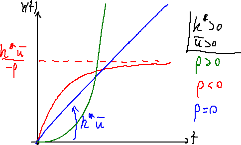
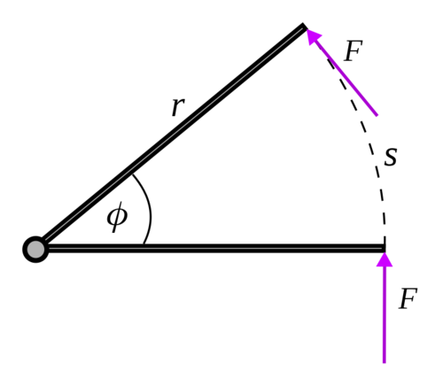

# 微积分与动态系统：从位置到速度、加速度和闭环

> **本章问题：** 位置方程为什么会产生雅可比？速度差分什么时候可信？控制器为什么必须考虑采样周期

**先修：** F02 矩阵与向量；以下均在足够光滑、维度一致的函数上讨论

## 核心 1. 偏导数与多变量链式法则

设 $\mathbf f:\mathbb R^n\to\mathbb R^m$ 可微，它对 $\mathbf q$ 的导数是 $m\times n$ 雅可比矩阵

$$
D\mathbf f(\mathbf q)=\mathbf J_f(\mathbf q),\qquad (\mathbf J_f)_{ij}=\frac{\partial f_i}{\partial q_j}
$$

给出足够小的 $\Delta\mathbf q$，局部线性化

$$
\mathbf f(\mathbf q+\Delta\mathbf q)=\mathbf f(\mathbf q)+\mathbf J_f(\mathbf q)\Delta\mathbf q+o(\|\Delta\mathbf q\|)
$$

对随时间变化的构型 $\mathbf q(t)$，链式法则得到

$$
\dot{\mathbf x}=\mathbf J_f(\mathbf q)\dot{\mathbf q},\qquad \mathbf x=\mathbf f(\mathbf q)
$$

**物理例子：** $x=L\cos q,\ y=L\sin q$，则 $\dot x=-L\sin q\,\dot q,\ \dot y=L\cos q\,\dot q$；关节以相同角速度转动时，末端速度方向不断改变

## 核心 2. 二阶导数和加速度

再次求导必须同时考虑 $\mathbf J$ 随构型的变化

$$
\ddot{\mathbf x}=\mathbf J(\mathbf q)\ddot{\mathbf q}+\dot{\mathbf J}(\mathbf q,\dot{\mathbf q})\dot{\mathbf q}
$$

第二项来自运动学几何本身；对单根长度 $L$ 的旋转杆，若 $\dot q=\omega$ 恒定，末端加速度包含向心项 $-L\omega^2[\cos q,\sin q]^T$，尽管关节角加速度为零

## 核心 3. 积分、能量与微分方程

动力学常写作一阶状态方程 $\dot{\mathbf x}=f(\mathbf x,\mathbf u,t)$；位置和速度的关系为

$$
q(t)=q(0)+\int_0^t\dot q(\tau)\,d\tau
$$

对简单惯性系统 $m\ddot x=u$，取状态 $\mathbf x=[x,\dot x]^T$

$$
\dot{\mathbf x}=\begin{bmatrix}0&1\\0&0\end{bmatrix}\mathbf x+\begin{bmatrix}0\\1/m\end{bmatrix}u
$$

该状态空间形式既可用于控制器设计，也可用于数值积分；连续状态并不意味着传感器能够连续测量；实际观测往往只有离散采样

<figure class="concept-diagram web-source-figure" data-asset="stability">
  
  <figcaption>横轴是时间，纵轴是响应；曲线在某时刻的斜率对应导数，累计面积对应时间积分，稳定的一阶阶跃响应逐渐变平；图中也有积分与不稳定情形，不能把所有曲线都当成收敛过程 · 来源：<a href="https://commons.wikimedia.org/wiki/File:1st-order_system_step_response.png" target="_blank" rel="noopener noreferrer">Luca Ghio</a> · <a href="https://creativecommons.org/licenses/by-sa/3.0" target="_blank" rel="noopener noreferrer">CC BY-SA 3.0</a></figcaption>
</figure>

<figure class="concept-diagram web-source-figure" data-asset="lever">
  
  <figcaption>绕铰点的微小转角会产生切向位移；在力与位移同向的图示条件下，微小功为力乘切向路程，也等于力矩乘转角，有限过程的功应沿运动积分 · 来源：<a href="https://commons.wikimedia.org/wiki/File:Work_on_lever_arm.png" target="_blank" rel="noopener noreferrer">SamL 199917</a> · <a href="https://creativecommons.org/licenses/by-sa/4.0" target="_blank" rel="noopener noreferrer">CC BY-SA 4.0</a></figcaption>
</figure>

## 核心 4. 离散化与数值微分

以固定采样周期 $T_s$ 采样，前向欧拉近似为

$$
\mathbf x_{k+1}\approx\mathbf x_k+T_s f(\mathbf x_k,\mathbf u_k)
$$

它是一阶数值积分方法，不是任意系统的精确离散模型；对常值输入的线性定常系统 $\dot{\mathbf x}=\mathbf A\mathbf x+\mathbf B\mathbf u$，精确零阶保持离散化是

$$
\mathbf A_d=e^{\mathbf A T_s},\quad\mathbf B_d=\int_0^{T_s}e^{\mathbf A\tau}\mathbf B\,d\tau
$$

中心差分导数

$$
\frac{f(t+h)-f(t-h)}{2h}=f'(t)+O(h^2)
$$

在函数足够光滑且浮点舍入可控时具有二阶截断误差；**$h$ 并非越小越好**：过小会因数值抵消和测量噪声导致误差增加

## 进阶 5. 梯度、Hessian 与约束优化接口

标量代价 $V(\mathbf x)$ 的梯度是 $\nabla V$；Hessian 为 $\nabla^2V$；在平衡点 $\mathbf x^*$ 附近的二阶 Taylor 展开为

$$
V(\mathbf x^*+\delta)\approx V(\mathbf x^*)+\nabla V(\mathbf x^*)^T\delta+\frac12\delta^T\nabla^2V(\mathbf x^*)\delta
$$

若局部极小点位于内部且函数二阶可微，必要条件是 $\nabla V=0$ 及 Hessian 半正定；正定 Hessian 则给出严格局部极小的充分条件

最优控制和运动规划将重复使用这种线性化与二次近似，但高阶近似在大范围运动中可能失效

## 进阶 6. 线性化的局限与稳定性

对非线性系统 $\dot{\mathbf x}=f(\mathbf x,\mathbf u)$，在平衡点 $(\mathbf x^*,\mathbf u^*)$，定义微小偏差 $\delta\mathbf x$、$\delta\mathbf u$，得

$$
\delta\dot{\mathbf x}\approx\mathbf A\delta\mathbf x+\mathbf B\delta\mathbf u,
\quad\mathbf A=\left.\frac{\partial f}{\partial\mathbf x}\right|_*,\ \mathbf B=\left.\frac{\partial f}{\partial\mathbf u}\right|_*
$$

该表达仅是局部模型；若线性化系统所有特征值实部严格为负，可推得光滑自治非线性系统的对应平衡点局部渐近稳定；存在零实部特征值时，仅靠线性化不能判定稳定性

## 实践 7. 做一个时间步长实验

将 $\ddot x=-\omega_0^2x$ 写成状态方程，分别用欧拉法与较高阶积分方法仿真一个周期；比较不同 $T_s$ 的相位、能量漂移和稳定性；再用中心差分从解析运动轨迹估计速度，画出误差随 $h$ 的变化

**自检：** 为什么 $\dot J\dot q$ 不能省略？为什么前向欧拉可能使原本稳定的振动系统数值发散？为什么不能直接用 $q_{k+1}-q_k$ 当作无噪声关节速度

**参考：** Lynch & Park, *Modern Robotics*, Chapter 5；Khalil, *Nonlinear Systems*, linearization and stability；Hairer, Nørsett & Wanner, *Solving Ordinary Differential Equations I*