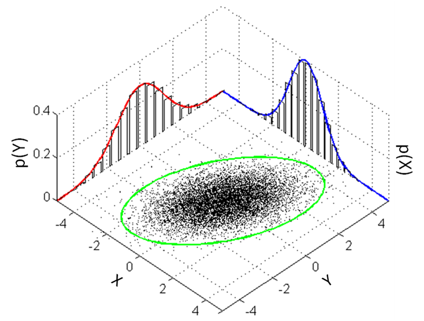
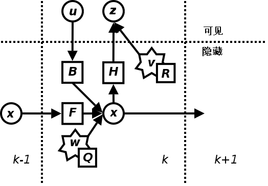

# 概率与优化：不确定性怎样进入机器人决策

> **本章问题：** 相机测量有噪声时，为什么不能把目标位置当成真值？多个传感器怎么合理融合？规划和辨识为何经常变成优化问题

**先修：** F02 矩阵、F03 微分；此处介绍的工具是 P 篇状态估计与第三篇最优控制的基础，不代替专门课程

## 核心 1. 随机变量与测量误差

记真实量为 $\mathbf x$，测量为 $\mathbf z=\mathbf h(\mathbf x)+\mathbf v$，其中 $\mathbf v$ 是随机测量噪声；期望 $\mathbb E[\mathbf v]$ 描述平均偏差，协方差

$$
\boldsymbol\Sigma=\mathbb E[(\mathbf v-\mathbb E\mathbf v)(\mathbf v-\mathbb E\mathbf v)^T]
$$

描述波动及不同维度间的相关性；协方差是对称半正定矩阵；协方差小不自动意味着传感器准确，因为系统性偏差不一定包含在内

若噪声近似高斯 $\mathbf v\sim\mathcal N(\mathbf0,\boldsymbol\Sigma)$ 且 $\boldsymbol\Sigma\succ0$，其负对数似然除常数项外为

$$
\frac12\mathbf v^T\boldsymbol\Sigma^{-1}\mathbf v
$$

因此噪声较大的观测应具有较小的信息权重（$\boldsymbol\Sigma^{-1}$）

<figure class="concept-diagram web-source-figure" data-asset="gaussian">
  
  <figcaption>样本云的长方向对应较大的方差，倾斜椭圆反映两个分量相关；协方差逆矩阵让长轴方向的同等距离残差受到较小惩罚，等高线不是未经标定即可使用的置信边界 · 来源：<a href="https://commons.wikimedia.org/wiki/File:MultivariateNormal.png" target="_blank" rel="noopener noreferrer">Bscan</a> · <a href="http://creativecommons.org/publicdomain/zero/1.0/deed.en" target="_blank" rel="noopener noreferrer">CC0</a></figcaption>
</figure>

## 核心 2. 两次测量怎么融合

两个独立、无偏标量测量 $z_1,z_2$ 对同一未知量 $x$ 进行观测，方差分别为 $\sigma_1^2,\sigma_2^2>0$；最小方差线性无偏估计为

$$
\hat x=\frac{z_1/\sigma_1^2+z_2/\sigma_2^2}{1/\sigma_1^2+1/\sigma_2^2},\quad
\sigma_{\hat x}^2=\frac1{1/\sigma_1^2+1/\sigma_2^2}
$$

若传感器数据相关，直接使用上式会过度自信，应把交叉相关性纳入模型；这也是机器人多传感器融合中容易忽略的前提

## 核心 3. 贝叶斯更新

设 $\mathbf x$ 为待估计状态、$\mathbf z$ 为新观测

$$
p(\mathbf x\mid\mathbf z)=\frac{p(\mathbf z\mid\mathbf x)p(\mathbf x)}{p(\mathbf z)}
$$

先验 $p(\mathbf x)$ 表示观测前的认知；似然 $p(\mathbf z\mid\mathbf x)$ 表示测量模型；后验 $p(\mathbf x\mid\mathbf z)$ 综合两者；定位、SLAM 和状态估计都可以在这一框架下理解，但实际求解通常需要近似

<figure class="concept-diagram web-source-figure" data-asset="kalman">
  
  <figcaption>沿状态到观测的箭头读测量模型，沿前一状态到后一状态的箭头读预测模型；过程噪声与测量噪声作用在不同位置，贝叶斯更新把预测和新观测结合起来 · 来源：<a href="https://commons.wikimedia.org/wiki/File:Kalman_filter_model.png" target="_blank" rel="noopener noreferrer">Own work by Ciphergoth .</a> · <a href="https://commons.wikimedia.org/wiki/File:Kalman_filter_model.png" target="_blank" rel="noopener noreferrer">Public domain</a></figcaption>
</figure>

## 核心 4. 从最小二乘到加权最小二乘

线性测量模型为 $\mathbf z=\mathbf H\mathbf x+\mathbf v$；在噪声高斯、协方差 $\boldsymbol\Sigma\succ0$ 条件下，极大似然对应加权最小二乘

$$
\min_{\mathbf x}\frac12(\mathbf H\mathbf x-\mathbf z)^T\boldsymbol\Sigma^{-1}(\mathbf H\mathbf x-\mathbf z)
$$

若 $\mathbf H^T\boldsymbol\Sigma^{-1}\mathbf H$ 可逆，唯一解为

$$
\hat{\mathbf x}=(\mathbf H^T\boldsymbol\Sigma^{-1}\mathbf H)^{-1}\mathbf H^T\boldsymbol\Sigma^{-1}\mathbf z
$$

这是一条数学表达式，**并不是推荐的软件实现**；实际数值计算应优先用 QR、Cholesky（条件允许时）或 SVD 解线性方程组

<figure class="concept-diagram web-source-figure" data-asset="projection">
  
  <figcaption>普通最小二乘在欧氏空间做正交投影；加权最小二乘应先按噪声尺度白化，再解释投影，不能把原坐标中的垂直关系直接沿用到任意权重 · 来源：<a href="https://commons.wikimedia.org/wiki/File:Least_squares_projection_geometry.png" target="_blank" rel="noopener noreferrer">Eteri byazrova (GraphMath)</a> · <a href="https://creativecommons.org/licenses/by-sa/4.0" target="_blank" rel="noopener noreferrer">CC BY-SA 4.0</a></figcaption>
</figure>

## 进阶 5. 非线性优化和约束

以关节姿态 $\mathbf q$ 最小化末端定位误差

$$
\min_{\mathbf q}\frac12\|\mathbf p(\mathbf q)-\mathbf p_d\|_2^2,
\qquad\mathbf q_{\min}\le\mathbf q\le\mathbf q_{\max}
$$

令 $\mathbf e=\mathbf p(\mathbf q)-\mathbf p_d$、$\mathbf J=\partial\mathbf p/\partial\mathbf q$，目标函数梯度为 $\mathbf J^T\mathbf e$；Gauss–Newton 对最小二乘问题忽略残差 Hessian 的部分项，Levenberg–Marquardt 再引入阻尼改善病态性；两者均不能自动保证全局最优

约束可以来自关节限位、碰撞距离、电机力矩与速度饱和；一个优化器返回数值解，不代表物理上一定可执行，必须检查约束及模型偏差

## 进阶 6. 凸优化与 KKT 的位置

若目标凸、可行集凸，局部最优也是全局最优；否则优化器可能停在局部解；对于带光滑不等式与等式约束的问题，KKT 条件在适当约束资格条件下为局部最优的必要条件；在凸问题、满足相应条件时也可成为充分判据

机器人运动规划常含非凸碰撞约束，因此“用了二次规划/MPC”不代表整个问题必然凸

## 实践 7. 观察权重如何影响定位

假设两个独立测距传感器读数为 $z_1=1.00\ \mathrm m$、$z_2=1.20\ \mathrm m$，标准差为 $0.02\ \mathrm m$、$0.10\ \mathrm m$；手算加权结果，并与简单算术平均比较；检查估计为什么更靠近第一个读数

**练习：** 设两个噪声完全正相关，上面的独立融合方差公式还成立吗？为什么改变误差单位会要求对应更改权重矩阵

**参考：** Thrun, Burgard & Fox, *Probabilistic Robotics*；Boyd & Vandenberghe, *Convex Optimization*；Lynch & Park, *Modern Robotics*, Chapter 6 numerical IK