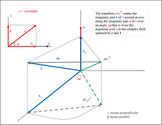
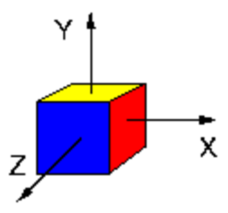

# 旋量与李群李代数：把三维运动写成统一语言

> **本章问题：** 为什么使用 $SO(3),SE(3)$？什么是旋量 twist？矩阵指数为什么能把一个关节的转动变成末端位姿

**先修：** F03、F05；默认采用**角分量在前**的旋量顺序 $\mathbf V=[\boldsymbol\omega;\mathbf v]$

## 核心 1. 旋转空间不是普通向量空间

旋转矩阵组成李群 $SO(3)$，刚体位姿组成李群 $SE(3)$；它们有连续可微的局部结构，也能通过矩阵乘法组合，但一般不能用普通三维向量相加来完成有限旋转复合

在单位元附近，角速度的反对称矩阵 $[\boldsymbol\omega]_\times$ 属于李代数 $\mathfrak{so}(3)$，满足

$$
[\boldsymbol\omega]_\times=\begin{bmatrix}
0&-\omega_z&\omega_y\\\omega_z&0&-\omega_x\\-\omega_y&\omega_x&0
\end{bmatrix},\quad
[\boldsymbol\omega]_\times\mathbf r=\boldsymbol\omega\times\mathbf r
$$

此处 hat 运算 $[\cdot]$ 把向量变为矩阵，vee 运算 $(\cdot)^\vee$ 是它在对应李代数上的逆

<figure class="concept-diagram web-source-figure" data-asset="qrot">
  
  <figcaption>四元数图帮助区分旋转的轴与角；单位四元数表示三维旋转，不能把四个参数当成四个独立转动自由度，也不能直接按普通向量加法复合姿态 · 来源：<a href="https://commons.wikimedia.org/wiki/File:Quaternionic_rotation.png" target="_blank" rel="noopener noreferrer">HansVanLeunen</a> · <a href="https://creativecommons.org/licenses/by-sa/4.0" target="_blank" rel="noopener noreferrer">CC BY-SA 4.0</a></figcaption>
</figure>

## 核心 2. 指数映射与 Rodrigues 公式

对于单位向量 $\hat{\boldsymbol\omega}$ 与角度 $\theta$，矩阵指数

$$
\mathbf R=e^{[\hat{\boldsymbol\omega}]_\times\theta}
=\mathbf I+\sin\theta[\hat{\boldsymbol\omega}]_\times
+(1-\cos\theta)[\hat{\boldsymbol\omega}]_\times^2
$$

这就是 Rodrigues 公式；它把一条旋转轴与一个旋转量合成为真实旋转矩阵；对非单位向量 $\boldsymbol\phi=\hat{\boldsymbol\omega}\theta$，也可写 $\mathbf R=e^{[\boldsymbol\phi]_\times}$

矩阵对数则是局部反问题，但在旋转角接近 $\pi$ 时存在多值性与数值分支问题，不能把对数当成全局唯一表示

## 核心 3. 旋转关节的螺旋轴

设旋转轴方向 $\hat{\boldsymbol\omega}$ 为单位向量，穿过空间点 $\mathbf r$，旋量轴定义为

$$
\mathbf S=\begin{bmatrix}\hat{\boldsymbol\omega}\\-\hat{\boldsymbol\omega}\times\mathbf r\end{bmatrix}\in\mathbb R^6
$$

如果关节沿单位向量 $\hat{\mathbf v}$ 做纯平移，则 $\mathbf S=[\mathbf0;\hat{\mathbf v}]$；这里 $\mathbf S$ 是**给定零位、给定表达系**中的螺旋轴；旋转轴经过哪一点会改变线分量

对应的 $\mathfrak{se}(3)$ 矩阵为

$$
[\mathbf S]=\begin{bmatrix}[\boldsymbol\omega]_\times&\mathbf v\\\mathbf0^T&0\end{bmatrix}
$$

关节运动 $q$ 引入的刚体变换是 $e^{[\mathbf S]q}$，其中旋转关节 $q$ 的单位为 rad，移动关节为 m，螺旋轴须采用与该参数相匹配的归一化

## 核心 4. 从 Lie 群到机械臂正运动学

若零位工具位姿为 $\mathbf M$，所有关节的零位空间螺旋轴是 $\mathbf S_1,\ldots,\mathbf S_n$，则

$$
\boxed{\mathbf T(\mathbf q)=e^{[\mathbf S_1]q_1}\cdots e^{[\mathbf S_n]q_n}\mathbf M}
$$

该表达称为指数积（PoE）公式；它避免了通过连杆形状强行匹配 DH 坐标框架，但要先准确确定零位关节轴、零位工具位姿和每个轴的表达系

## 进阶 5. 空间 twist 与本体 twist

设 $\mathbf T={}^s\mathbf T_b$ 随时间变化，定义

$$
[\mathbf V_s]=\dot{\mathbf T}\mathbf T^{-1},\qquad
[\mathbf V_b]=\mathbf T^{-1}\dot{\mathbf T}
$$

它们属于同一个刚体的运动，但在不同形式下表达；对 $\mathbf T=[\mathbf R,\mathbf p;\mathbf0^T,1]$，伴随变换

$$
\operatorname{Ad}_{\mathbf T}=\begin{bmatrix}
\mathbf R&\mathbf0\\[\mathbf p]_\times\mathbf R&\mathbf R
\end{bmatrix}
$$

使 $\mathbf V_s=\operatorname{Ad}_{\mathbf T}\mathbf V_b$；**空间 twist 的线分量不是“末端原点线速度”的无条件同义词**：其关系为 $\mathbf v_s=\dot{\mathbf p}-\boldsymbol\omega_s\times\mathbf p$

## 进阶 6. 非交换性为何重要

一般有 $e^{\mathbf A}e^{\mathbf B}\ne e^{\mathbf A+\mathbf B}$；对于非交换的刚体变换，旋转/平移更新的左右乘约定会决定扰动是在空间系还是本体系解释；求误差、线性化或迭代 IK 时需要与实现保持一致

<figure class="concept-diagram web-source-figure" data-asset="rot">
  
  <figcaption>图中只有立方体与坐标轴，未画旋转序列；可自行想象先绕 X 轴转 90° 再绕 Y 轴转 90°，然后交换顺序比较彩色面的朝向，理解变换链的乘法为何通常不交换 · 来源：<a href="https://commons.wikimedia.org/wiki/File:Rotation3D.png" target="_blank" rel="noopener noreferrer">The original uploader was Ske at French Wikipedia .</a> · <a href="http://creativecommons.org/licenses/by-sa/3.0/" target="_blank" rel="noopener noreferrer">CC BY-SA 3.0</a></figcaption>
</figure>

## 实践 7. 自己推导 2R 的 PoE

平面 2R 的两根旋转轴沿 $z$ 轴，分别经过 $(0,0,0)$ 和 $(L_1,0,0)$；零位工具位姿取 $\mathbf M=\mathrm{Trans}(L_1+L_2,0,0)$，有

$$
\mathbf S_1=[0,0,1,0,0,0]^T,\quad
\mathbf S_2=[0,0,1,0,-L_1,0]^T
$$

计算 $e^{[\mathbf S_1]q_1}e^{[\mathbf S_2]q_2}\mathbf M$，应还原出末端位置

$$
x=L_1\cos q_1+L_2\cos(q_1+q_2),\quad
y=L_1\sin q_1+L_2\sin(q_1+q_2)
$$

配套运动学 `labs/python/kinematics/` 将利用数值矩阵指数核对这一结果

**练习：** 移动第二关节转轴上的参考点 $\mathbf r$ 沿该轴方向移动，旋量 $\mathbf S_2$ 会改变吗？解释原因

**参考：** Lynch & Park, *Modern Robotics*, Chapter 3–4；Murray, Li & Sastry, *A Mathematical Introduction to Robotic Manipulation*, Chapter 2
