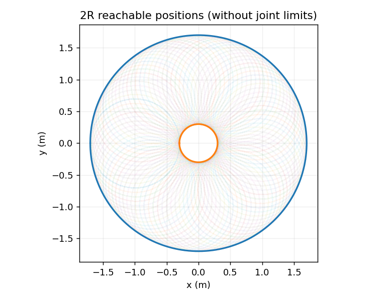

# 机器人机构学：自由度、构型与性能不是一回事

> **本章问题：** 为什么某些四杆机构只有一个自由度？七轴机械臂为什么叫冗余？增加连杆数量会让工作空间必然变大吗

**先修：** F01、F05；本文主要关注理想刚性机构的运动结构，不替代强度校核与机械设计

## 核心 1. 连杆、关节、运动副

连杆视作刚体，关节允许相邻刚体间某些相对运动；常见运动副包括旋转副 R、移动副 P、球副 S、柱面副 C 等；一个三维自由刚体有 6 个局部构型自由度，平面自由刚体有 3 个

开链 $n$ 个独立 1-DOF 关节、固定基座通常具有 $n$ 个局部构型自由度；若存在闭链、齿轮或其他耦合约束，则不能直接按关节数计算

## 核心 2. 自由度计数：公式与边界

对一般空间机构，Grübler–Kutzbach 计数给出常见的结构性估计

$$
M=6(N-1-J)+\sum_{i=1}^J f_i
$$

$N$ 包含机架在内的连杆数量，$J$ 为运动副数，$f_i$ 是各运动副允许的相对自由度；平面机构将 6 换成 3

对四杆平面机构，$N=4,J=4$，四个旋转副各 $f_i=1$，得到 $M=3(4-1-4)+4=1$

**适用限制：** 这些计数假设约束独立，且机构不存在特殊几何关系导致的多余约束、奇异位形或自运动；要获得真实局部自由度，应检查约束雅可比秩，而不是把公式结果当成所有构型都有效的保证

## 核心 3. 工作空间和奇异性

机构自由度不是末端任务自由度；平面 2R 机械臂末端位置在平面内有两个可控坐标（非奇异位形）；但其末端姿态角还由 $q_1+q_2$ 决定，不能同时任意独立指定 $(x,y,\theta)$ 三个量

忽略障碍与关节限位，平面 2R 的末端距离 $r$ 满足

$$
|L_1-L_2|\le r\le L_1+L_2
$$

若关节有限位，实际工作空间一般是该环带的子集；靠近边界的伸直/折叠构型往往接近位置雅可比奇异点，任务方向上的力和速度能力会发生变化

## 核心 4. 串联、并联、闭链与欠驱动

| 结构 | 主要特点 | 需重点分析的内容 |
|---|---|---|
| 串联机械臂 | 连杆沿链依次传递运动 | 累积定位误差、末端负载、工作空间 |
| 并联机构 | 多个支链共同约束动平台 | 闭链约束、奇异性、驱动力分配 |
| 冗余机械臂 | 关节自由度高于当前任务维数 | 零空间、避限位和姿态优化 |
| 欠驱动机构 | 独立控制输入少于构型自由度 | 动态耦合、被动自由度、可控性 |
| 柔性/软体机构 | 形变不可忽略 | 连续体建模、变形测量与控制 |

“七轴一定比六轴更灵巧”不是普适结论：冗余度能够增加解决某些约束问题的余地，但性能仍取决于几何设计、关节限位、碰撞及任务定义

## 进阶 5. 奇异性和刚度的联系

理想关节弹簧模型中，关节刚度 $\mathbf K_q\succ0$、末端小位移与关节位移满足 $\delta\mathbf x=\mathbf J\delta\mathbf q$；在合适的准静态假设下，末端柔度可写为

$$
\mathbf C_x=\mathbf J\mathbf K_q^{-1}\mathbf J^T
$$

若所选任务空间雅可比是方阵且可逆，在相同假设下可得到 $\mathbf K_x=\mathbf C_x^{-1}$；但在冗余或奇异构型、存在预载和非线性接触时，不能随意把它作为全局刚度公式；必须考虑边界约束和几何刚度

## 实践 6. 对机构进行约束审计

选择一种机构：4R 平面四杆、并联平台或轮式底盘；列出构型变量 $\mathbf q$、独立驱动输入、闭链/接触约束、所选末端任务维数，并检查它们是否相同；对 2R 机械臂，尝试改变 $L_1/L_2$ 并描绘工作空间环带

**练习：** 当 $L_1=L_2$ 时，理论工作空间为何包含原点？原点附近是否能够用任意较小关节速度产生任意较小末端速度

**参考：** Lynch & Park, *Modern Robotics*, Chapter 2 and Chapter 7；Merlet, *Parallel Robots*
