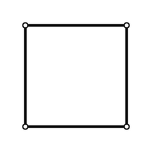

# 机器人运动链与模型描述：让结构变成可计算对象

> **本章问题：** 一份 CAD 模型为什么不能直接当机器人运动学模型？URDF 中 link、joint、origin、axis 究竟意味着什么

**先修：** F05 刚体表示、F07 机构学；本章聚焦理想刚体运动链；动力学惯量、碰撞模型与传动弹性属于不同层面的模型


## 核心 1. 运动学模型需要的最少信息

一台开链机械臂的运动学模型至少要回答

- 哪个坐标系固定为基座、哪个坐标系连接哪根刚体
- 每个关节允许什么相对运动（R / P / fixed），关节轴在哪里
- 每个关节的**零位定义**是什么
- 关节变量的正方向与上下限如何约定
- 工具坐标系 TCP 相对于末端连杆在哪

只知道每根连杆长度通常不够；一个仅差 $90^\circ$ 的关节轴定义错误，会让末端运动方向完全变化

## 核心 2. 用有向树表示开链运动链

一个固定基座的普通串联机械臂可以写成

```text
base_link → joint_1 → link_1 → joint_2 → link_2 → ... → tool0
```

连杆是刚体节点，关节是允许父、子连杆发生相对位姿变化的边；相邻刚体的坐标变换写成

$$
{}^{parent}\mathbf T_{child}(q_i)=\mathbf T_{origin,i}\mathbf T_{motion,i}(q_i)
$$

其中 $\mathbf T_{origin,i}$ 代表关节零位在父连杆参考系中的安装变换，$\mathbf T_{motion,i}(q_i)$ 代表在关节坐标系中发生的运动；这种分解必须与具体建模格式的定义一致，而不是所有软件都默认相同的乘法次序

从 base 到 TCP 的正运动学是沿运动链逐项相乘

$$
{}^{base}\mathbf T_{tcp}(\mathbf q)=\left(\prod_i{}^{i-1}\mathbf T_i(q_i)\right){}^{last}\mathbf T_{tcp}
$$

这里的 $\prod$ 表示**按基座到末端的顺序**相乘；旋转不可交换，不能任意重排

## 核心 3. URDF 的三个关键标签

URDF 用 XML 描述运动学树；下面是一个示意性的单旋转关节，不是可直接投入完整仿真的全部模型

```xml
<joint name="joint_1" type="revolute">
  <parent link="base_link"/>
  <child link="link_1"/>
  <origin xyz="0 0 0.1" rpy="0 0 0"/>
  <axis xyz="0 0 1"/>
  <limit lower="-1.57" upper="1.57" effort="10" velocity="1"/>
</joint>
```

- `origin`：关节参考系在父连杆坐标系下的固定安装位姿；`rpy` 的具体解析约定遵循 URDF 规范
- `axis`：在关节参考系中表达的运动轴向量（对 R 是转动轴，对 P 是移动方向）
- `limit`：关节位置、速度、力/力矩限制的模型描述；它不能替代硬件驱动器中的安全限制

URDF 原生表达树形连接，不是任意闭环机构的完整约束求解格式；闭链机构常需要其他约束或仿真格式补充，也不能仅靠 URDF 视觉模型判断真实碰撞

## 核心 4. 同一几何体有多个不同的坐标系

机械臂末端常有 `link6`、`flange`、`tool0` 和 TCP；它们可以共处于同一刚体，但不代表原点相同

若 ${}^{base}\mathbf T_{flange}(\mathbf q)$ 已知，且 ${}^{flange}\mathbf T_{tcp}$ 固定，则

$$
{}^{base}\mathbf T_{tcp}(\mathbf q)={} ^{base}\mathbf T_{flange}(\mathbf q){}^{flange}\mathbf T_{tcp}
$$

只要工具发生更换，右侧固定变换便可能需要更新，而机械臂前六个关节的结构本身不一定发生变化；**一个 TCP 的错误不应通过改动整条手臂运动链的几何参数掩盖**

## 进阶 5. 图结构与闭链限制

闭链机构的约束不允许简单地沿唯一树路径独立计算所有运动；若存在闭合回路，关节变量往往要满足

$$
\boldsymbol\Phi(\mathbf q)=\mathbf0,
\quad\mathbf A(\mathbf q)\dot{\mathbf q}=\mathbf0,
\quad\mathbf A=\frac{\partial\boldsymbol\Phi}{\partial\mathbf q}
$$

在正则点，独立局部自由度由变量维数减去约束雅可比秩得到；若 $\mathbf A$ 降秩，则相应构型需要重新分析，不能继续沿用常规自由度计数结果

<figure class="concept-diagram web-source-figure" data-asset="chain">
  
  <figcaption>图中的四根杆首尾闭合，构成一个环；这是树形运动链的反例，建模时可以先断开一条边建立生成树，再显式加入闭环约束，不能将四条边都当成相互独立的关节输入 · 来源：<a href="https://commons.wikimedia.org/wiki/File:KGG_01_Kinematische_Kette.png" target="_blank" rel="noopener noreferrer">Manfred Morgner ( ka-em-zwei-ein )</a> · <a href="https://commons.wikimedia.org/wiki/File:KGG_01_Kinematische_Kette.png" target="_blank" rel="noopener noreferrer">Public domain</a></figcaption>
</figure>

## 实践 6. 对一个 URDF 进行三层审计

1. **结构层：** parent/child 是否连通，轴方向和关节限制是否符合机械设计
2. **几何层：** 单独转动每个关节，观察下游连杆运动是否与实际对应
3. **运动学层：** 选若干构型，比较模型给出的末端位姿、独立计算与可测量基准

`robot_state_publisher` 将 URDF 运动学树与关节状态组合发布变换；它不自动证明 URDF 几何尺寸正确，也不提供高精度动力学辨识结果

**练习：** 给工具末端增加一段沿自身 $z$ 轴的 $0.10\ \mathrm m$ 偏移，写出 TCP 位姿的变换链，并说明为何它可能影响末端位置雅可比，却不改变上游关节零位定义

**参考：** Lynch & Park, *Modern Robotics*, Chapters 2–4；ROS `robot_state_publisher` 官方仓库 https://github.com/ros/robot_state_publisher ；ROS URDF 官方文档 https://wiki.ros.org/urdf/XML/joint
