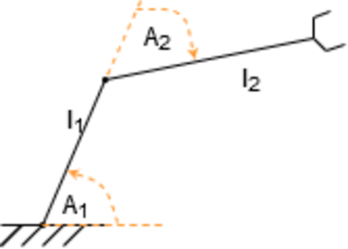
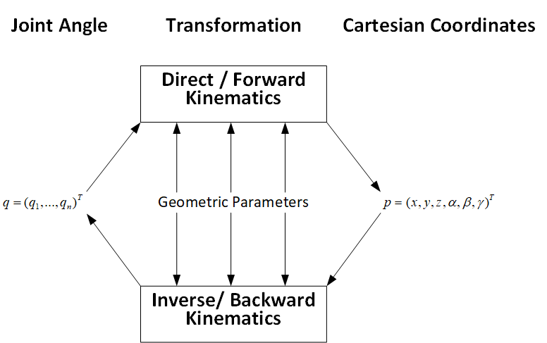

# 正运动学：已知关节角，工具坐标系在哪里

> **本章问题：** 怎样从一组关节角得到末端的位置与姿态？DH 和指数积（PoE）有什么关系？为什么零位和关节轴必须先核准

**先修：** M01、F06；本章以旋量 PoE 作为主要表达，同时介绍标准 DH；二者是不同的参数化方式，在物理模型一致时应当给出相同位姿

## 核心 1. 从平面 2R 推导起步

两根连杆长 $L_1,L_2$，关节角 $q_1$、$q_2$ 均逆时针为正，第二关节角是相对于第一连杆的转角；末端点位置

$$
\mathbf p(q_1,q_2)=\begin{bmatrix}
L_1\cos q_1+L_2\cos(q_1+q_2)\\
L_1\sin q_1+L_2\sin(q_1+q_2)
\end{bmatrix},\quad\theta=q_1+q_2
$$

输入 $q_1=q_2=0$ 时，机械臂沿 $x$ 轴伸直，末端在 $(L_1+L_2,0)$；输入 $q_1=\pi/2,q_2=0$ 时沿 $y$ 轴伸直；**先用极端构型检验零位，是防止模型符号错误的低成本方法**

<figure class="concept-diagram web-source-figure" data-asset="scheme">
  
  <figcaption>以第一段方向为关节角起点，第二段的绝对方向由两个关节角叠加决定；末端位置是两段长度向量相加，注意图中角度标注与正文相对角约定的差异 · 来源：<a href="https://commons.wikimedia.org/wiki/File:Robotic_Arm_schemat.png" target="_blank" rel="noopener noreferrer">Arczi325</a> · <a href="https://creativecommons.org/licenses/by-sa/4.0" target="_blank" rel="noopener noreferrer">CC BY-SA 4.0</a></figcaption>
</figure>

## 核心 2. 变换链中的每一项

把各连杆安装坐标系视作固连刚体的坐标系，对任意相邻关节可以写

$$
{}^0\mathbf T_n(\mathbf q)={}^0\mathbf T_1(q_1){}^1\mathbf T_2(q_2)\cdots{}^{n-1}\mathbf T_n(q_n)
$$

固定工具安装变换应在末尾显式相乘；这条链输出的是**末端坐标系的位姿**，而不是天然等于法兰盘中心、夹爪尖端或相机光心的坐标

<figure class="concept-diagram web-source-figure" data-asset="kin">
  
  <figcaption>正运动学从关节量和几何参数得到末端坐标；逆运动学沿相反方向求关节解，但不是把矩阵乘积直接求逆就能完成，解可能不唯一 · 来源：<a href="https://commons.wikimedia.org/wiki/File:FWDvsINV_Kinematics_HighResTransp.png" target="_blank" rel="noopener noreferrer">Haendy-freak</a> · <a href="https://creativecommons.org/licenses/by-sa/4.0" target="_blank" rel="noopener noreferrer">CC BY-SA 4.0</a></figcaption>
</figure>

## 核心 3. PoE：用零位螺旋轴写运动学

设零位工具姿态为 $\mathbf M={}^s\mathbf T_b(\mathbf0)$，第 $i$ 个关节在零位的空间螺旋轴为 $\mathbf S_i$；开链机械臂正运动学为

$$
\boxed{\mathbf T(\mathbf q)=e^{[\mathbf S_1]q_1}\cdots e^{[\mathbf S_n]q_n}\mathbf M}
$$

对平面 2R，使用 $\mathbf S_1=[0,0,1,0,0,0]^T$、$\mathbf S_2=[0,0,1,0,-L_1,0]^T$，$\mathbf M$ 的位置为 $(L_1+L_2,0,0)$、朝向是单位旋转；对旋转螺旋轴 $\mathbf S=[\boldsymbol\omega;\mathbf v]$，$\|\boldsymbol\omega\|=1$，有

$$
e^{[\mathbf S]\theta}=\begin{bmatrix}
 e^{[\boldsymbol\omega]_\times\theta}&(\mathbf I\theta+(1-\cos\theta)[\boldsymbol\omega]_\times+(\theta-\sin\theta)[\boldsymbol\omega]_\times^2)\mathbf v\\
\mathbf0^T&1
\end{bmatrix}
$$

公式中的平移部分与旋转共同依赖关节角；矩阵指数把螺旋轴几何变为单个关节位姿，再相乘得到末端位姿

## 核心 4. 标准 DH 变换

标准 Denavit–Hartenberg（DH）是一种按共同法线布置相邻连杆坐标系的约定；以下明确采用**标准 DH**，每节变换定义为

$$
{}^{i-1}\mathbf T_i=\operatorname{Rot}_z(\theta_i)\operatorname{Trans}_z(d_i)
\operatorname{Trans}_x(a_i)\operatorname{Rot}_x(\alpha_i)
$$

- $a_i$：沿新的 $x$ 轴的连杆长度
- $\alpha_i$：相邻关节 $z$ 轴间绕 $x$ 的扭转角
- $d_i$：沿上一坐标系 $z$ 轴的偏移
- $\theta_i$：绕上一坐标系 $z$ 轴的旋转角

对 2R 平面机械臂，取 $a_1=L_1,a_2=L_2$，$d_i=0,\alpha_i=0,\theta_i=q_i$，可得

$$
{}^0\mathbf T_2=\operatorname{Rot}_z(q_1)\operatorname{Trans}_x(L_1)
\operatorname{Rot}_z(q_2)\operatorname{Trans}_x(L_2)
$$

其平移部分与第 1 节一致；**改进 DH（MDH）使用不同的相乘次序，不能混用同一套表直接计算；** DH 坐标系并不总唯一，尤其对重合或平行关节轴，需要明确建系习惯

## 进阶 5. PoE 的本体表达

也可以用零位末端系中的螺旋轴 $\mathbf B_i$ 表示

$$
\mathbf T(\mathbf q)=\mathbf M e^{[\mathbf B_1]q_1}\cdots e^{[\mathbf B_n]q_n},
\quad\mathbf B_i=\operatorname{Ad}_{\mathbf M^{-1}}\mathbf S_i
$$

空间形式和本体形式对应同一个物理变换；使用工具软件前，务必确认它要求的轴在零位空间系还是零位末端系表达

## 进阶 6. 数值验证、误差与建模边界

可以在数十组甚至数百组随机、合法关节构型上比较 DH、PoE 与 URDF/独立模型；误差需要拆为平移和旋转，不能把它们直接混在一个未经尺度归一化的欧氏范数中

$$
e_p=\|\mathbf p_a-\mathbf p_b\|_2\ \mathrm{(m)},\quad
e_R=\arccos\left(\operatorname{clip}\frac{\operatorname{tr}(\mathbf R_a^T\mathbf R_b)-1}{2},-1,1\right)\ \mathrm{(rad)}
$$

若姿态误差接近 $\pi$，还需注意反余弦形式的数值敏感性；模型之间数值一致只能证明其实现一致，**不能单独证明所有模型都与真机一致**

## 实践 7. 可复现的平面 2R 对照

`labs/python/kinematics/main.py --check` 包含 DH 连乘、PoE 矩阵指数与解析三角公式的对照；它不需要 ROS2 和机械臂真机

**练习：** 若 TCP 还沿末端 $x$ 轴伸出 $0.10\ \mathrm m$，如何更新 $\mathbf M$？改变 $\mathbf M$ 时，零位空间螺旋轴 $\mathbf S_i$ 是否也必须改变

## 交互观察

拖动下方参数，比较模型输出与本章公式的联系，交互演示采用简化假设，不替代 Python 数值检查或真实机器人验证

<!-- INTERACTIVE:FK -->

**参考：** Lynch & Park, *Modern Robotics*, Chapter 4 and Appendix C；Murray, Li & Sastry, *A Mathematical Introduction to Robotic Manipulation*, Chapter 3