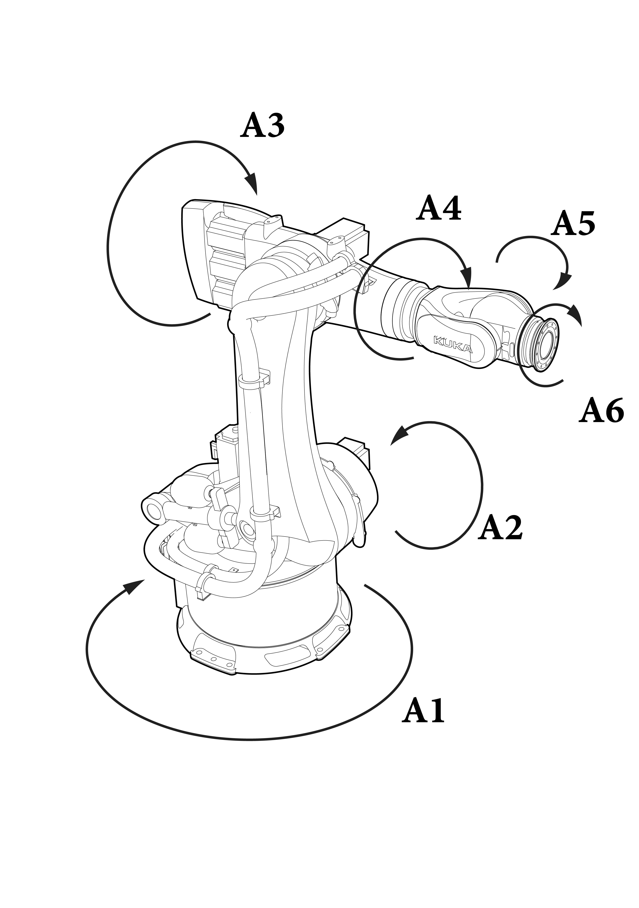

# 微分运动学与雅可比矩阵

> **本章回答的问题：** 已知每个关节以什么速度转动，如何求末端的瞬时运动速度？反过来，要求末端沿某方向运动，怎样决定关节速度？又为什么有些姿态会失去运动能力

**本章导航：** 核心（平面二连杆与速度映射） → 进阶（空间/本体雅可比、奇异性与数值方法） → 实践（交互演示、Python 有限差分验证）

**建议先修：** M02 正运动学、F03 多元微分、F05 刚体空间表示；相关章节介绍了必要概念，本文在使用时仍给出关键定义


## 1. 先理解：末端为什么会动得更快

试着水平伸直手臂，缓慢转动肩关节；虽然肩部角速度不大，手掌也会划过很长的弧线；离转轴越远，同样的角速度产生的线速度越大

对平面内绕固定点转动的一根杆，末端速度的大小为

$$
\|\mathbf v\|=r\,|\dot\theta|
$$

其中 $r$ 是转轴到末端的距离（m），$\dot\theta$ 是关节角速度（rad/s），$\mathbf v$ 是末端线速度（m/s）；速度方向与杆垂直

多个关节同时运动时，各关节对末端速度的贡献相加；我们希望把这种“逐关节叠加”写成矩阵

$$
\boxed{\dot{\mathbf p}=\mathbf J_p(\mathbf q)\dot{\mathbf q}}
$$

- $\mathbf q\in\mathbb R^n$：关节坐标向量；$\dot{\mathbf q}\in\mathbb R^n$：关节速度
- $\mathbf p\in\mathbb R^m$：所选任务点的位置；$\dot{\mathbf p}\in\mathbb R^m$：任务点线速度
- $\mathbf J_p(\mathbf q)\in\mathbb R^{m\times n}$：**位置雅可比矩阵**，其第 $i$ 列表示仅第 $i$ 个关节以单位速度运动时任务点的瞬时速度贡献

**注意：** 此处 $\dot{\mathbf p}$ 是选定末端点的物理线速度；它尚不是第 4 节介绍的六维刚体空间 twist 的线分量

## 2. 核心推导：平面二连杆机械臂

考虑水平平面内的 2R（两个旋转关节）机械臂，基座位于原点，长度 $L_1,L_2>0$，两关节角度分别为 $q_1,q_2$；逆时针为正，$q_2$ 为第二根杆**相对第一根杆**的角度；末端相对基座的姿态角是 $q_1+q_2$

### 2.1 从正运动学开始

末端点在固定坐标系 $\{s\}$ 中的位置为

$$
\mathbf p(\mathbf q)=\begin{bmatrix}
L_1\cos q_1+L_2\cos(q_1+q_2)\\
L_1\sin q_1+L_2\sin(q_1+q_2)
\end{bmatrix}
$$

将 $x,y$ 分别对时间求导，运用链式法则

$$
\begin{aligned}
\dot x&=\big[-L_1\sin q_1-L_2\sin(q_1+q_2)\big]\dot q_1
-L_2\sin(q_1+q_2)\dot q_2,\\
\dot y&=\big[L_1\cos q_1+L_2\cos(q_1+q_2)\big]\dot q_1
+L_2\cos(q_1+q_2)\dot q_2
\end{aligned}
$$

整理为矩阵形式

$$
\boxed{\mathbf J_p(\mathbf q)=
\begin{bmatrix}
-L_1\sin q_1-L_2\sin(q_1+q_2)&-L_2\sin(q_1+q_2)\\
L_1\cos q_1+L_2\cos(q_1+q_2)&L_2\cos(q_1+q_2)
\end{bmatrix}}
$$

这就是 2R 机械臂**末端位置雅可比**；两个输入关节速度，输出两个平面线速度分量

$$
\begin{bmatrix}\dot x\\\dot y\end{bmatrix}
=\mathbf J_p(q_1,q_2)\begin{bmatrix}\dot q_1\\\dot q_2\end{bmatrix}
$$

### 2.2 每一列有直观的几何意义

第 1 列来自第一个关节，旋转中心是基座；第 2 列来自第二个关节，旋转中心是两根杆的连接点

对轴线方向为 $\hat{\mathbf z}$ 的旋转关节，若转轴穿过 $\mathbf o_i$，某任务点位于 $\mathbf p$，其速度贡献为

$$
\mathbf v_i=\dot q_i\,\hat{\mathbf z}\times(\mathbf p-\mathbf o_i)
$$

二维平面可把结果取前两个分量；这一方法与对正运动学求偏导数完全等价；该结论适用于旋转轴固定在对应关节局部刚体、且几何量已统一表达到一个坐标系的情形

对移动关节（prismatic joint），相应列则是关节移动轴方向在选定表达系中的单位向量

### 2.3 带数值的例题

取 $L_1=1.0\ \mathrm m$、$L_2=0.7\ \mathrm m$，$q_1=0$、$q_2=\pi/2$，关节速度为 $\dot{\mathbf q}=[0.2,-0.1]^T\ \mathrm{rad/s}$

此时

$$
\mathbf p=\begin{bmatrix}1\\0.7\end{bmatrix}\mathrm m,
\qquad
\mathbf J_p=\begin{bmatrix}-0.7&-0.7\\1.0&0\end{bmatrix}
$$

所以

$$
\dot{\mathbf p}=\begin{bmatrix}-0.7&-0.7\\1.0&0\end{bmatrix}
\begin{bmatrix}0.2\\-0.1\end{bmatrix}
=\boxed{\begin{bmatrix}-0.07\\0.20\end{bmatrix}\ \mathrm{m/s}}
$$

这意味着末端瞬间向左运动 $0.07\ \mathrm{m/s}$、向上运动 $0.20\ \mathrm{m/s}$；改变关节角后，即便关节速度保持不变，末端速度方向也会变化，因为 $\mathbf J_p$ 随构型变化

## 3. 瞬时速度和加速度不是一回事

位置雅可比只在**当前构型**给出一阶速度映射；它不是“从当前关节角直接算出完整运动轨迹”的方程

对速度关系继续求时间导数，可以得到

$$
\boxed{\ddot{\mathbf p}=\mathbf J_p(\mathbf q)\ddot{\mathbf q}+\dot{\mathbf J}_p(\mathbf q,\dot{\mathbf q})\dot{\mathbf q}}
$$

其中

$$
\dot{\mathbf J}_p=\sum_{i=1}^{n}\frac{\partial\mathbf J_p}{\partial q_i}\dot q_i
$$

即使各关节角速度恒定、$\ddot{\mathbf q}=0$，末端仍可能沿曲线运动并产生非零加速度，这是 $\dot{\mathbf J}_p\dot{\mathbf q}$ 项的作用

**常见误区：** 误把 $\ddot{\mathbf p}=\mathbf J_p\ddot{\mathbf q}$ 当作一般公式，会遗漏机械臂构型变化引入的加速度

## 4. 进阶：从位置雅可比到空间 / 本体雅可比

二维末端点的 $\dot{\mathbf p}\in\mathbb R^2$ 不能描述三维刚体全部运动；六维刚体运动用 twist 表示，本教材采用**角分量在前**的顺序

$$
\mathbf V=\begin{bmatrix}\boldsymbol\omega\\\mathbf v\end{bmatrix}\in\mathbb R^6
$$

设末端刚体位姿 $\mathbf T={}^s\mathbf T_b\in SE(3)$，其中 $s$ 是固定空间坐标系，$b$ 是随末端运动的坐标系；空间 twist 和本体 twist 分别定义为

$$
[\mathbf V_s]=\dot{\mathbf T}\mathbf T^{-1},\qquad
[\mathbf V_b]=\mathbf T^{-1}\dot{\mathbf T}
$$

这里 $[\cdot]$ 是将六维 twist 映射为 $4\times4$ 的 $\mathfrak{se}(3)$ 矩阵；取 $\vee$ 运算可还原成六维列向量；它们对应

$$
\mathbf V_s=\mathbf J_s(\mathbf q)\dot{\mathbf q},\qquad
\mathbf V_b=\mathbf J_b(\mathbf q)\dot{\mathbf q}
$$

### 4.1 为什么空间 twist 的线分量不一定等于末端线速度

令末端原点相对空间坐标系的位置为 $\mathbf p$、角速度为 $\boldsymbol\omega_s$；按照上述 twist 定义

$$
\mathbf v_s=\dot{\mathbf p}-\boldsymbol\omega_s\times\mathbf p
$$

因此真正的末端原点线速度是

$$
\boxed{\dot{\mathbf p}=\mathbf v_s+\boldsymbol\omega_s\times\mathbf p}
$$

不能把空间 twist 的线分量 $\mathbf v_s$ 直接读成末端原点的线速度；尤其当空间原点与末端原点不重合时，这会导致控制接口的速度混用错误

### 4.2 用 PoE 求空间雅可比

若开链机械臂以指数积形式表示

$$
\mathbf T(\mathbf q)=e^{[\mathbf S_1]q_1}\cdots e^{[\mathbf S_n]q_n}\mathbf M
$$

其中 $\mathbf S_i$ 是零位时用空间系表达的关节螺旋轴，$\mathbf M$ 是零位末端位姿，则空间雅可比的列为

$$
\begin{aligned}
\mathbf J_{s,1}&=\mathbf S_1,\\
\mathbf J_{s,i}&=\operatorname{Ad}_{e^{[\mathbf S_1]q_1}\cdots e^{[\mathbf S_{i-1}]q_{i-1}}}\mathbf S_i\quad (i\ge2)
\end{aligned}
$$

公式反映一个几何事实：第 $i$ 个关节轴在空间系中的位置和朝向，只取决于它之前关节的运动

### 4.3 空间与本体雅可比的换算

设 $\mathbf T=[\mathbf R,\mathbf p;\mathbf 0^T,1]$，角速度优先记号下的伴随矩阵为

$$
\operatorname{Ad}_{\mathbf T}=\begin{bmatrix}
\mathbf R&\mathbf 0\\
[\mathbf p]_{\times}\mathbf R&\mathbf R
\end{bmatrix}
$$

由于 $\mathbf V_s=\operatorname{Ad}_{\mathbf T}\mathbf V_b$，可以得到

$$
\boxed{\mathbf J_b(\mathbf q)=\operatorname{Ad}_{\mathbf T(\mathbf q)^{-1}}\mathbf J_s(\mathbf q)}
$$

这里的 $\mathbf J_s,\mathbf J_b\in\mathbb R^{6\times n}$ 与平面位置雅可比 $\mathbf J_p\in\mathbb R^{2\times n}$ 并不相同；不能不考虑表达系、参考点及线速度定义就直接互换

### 4.4 一个可检查的 2R 空间雅可比

对于第 2 节的平面 2R 机械臂，嵌入三维、关节绕 $z$ 轴转动，在固定系下的空间雅可比为

$$
\mathbf J_s(q_1)=\begin{bmatrix}
0&0\\0&0\\1&1\\0&L_1\sin q_1\\0&-L_1\cos q_1\\0&0
\end{bmatrix}
$$

例如 $q_1=0$ 时，第二关节轴穿过 $(L_1,0,0)$，故该旋转轴的 twist 线分量是 $[0,-L_1,0]^T$；将 $\mathbf J_s\dot{\mathbf q}$ 的角速度和线分量代入第 4.1 节公式，可以再次得到第 2.3 节的末端线速度

<figure class="concept-diagram web-source-figure" data-asset="6dof">
  
  <figcaption>六个关节轴给出关节运动的几何方向；雅可比的每一列描述单个关节单位速度的末端贡献，列之间是否独立取决于当前构型和任务定义 · 来源：<a href="https://commons.wikimedia.org/wiki/File:6_Degree-of-Freedom_Robot_Diagram.png" target="_blank" rel="noopener noreferrer">Israel adilman</a> · <a href="https://creativecommons.org/licenses/by/4.0" target="_blank" rel="noopener noreferrer">CC BY 4.0</a></figcaption>
</figure>

## 5. 雅可比奇异性：为什么有些方向动不了

对方阵 $2\times2$ 的 2R 位置雅可比，可直接求行列式

$$
\boxed{\det\mathbf J_p=L_1L_2\sin q_2}
$$

因为 $L_1,L_2>0$，所以当 $q_2=k\pi$（整数 $k$）时，$\det\mathbf J_p=0$，雅可比秩下降，机械臂此时两根杆共线

该构型称为**奇异构型**，含义是：关节速度能产生的末端**瞬时**速度方向不再张成整个二维任务空间；不是说机械臂“完全不能动”，而是不能在这一瞬间独立产生任意二维末端速度

**重要限制：** 行列式只能直接用于方阵；实际六维末端任务、冗余机械臂及欠驱动情况通常需要分析矩阵的秩和奇异值，不应仅套用 $\det J=0$

### 5.1 用 SVD 认识奇异方向

对任意 $m\times n$ 雅可比，奇异值分解为

$$
\mathbf J=\mathbf U\boldsymbol\Sigma\mathbf V^T
$$

非零奇异值表示关节速度空间某些正交单位方向映射为任务速度的放大倍数；某个奇异值接近零，意味着该任务方向变得难以产生显著的速度

单位球 $\|\dot{\mathbf q}\|_2\le1$ 经过 $\mathbf J$ 映射，会形成任务速度空间的**可达速度椭球（或低维椭圆）**；这是一种局部速度能力的几何直觉，并不直接代表所有真实关节速度限制或整条轨迹的可达性

### 5.2 伪逆和阻尼最小二乘

对于期望任务速度 $\mathbf v_d$，常见局部逆速度方法为

$$
\dot{\mathbf q}=\mathbf J^{\dagger}\mathbf v_d
$$

Moore–Penrose 伪逆提供最小二乘意义的解，若存在多解则选择欧氏范数最小的解；但当某些非零奇异值极小时，关节速度可能被严重放大

阻尼最小二乘可以写成

$$
\boxed{\dot{\mathbf q}=\mathbf J^T(\mathbf J\mathbf J^T+\lambda^2\mathbf I)^{-1}\mathbf v_d},\qquad \lambda>0
$$

该表达对任意形状 $\mathbf J$ 的欧氏二范数正则化最小二乘有效；它限制近奇异方向的放大，但会引入跟踪偏差，不是无条件更准确；不同任务量纲的混合（如 m/s 与 rad/s）需要合理归一化或加权，不能直接随意比较奇异值

## 6. 实践：亲自改变关节角，观察速度与奇异性

下面交互演示使用 $L_1=1.0\ \mathrm m$、$L_2=0.7\ \mathrm m$；关节角速度固定为 $[0.8,-0.5]^T\ \mathrm{rad/s}$，改变滑块时重新计算当前雅可比及末端瞬时速度

<!-- INTERACTIVE:ARM2R -->

**观察任务**

1. 固定 $q_1$，逐渐将 $q_2$ 调至 $0^\circ$，观察 $\det\mathbf J_p$ 和最小奇异值趋于零
2. 把 $q_2$ 调至 $90^\circ$，改变 $q_1$，观察速度方向随整体旋转而改变
3. 将 $q_2$ 调至 $180^\circ$，思考为什么两根杆折叠时依旧是奇异构型

### 6.1 可复现的 Python 实验

配套工程位于 `labs/python/arm2r/`，使用 NumPy 和 Matplotlib

在完整源码工程根目录下运行

```bash
python labs/python/arm2r/main.py --check --out labs/python/arm2r/results
```

该命令完成三类检查：在多组构型下计算解析/有限差分雅可比的最大误差；验证前述数值例题；检查直杆与反向折叠时的秩退化，并生成速度映射、奇异值曲线图

单独复制本 HTML 文件到其他电脑不会携带 Python 实验源码；不过本节的交互图仍可运行；HTML 演示用于理解物理行为，Python 实验用于可复现数值验证

## 7. 本章小结与常见错误

| 要回答的问题 | 正确结论 |
|---|---|
| 末端线速度如何由关节速度得到？ | $\dot{\mathbf p}=\mathbf J_p\dot{\mathbf q}$，其中 $\mathbf J_p=\partial\mathbf p/\partial\mathbf q$ |
| 末端加速度能否只写成 $J\ddot q$？ | 不能，通常还要加上 $\dot J\dot q$ |
| 空间 twist 的线分量等于末端点速度吗？ | 一般不等于，需考虑 $\boldsymbol\omega\times\mathbf p$ |
| 雅可比奇异意味着机械臂完全不动？ | 否，意味着局部可达任务速度空间维度下降 |
| 伪逆能保证在奇异点精确跟踪任意任务速度？ | 不能，目标方向可能不可达，近奇异处关节速度可能很大 |
| 阻尼最小二乘一定更准确吗？ | 不是，以有偏差换取更稳定的数值行为 |

## 8. 练习与自检

**练习 A（基础）：** 把第 2.3 节 $q_1$ 改成 $\pi/2$、$q_2$ 保持 $\pi/2$，手算位置雅可比和 $\dot{\mathbf p}$，再用演示检查方向

**练习 B（推导）：** 从 $\mathbf v_s=\dot{\mathbf p}-\boldsymbol\omega_s\times\mathbf p$ 出发，解释为什么不能直接取空间雅可比的后三行作为末端原点的线速度雅可比

**练习 C（深入）：** 利用 $\mathbf J=\mathbf U\boldsymbol\Sigma\mathbf V^T$ 推导阻尼最小二乘在每个奇异方向上的增益 $\sigma_i/(\sigma_i^2+\lambda^2)$，说明它如何限制接近零奇异值造成的放大

**练习 D（编程）：** 在 Python 实验中修改 $L_1,L_2$、有限差分步长 $h$，观察过大和过小的 $h$ 对数值误差的影响

## 9. 参考资料与知识边界

1. Kevin M. Lynch & Frank C. Park, *Modern Robotics: Mechanics, Planning, and Control*, Cambridge University Press, 2017, **Chapter 3**（twist）、**Chapter 4**（PoE）、**Chapter 5**（Velocity Kinematics and Statics），[美国西北大学官方第 5 章视频与讲义入口](https://modernrobotics.northwestern.edu/chapters/chapter5/)
2. Bruno Siciliano et al., *Robotics: Modelling, Planning and Control*, Springer, 2009，微分运动学、奇异性与逆速度解法，DOI: [10.1007/978-1-84628-642-1](https://doi.org/10.1007/978-1-84628-642-1)
3. Richard M. Murray, Zexiang Li & S. Shankar Sastry, *A Mathematical Introduction to Robotic Manipulation*, CRC Press, 1994，刚体运动群、空间速度与操纵臂几何分析

这些引用支持经典模型的定义及相关理论；本章的中文讲解、数值例子和交互实验均独立编写；更高级的操作空间力控制、冗余机器人零空间优化将在 C04/M05 中系统展开；不应仅由本章的雅可比速度方程推断完整动力学或控制稳定性