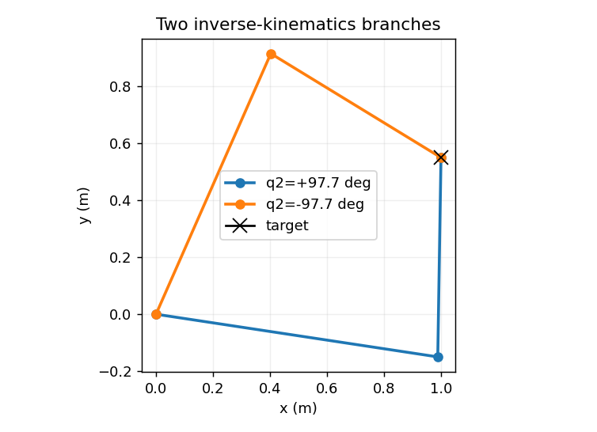
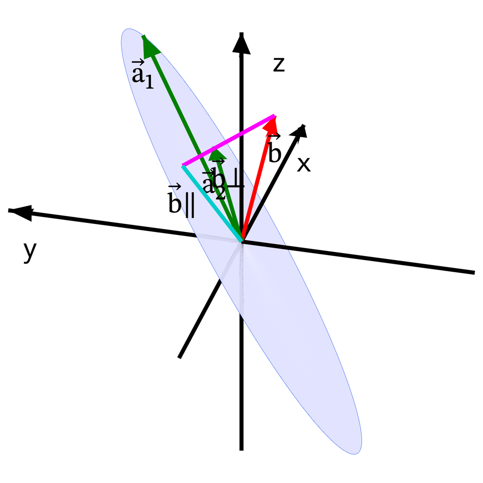

# 逆运动学与奇异性：从目标位姿到关节解

> **本章问题：** 已知工具要去哪，为什么可能没有解、有多个解，甚至有无穷多解？接近奇异点时为什么关节速度会突然变大

**先修：** F02、M02、M03；逆运动学需要同时考虑任务定义、几何可达性、关节限位及数值迭代收敛性

## 核心 1. 逆运动学不是普通矩阵求逆

已知期望工具位姿 $\mathbf T_d\in SE(3)$，逆运动学要找合法 $\mathbf q$ 使

$$
\mathbf T(\mathbf q)=\mathbf T_d,
\qquad\mathbf q_{min}\le\mathbf q\le\mathbf q_{max}
$$

任务可能不可达、具有离散多组解，或在冗余机械臂中具有连续的解集；若考虑碰撞、关节速度、奇异性及路径连接问题，还需要进一步规划

**位置 IK 与完整位姿 IK 是不同任务；** 例如平面 2R 只有两个独立关节，通常不能同时任意独立指定 $(x,y,\theta)$ 三个任务量

<figure class="concept-diagram web-source-figure" data-asset="kin">
  
  <figcaption>图中逆运动学由期望末端坐标回到关节角；一个末端目标可能对应多组关节解，也可能不可达，这正是逆运动学不同于一般函数求值的地方 · 来源：<a href="https://commons.wikimedia.org/wiki/File:FWDvsINV_Kinematics_HighResTransp.png" target="_blank" rel="noopener noreferrer">Haendy-freak</a> · <a href="https://creativecommons.org/licenses/by-sa/4.0" target="_blank" rel="noopener noreferrer">CC BY-SA 4.0</a></figcaption>
</figure>

## 核心 2. 二连杆的解析 IK：余弦定理

末端期望位置 $(x_d,y_d)$，连杆长度 $L_1,L_2>0$；定义半径 $r=\sqrt{x_d^2+y_d^2}$；忽略关节限位和碰撞时，可达条件是

$$
|L_1-L_2|\le r\le L_1+L_2
$$

由余弦定理

$$
D=\frac{x_d^2+y_d^2-L_1^2-L_2^2}{2L_1L_2}=\cos q_2
$$

若 $|D|>1$，严格意义上没有实角解；允许数值浮点误差时可对接近 $\pm1$ 的 $D$ 做容差处理，但**不能把真正超出工作空间的点通过裁剪伪装成可达目标**

若 $|D|\le1$，两种分支为

$$
q_2=\operatorname{atan2}(\pm\sqrt{1-D^2},D)
$$

$$
q_1=\operatorname{atan2}(y_d,x_d)-\operatorname{atan2}(L_2\sin q_2,L_1+L_2\cos q_2)
$$

正负号通常对应不同肘部构型；在伸直或折叠的奇异位置两个分支可能合并；若两连杆等长且目标恰好在原点，还有特殊退化的连续配置需要单独讨论

## 核心 3. 为什么数值 IK 要用雅可比

对末端位置任务 $\mathbf p(\mathbf q)$，定义误差 $\mathbf e=\mathbf p_d-\mathbf p(\mathbf q)$；局部线性化

$$
\mathbf p(\mathbf q+\Delta\mathbf q)\approx\mathbf p(\mathbf q)+\mathbf J_p(\mathbf q)\Delta\mathbf q
$$

因此可通过求解 $\mathbf J_p\Delta\mathbf q\approx\mathbf e$ 获得迭代步长；对可用逆的方阵可以写 $\Delta\mathbf q=\mathbf J_p^{-1}\mathbf e$，但在一般非方阵情形通常考虑伪逆或阻尼最小二乘

## 核心 4. 伪逆、阻尼最小二乘和正则化

最小范数最小二乘步长为

$$
\Delta\mathbf q=\mathbf J_p^\dagger\mathbf e
$$

在奇异值很小时，伪逆可能使关节增量过大；阻尼最小二乘方法求解

$$
\min_{\Delta\mathbf q}\|\mathbf J_p\Delta\mathbf q-\mathbf e\|_2^2+\lambda^2\|\Delta\mathbf q\|_2^2,
\quad\lambda>0
$$

对应

$$
\Delta\mathbf q=(\mathbf J_p^T\mathbf J_p+\lambda^2\mathbf I)^{-1}\mathbf J_p^T\mathbf e
$$

该表达用于推导，实际实现宜直接解线性系统而非显式求逆；阻尼保证更新有界，但会引入偏差，也不保证复杂非线性 IK 的全局收敛

一般迭代可写为 $\mathbf q_{k+1}=\Pi_{\mathcal Q}(\mathbf q_k+\alpha\Delta\mathbf q)$，其中 $\Pi_{\mathcal Q}$ 是满足关节位置限制的投影操作，$\alpha$ 是步长；直接裁剪可保证位置限位，但可能破坏其他约束；复杂问题需约束优化

<figure class="concept-diagram web-source-figure" data-asset="projection">
  
  <figcaption>当期望的微小末端位移不在雅可比列空间中时，伪逆给出最小二乘近似；图中的正交残差代表当前瞬间无法实现的分量，有限步更新后还要重新计算雅可比 · 来源：<a href="https://commons.wikimedia.org/wiki/File:Least_squares_projection_geometry.png" target="_blank" rel="noopener noreferrer">Eteri byazrova (GraphMath)</a> · <a href="https://creativecommons.org/licenses/by-sa/4.0" target="_blank" rel="noopener noreferrer">CC BY-SA 4.0</a></figcaption>
</figure>

## 进阶 5. 六维位姿误差必须与雅可比匹配

对于 $\mathbf T_d,\mathbf T(\mathbf q)\in SE(3)$，一种本体坐标形式的局部误差定义为

$$
\mathbf e_b=\operatorname{Log}(\mathbf T(\mathbf q)^{-1}\mathbf T_d)^\vee\in\mathbb R^6
$$

将其与本体雅可比 $\mathbf J_b$ 结合，局部迭代方向可写为 $\Delta\mathbf q\approx\mathbf J_b^\dagger\mathbf e_b$；但大误差时需要考虑 $SE(3)$ 对数微分（右/左雅可比）与局部线性化近似，不能宣称该式在所有姿态下都是精确 Newton 步长；接近角度 $\pi$ 时，对数分支也会带来不连续问题

若将位置误差（米）和姿态误差（弧度）叠在一个六维范数中，应说明任务权重或特征长度，否则优化结果取决于单位尺度

## 进阶 6. 冗余解与零空间

对于高于任务维数的关节系统，可用

$$
\Delta\mathbf q=\mathbf J^\dagger\mathbf e+(\mathbf I-\mathbf J^\dagger\mathbf J)\mathbf z
$$

添加零空间任务，例如尽量避开关节限位；这里第二项在**使用同一个理想雅可比和 Moore–Penrose 伪逆**时属于精确零空间投影；使用阻尼逆时，$\mathbf I-\mathbf J_\lambda^\#\mathbf J$ 通常不再是严格零空间投影，因此会影响主任务

## 进阶 7. 奇异性与连续路径

2R 位置雅可比满足

$$
\det\mathbf J_p=L_1L_2\sin q_2
$$

$q_2=0$ 或 $\pi$ 时瞬时映射降秩；即使目标在几何工作空间内，求解过程仍可能出现大增量、分支切换或碰撞；在实际系统中，应当同时检查速度/加速度上限、碰撞、目标误差与相邻时刻解的连续性

## 实践 8. 比较三种 IK 算法

配套实验 `labs/python/kinematics/main.py --check` 提供二连杆解析解与阻尼数值解对照；可进一步加入普通伪逆，比较接近伸直位置时的更新幅度；评价至少包括末端位置残差、最大关节增量、迭代次数和成功率，不能只记录“是否收敛”

**练习：** 对 $L_1=L_2=1\ \mathrm m$、目标 $(1,1)$，列出两个肘部解并代回正运动学；若将目标移动到 $(2.1,0)$，解释为何数值求解器不应返回“精确到达”

**参考：** Lynch & Park, *Modern Robotics*, Chapter 6；Siciliano et al., *Robotics: Modelling, Planning and Control*, inverse kinematics chapters；Nakamura, *Advanced Robotics: Redundancy and Optimization*