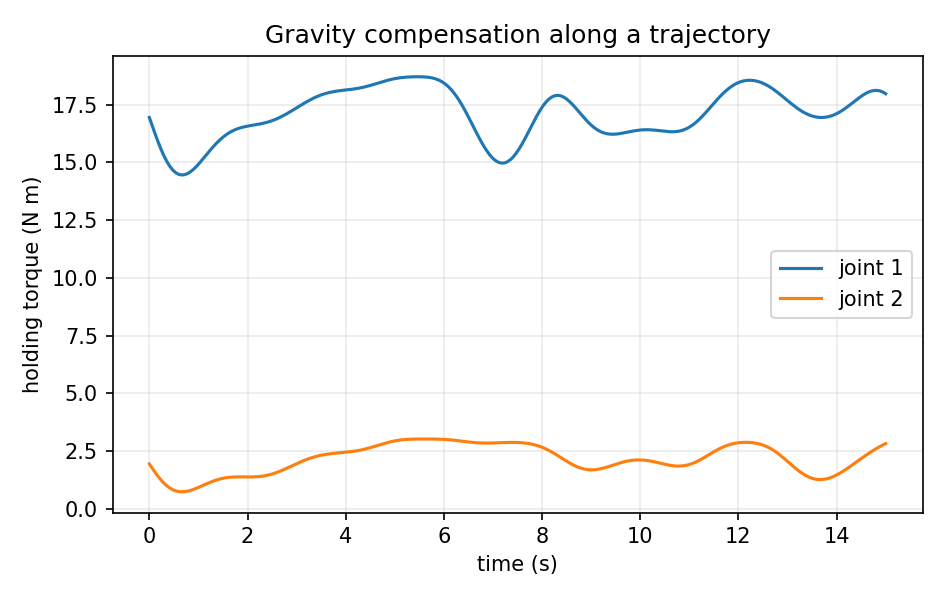

# 机器人静力学：从末端受力到关节力矩

> **本章解决的问题：** 机械臂末端被外力推动时，各关节承受多大力矩？为什么静力学与雅可比矩阵有关？重力补偿为什么不是简单地令每个关节力矩为零

**先修：** M03 雅可比、F06 旋量与坐标表达；后续：M06 动力学、M07 接触与抓取、C05 力与柔顺控制

**学习路线：** 核心（自由体图、虚功与重力平衡）→ 进阶（六维 wrench 与约束反力）→ 实践（二维二连杆力矩核验）

## 1. 先画自由体图：谁在向谁施力

想象一条机械臂停在空中，末端压住一块海绵

- 地球使各连杆受到重力，电机需要提供抵消重力的关节力矩
- **环境施加给机械臂**的接触力通过连杆传到关节
- 机械臂**施加给环境**的力方向相反，不能把两个力混用
- 静止时加速度为零，但**合力与合力矩为零**不等于“每个力都为零”

为避免符号混乱，本章采用全书约定：关节驱动力为 $\boldsymbol\tau_{\mathrm{cmd}}$，环境**作用在机器人上**的末端力为 $\mathbf f_{\mathrm{ext}}$，重力项为 $\mathbf g(\mathbf q)=\partial U/\partial\mathbf q$；在零加速度、零速度的理想刚体静力平衡下

$$
\boxed{\mathbf g(\mathbf q)=\boldsymbol\tau_{\mathrm{cmd}}+\mathbf J_p(\mathbf q)^T\mathbf f_{\mathrm{ext}}}
$$

也就是说，对于给定的环境作用力，保持静止所需的驱动力为 $\boldsymbol\tau_{\mathrm{cmd}}=\mathbf g-\mathbf J_p^T\mathbf f_{\mathrm{ext}}$；若将 $\mathbf f$ 改成机器人施加给环境的力，符号会反过来

此处 $\mathbf J_p$ 映射关节速度到**受力点**的线速度，$\mathbf f_{\mathrm{ext}}$ 与该速度在同一坐标系表达；若还有其他外力或其它静力负载，应将对应的广义力相加

## 2. 核心：虚功为什么得到 $\mathbf J^T\mathbf f$

静力学最容易理解的起点，是**功率必须一致**

对于受力点 $\mathbf p(\mathbf q)\in\mathbb R^m$，微小关节位移 $\delta\mathbf q$ 引起

$$
\delta\mathbf p=\mathbf J_p(\mathbf q)\,\delta\mathbf q
$$

假设作用点固定在相应刚体上，忽略变形，并且仅考虑相容的虚位移；外力作虚功

$$
\delta W_{\mathrm{ext}}=\mathbf f_{\mathrm{ext}}^T\delta\mathbf p
=\mathbf f_{\mathrm{ext}}^T\mathbf J_p\delta\mathbf q
=(\mathbf J_p^T\mathbf f_{\mathrm{ext}})^T\delta\mathbf q
$$

关节上等效广义外力的虚功为 $\delta W_{\mathrm{ext}}=\boldsymbol\tau_{\mathrm{ext}}^T\delta\mathbf q$；任意独立的 $\delta\mathbf q$ 都成立时，必有

$$
\boxed{\boldsymbol\tau_{\mathrm{ext}}=\mathbf J_p^T\mathbf f_{\mathrm{ext}}}
$$

**注意两个不同的含义：** $\mathbf J_p\dot{\mathbf q}$ 把关节**速度映射到末端速度**；$\mathbf J_p^T\mathbf f$ 把末端**力映射到关节广义力**；它们互为功率对偶，而不意味着力必须由 $\mathbf J_p^{-1}$ 计算

### 2.1 单位和尺寸自检

平面 2R 情况下 $\mathbf J_p\in\mathbb R^{2\times2}$，矩阵元素量纲为 m/rad；$\mathbf f\in\mathbb R^2$ 的量纲为 N，因此输出关节力矩为 N·m（角度在数学上无量纲，工程标注使用 rad）

推广到平移关节时，同一广义力向量可能混合 N·m 与 N；不要笼统称全部分量为“力矩”

<figure class="concept-diagram web-source-figure" data-asset="lever">
  
  <figcaption>力矩大小由力与转轴到作用点向量的叉积决定；图中切向力与杆垂直，力矩大小等于杆长乘力，若改为沿杆方向施力则力矩为零 · 来源：<a href="https://commons.wikimedia.org/wiki/File:Work_on_lever_arm.png" target="_blank" rel="noopener noreferrer">SamL 199917</a> · <a href="https://creativecommons.org/licenses/by-sa/4.0" target="_blank" rel="noopener noreferrer">CC BY-SA 4.0</a></figcaption>
</figure>

## 3. 一张力的自由体图如何转成算法

仍采用 M03 中的水平平面 2R，长度 $L_1,L_2$，关节角度 $q_1,q_2$；末端位置雅可比为

$$
\mathbf J_p=\begin{bmatrix}
-L_1\sin q_1-L_2\sin(q_1+q_2)&-L_2\sin(q_1+q_2)\\
L_1\cos q_1+L_2\cos(q_1+q_2)&L_2\cos(q_1+q_2)
\end{bmatrix}
$$

取 $L_1=0.8\ \mathrm m$、$L_2=0.6\ \mathrm m$、$q_1=0$、$q_2=\pi/2$，若末端受到空间坐标下的水平向右外力 $\mathbf f_{\mathrm{ext}}=[10,0]^T\ \mathrm N$

$$
\mathbf J_p=\begin{bmatrix}-.6&-.6\\ .8&0\end{bmatrix},\qquad
\boldsymbol\tau_{\mathrm{ext}}=\mathbf J_p^T\mathbf f_{\mathrm{ext}}
=\begin{bmatrix}-6\\-6\end{bmatrix}\ \mathrm{N\,m}
$$

这个例子中关节外力矩为负，意思是该外力倾向使关节沿负转角方向转动；若忽略重力并保持静止，驱动器应施加 $[+6,+6]^T\ \mathrm{N\,m}$ 来抵消外力矩，而不是继续施加 $[-6,-6]^T$

### 3.1 多个受力点

外力不止作用在工具尖端；若第 $k$ 个受力点的线速度雅可比为 $\mathbf J_k$，则

$$
\boldsymbol\tau_{\mathrm{ext}}=\sum_k\mathbf J_k^T\mathbf f_k
$$

接触点在不同连杆时必须分别计算雅可比；不能把所有外力强行放到工具尖端的雅可比上

<figure class="concept-diagram web-source-figure" data-asset="scheme">
  
  <figcaption>沿两根连杆读出长度和关节角，再确定末端受力点的位置；将同一坐标系的外力代入雅可比转置，关节力矩的正负要按约定的正转向判断 · 来源：<a href="https://commons.wikimedia.org/wiki/File:Robotic_Arm_schemat.png" target="_blank" rel="noopener noreferrer">Arczi325</a> · <a href="https://creativecommons.org/licenses/by-sa/4.0" target="_blank" rel="noopener noreferrer">CC BY-SA 4.0</a></figcaption>
</figure>

## 4. 核心：重力补偿来自势能梯度

采用竖直平面 2R，$x$ 水平向右、$y$ 竖直向上，重力加速度向下，大小 $g>0$；令 $c_1,c_2$ 为各连杆质心距离本关节转轴的长度，连杆质量为 $m_1,m_2$

质心纵坐标为

$$
\begin{aligned}
y_{c1}&=c_1\sin q_1,\\
y_{c2}&=L_1\sin q_1+c_2\sin(q_1+q_2)
\end{aligned}
$$

选零势能平面 $y=0$，重力势能为

$$
U(\mathbf q)=(m_1c_1+m_2L_1)g\sin q_1+m_2c_2g\sin(q_1+q_2)
$$

用虚功或拉格朗日方程可得重力广义力项

$$
\boxed{\mathbf g(\mathbf q)=\begin{bmatrix}
(m_1c_1+m_2L_1)g\cos q_1+m_2c_2g\cos(q_1+q_2)\\
m_2c_2g\cos(q_1+q_2)
\end{bmatrix}}
$$

当机械臂竖直向上时，重力对绕垂直平面法向的关节轴力矩可能接近零；当水平伸出时，抗重力力矩更大；**重力补偿力矩由姿态和质量分布共同决定，并非所有位置都恒定**

注意，前面的水平 2R 外力算例与这里的竖直 2R 重力算例，只是同一个平面运动学在不同物理布置下的应用；不能同时假定机械臂在水平面运动又受到平面内竖直重力



## 5. 进阶：六维力旋量（wrench）的表达约定

对于刚体刚性接触，一个三维力 $\mathbf f$ 与关于某参考点的力矩 $\mathbf m$ 组成 wrench；本教材与 M03 采用**角分量在前**

$$
\mathbf V=\begin{bmatrix}\boldsymbol\omega\\\mathbf v\end{bmatrix},\qquad
\mathbf F=\begin{bmatrix}\mathbf m\\\mathbf f\end{bmatrix},\qquad
P=\mathbf F^T\mathbf V
$$

如果 $\mathbf V_s=\mathrm{Ad}_{\mathbf T}\mathbf V_b$，为了保留同一功率，wrench 必须对应地变换

$$
\mathbf F_b=\mathrm{Ad}_{\mathbf T}^{T}\mathbf F_s
$$

对与 $\mathbf V=\mathbf J\dot{\mathbf q}$ 使用**同一个刚体 twist 定义**的六维雅可比，有

$$
\boldsymbol\tau_{\mathrm{ext}}=\mathbf J^T\mathbf F_{\mathrm{ext}}
$$

但是 $\mathbf F_s$ 的力矩分量关于**空间原点**，不一定是工具原点处的局部力矩；将六维空间雅可比与工具原点处的 $[\mathbf m;\mathbf f]$ 直接相乘是常见错误；若外力为作用在工具点的纯力，应先搬移 wrench 的参考点，或使用该接触点的线速度雅可比

## 6. 进阶：约束力和静力可解性

若关节存在闭环约束 $\boldsymbol\phi(\mathbf q)=0$，其可容许虚位移满足 $\mathbf J_c\delta\mathbf q=0$，约束反力 $\boldsymbol\tau_c=\mathbf J_c^T\boldsymbol\lambda$ 对相容虚位移不做功

在静力平衡下可写

$$
\mathbf g=\boldsymbol\tau_{\mathrm{cmd}}+\mathbf J_{\mathrm{ext}}^T\mathbf F_{\mathrm{ext}}+\mathbf J_c^T\boldsymbol\lambda
$$

静力学是否能唯一求出接触力，要看约束数、雅可比秩、摩擦条件和实际支撑情况；**仅知道关节力矩通常不足以唯一重建全部接触力；** 若 $\mathbf J^T\mathbf F=\boldsymbol\tau$ 有多个力解，还需要正则化、任务条件或接触模型；在奇异附近小的测量噪声可能导致巨大的估计不确定性

## 7. 实践：如何核验式子而不依赖真机

`labs/python/dynamics/main.py` 中提供虚功映射和重力势能梯度检查

```bash
python labs/python/dynamics/main.py --check
```

脚本使用随机关节位姿、随机虚位移和随机末端外力，对照 $\mathbf f^T\mathbf J\delta\mathbf q$ 与 $(\mathbf J^T\mathbf f)^T\delta\mathbf q$，并通过中心差分检查 $\partial U/\partial\mathbf q=\mathbf g$；它验证了数学一致性，**不能替代真实电机的摩擦、减速器效率或力传感器标定**

### 本章自测

1. 重力竖直向下、末端受到外力时，解释为什么保持力矩写作 $\boldsymbol\tau=\mathbf g-\mathbf J^T\mathbf f_{\mathrm{ext}}$，而不是加号
2. 如果接触点从末端移动到第二连杆中点，为什么原末端雅可比不再适用
3. 对刚体空间雅可比，说明“线速度分量”和“工具原点线速度”的区别如何影响 wrench 换算

**参考：** Lynch & Park, *Modern Robotics*, Ch. 3、5、12；Murray, Li & Sastry, *A Mathematical Introduction to Robotic Manipulation*, 1994；Siciliano et al., *Robotics: Modelling, Planning and Control*, 2009
