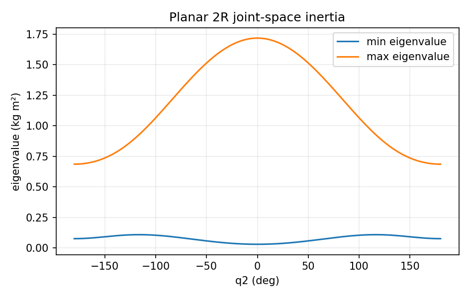

# 刚体机器人动力学：从能量到力矩

> **本章解决的问题：** 为什么相同的关节力矩在不同姿态产生不同加速度？什么叫惯性矩阵？如何使用拉格朗日法、牛顿–欧拉法以及 RNEA、CRBA、ABA 求出机器人动力学

**先修：** F03 动态系统、F08 电机传动、M03 微分运动学、M05 静力学；后续：M07、M08、C03、C05

**路线：** 核心（能量与 2R 完整推导）→ 进阶（空间刚体动力学、递归算法、结构性质）→ 实践（正逆动力学与能量验证）

## 1. 从一根杆开始：惯量不是“质量的另一个名字”

将杆握在接近端部与接近质心的位置，感受到的转动难易程度不同；这不仅取决于质量，还取决于质量相对转轴的分布；刚体绕固定轴的转动惯量单位为 $\mathrm{kg\,m^2}$

对于质心平动速度 $\mathbf v_c$、角速度 $\boldsymbol\omega$ 的三维刚体，动能为

$$
K=\frac12 m\mathbf v_c^T\mathbf v_c+\frac12\boldsymbol\omega^T\mathbf I_c\boldsymbol\omega
$$

$\mathbf I_c$ 是**质心处、在同一表达坐标系下**的转动惯量矩阵；若要使用绕其他点的惯量，必须用平行轴定理转换；对含 $n$ 个广义坐标的机器人，各刚体能量相加，会形成对关节速度的二次型

$$
\boxed{K=\tfrac12\dot{\mathbf q}^T\mathbf M(\mathbf q)\dot{\mathbf q}}
$$

这里 $\mathbf M(\mathbf q)\in\mathbb R^{n\times n}$ 为关节空间质量/惯性矩阵，不是所有连杆惯性张量简单求和，也不是机械臂所有关节的“质量表”；在独立广义坐标且刚体具有正质量和有效惯量的通常条件下，$\mathbf M$ 对称正定

## 2. 核心：拉格朗日动力学公式

对保守重力和广义驱动力，定义拉格朗日量 $\mathcal L=K-U$；第 $i$ 个广义坐标的欧拉–拉格朗日方程为

$$
\frac{d}{dt}\frac{\partial\mathcal L}{\partial\dot q_i}-\frac{\partial\mathcal L}{\partial q_i}=Q_i
$$

$Q_i$ 包含驱动、耗散及外力的广义功率对偶项；整理后常写成

$$
\boxed{\mathbf M(\mathbf q)\ddot{\mathbf q}
+\mathbf C(\mathbf q,\dot{\mathbf q})\dot{\mathbf q}
+\mathbf g(\mathbf q)+\boldsymbol\tau_f
=\boldsymbol\tau_{\mathrm{cmd}}+\mathbf J^T\mathbf F_{\mathrm{ext}}}
$$

- $\mathbf M\ddot{\mathbf q}$：惯性加速项
- $\mathbf C\dot{\mathbf q}$：科氏与离心相关速度项，$\mathbf C$ 的具体表示并不唯一
- $\mathbf g=\partial U/\partial\mathbf q$：势能引起的重力广义力
- $\boldsymbol\tau_f$：模型化的摩擦/耗散力，例如粘性摩擦 $\mathbf B\dot{\mathbf q}$
- $\mathbf J^T\mathbf F_{\mathrm{ext}}$：环境**施加在机器人上**的力矩映射，与 M05 相同约定

上式默认刚体、关节约束已由独立广义坐标消去；含闭环或接触约束时需要加入相应约束广义力（M07）

## 3. 核心算例：竖直平面 2R 的质量矩阵

两个旋转关节轴均垂直于运动平面；$L_1$ 是第一杆长度，$m_i$、$c_i$、$I_i$ 分别为质量、质心距本杆近端关节距离、**质心绕面外 $z$ 轴的转动惯量**；角度 $q_2$ 为第二杆相对第一杆角度，$y$ 向上，重力加速度大小为 $g$

第一杆质心位置与第二杆质心位置分别为

$$
\mathbf p_{c1}=\begin{bmatrix}c_1\cos q_1\\c_1\sin q_1\end{bmatrix},\quad
\mathbf p_{c2}=\begin{bmatrix}L_1\cos q_1+c_2\cos(q_1+q_2)\\ L_1\sin q_1+c_2\sin(q_1+q_2)\end{bmatrix}
$$

质心速度通过对时间求导获得；两根杆绕 $z$ 轴的角速度分别为 $\dot q_1$ 和 $\dot q_1+\dot q_2$，故总动能

$$
K=\frac12m_1\|\dot{\mathbf p}_{c1}\|^2
+\frac12 I_1\dot q_1^2
+\frac12m_2\|\dot{\mathbf p}_{c2}\|^2
+\frac12I_2(\dot q_1+\dot q_2)^2
$$

展开并收集 $\dot q_1^2,\dot q_1\dot q_2,\dot q_2^2$ 得到

$$
\mathbf M(\mathbf q)=\begin{bmatrix}
a+2b\cos q_2&d+b\cos q_2\\
d+b\cos q_2&d
\end{bmatrix}
$$

其中

$$
\begin{aligned}
a&=I_1+I_2+m_1c_1^2+m_2(L_1^2+c_2^2),\\
b&=m_2L_1c_2,\\
d&=I_2+m_2c_2^2
\end{aligned}
$$

$a,b,d$ 单位都是 $\mathrm{kg\,m^2}$；$q_1$ 没有出现在 $\mathbf M$ 中，并非说明第一个关节的运动不影响动力学，而是由于这里竖直平面内绕固定轴旋转、质心结构和惯性具有相应对称性；第二关节相对构型 $q_2$ 改变了耦合惯量



## 4. 推导速度项：为什么 $\mathbf C\dot{\mathbf q}$ 不是“阻尼”

对上面的 $K$、$U$ 使用欧拉–拉格朗日方程；定义 $h=b\sin q_2$，速度相关的非线性广义力为

$$
\mathbf c(\mathbf q,\dot{\mathbf q})=
\begin{bmatrix}
-h(2\dot q_1\dot q_2+\dot q_2^2)\\
h\dot q_1^2
\end{bmatrix}
$$

可选用下列一个 $\mathbf C$ 使 $\mathbf C\dot{\mathbf q}=\mathbf c$

$$
\mathbf C=\begin{bmatrix}
-h\dot q_2&-h(\dot q_1+\dot q_2)\\
h\dot q_1&0
\end{bmatrix}
$$

注意即便 $\mathbf C\dot{\mathbf q}$ 被惯用写作“科氏项”，它包括不同几何来源的速度二次项，通常**不会像粘性阻尼一样始终耗散能量**；将 $\mathbf C$ 与摩擦 $\boldsymbol\tau_f$ 混为一谈会使能量分析错误

### 4.1 一个重要的结构性质

对上述标准形式选择的 $\mathbf C$，满足

$$
\dot{\mathbf M}-2\mathbf C\quad\text{为斜对称矩阵}
$$

因此对任意 $\dot{\mathbf q}$，有

$$
\dot{\mathbf q}^T\!\left(\tfrac12\dot{\mathbf M}-\mathbf C\right)\!\dot{\mathbf q}=0
$$

这有助于证明无驱动、无摩擦、无外力条件下，机器人动能与势能守恒；**不是任何随意写出的 $\mathbf C$ 都自动保留同一个矩阵斜对称性质**；但只要速度广义力与惯性、势能符合对应拉格朗日结构，总机械能的物理关系应当一致

## 5. 重力、摩擦与功率平衡

M05 中已从势能梯度得到

$$
\mathbf g=\begin{bmatrix}
e\cos q_1+f\cos(q_1+q_2)\\f\cos(q_1+q_2)
\end{bmatrix},
\quad
 e=(m_1c_1+m_2L_1)g,\quad f=m_2c_2g
$$

用 $E=K+U$ 表示机械能，若 $\boldsymbol\tau_f=\mathbf B\dot{\mathbf q}$、$\mathbf B\succeq0$ 且没有冲击，则

$$
\boxed{\dot E=\dot{\mathbf q}^T\boldsymbol\tau_{\mathrm{cmd}}
+\dot{\mathbf q}^T\mathbf J^T\mathbf F_{\mathrm{ext}}
-\dot{\mathbf q}^T\mathbf B\dot{\mathbf q}}
$$

第二项等于对应任务速度与外力的功率；在接触约束没有相对运动的理想条件下，理想约束力可以做零功；滑动摩擦则可能耗散能量

## 6. 逆动力学与正动力学是两件不同的事

给定 $\mathbf q,\dot{\mathbf q},\ddot{\mathbf q}$，求**需要的关节驱动力**

$$
\boldsymbol\tau_{\mathrm{cmd}}=\mathbf M\ddot{\mathbf q}+\mathbf c+\mathbf g+\boldsymbol\tau_f-\mathbf J^T\mathbf F_{\mathrm{ext}}
$$

这是**逆动力学**；相反，给定驱动力，求产生的加速度

$$
\ddot{\mathbf q}=\mathbf M^{-1}
(\boldsymbol\tau_{\mathrm{cmd}}+\mathbf J^T\mathbf F_{\mathrm{ext}}-\mathbf c-\mathbf g-\boldsymbol\tau_f)
$$

这是**正动力学**；公式中写逆矩阵便于理解，代码应求解线性系统而不是显式求逆；模型外的摩擦、柔性和时延会使真机实际运动与理想输出不同

## 7. 进阶：牛顿—欧拉与空间刚体递归动力学

拉格朗日法从系统能量出发，适合构建结构清晰的方程；牛顿–欧拉法从每个刚体的平动和转动平衡出发

$$
\mathbf f=m\mathbf a_c,\qquad
\mathbf m_c=\mathbf I_c\dot{\boldsymbol\omega}
+\boldsymbol\omega\times(\mathbf I_c\boldsymbol\omega)
$$

上式右边分别是质心合外力和质心处的合外力矩，其中惯量在刚体随体系中常为常量；在空间固定系书写时须确保惯量及导数变换处理正确；向多体系统推广时，关节反力与作用反作用配对，消去内部力后得到关节力矩

可计算实现中常使用 spatial vector algebra；由于空间加速度与 twist 有特殊导数约定，**六维运动旋量绝不是直接拼接所有刚体某个点的线速度和角速度就能套用全部递归公式**；应以选定的空间代数约定为准

| 算法 | 求什么 | 主要求解思想 | 常见串联/树形模型计算量 |
|---|---|---|---|
| RNEA | $\tau=\mathrm{ID}(q,\dot q,\ddot q)$ | 前向运动状态递推 + 后向力递推 | $O(n)$ |
| CRBA | $\mathbf M(q)$ | 复合刚体惯量递推 | $O(n^2)$ |
| ABA | $\ddot q=\mathrm{FD}(q,\dot q,\tau)$ | 关节化惯量递推 | $O(n)$ |

这些复杂度针对常见无大量闭环、固定维度关节的树形结构；不是所有类型的约束动力学都自动达到同样成本

### 7.1 如何在代码中区分 API 计算目标

- `RNEA(q, dq, ddq)`：给定加速度的逆动力学；用 `ddq=0` 常可得到含速度/重力的偏置项
- `CRBA(q)`：计算关节惯性矩阵，需留意 API 输出矩阵的上下三角填充约定
- `ABA(q, dq, tau)`：直接计算正动力学，外力、重力、摩擦应明确采用统一符号并进入求解器

这三者并不“分别对应牛顿、拉格朗日、凯恩法”；它们是空间刚体运动方程的不同高效计算组织方式

### 7.2 凯恩法放在哪

凯恩法利用广义速度与偏速度，将惯性力、活动力投影成广义方程，尤其适合某些复杂多体约束和自动符号建模；它与拉格朗日及牛顿–欧拉的物理规律不冲突，但**不是本章 2R 数值实验的另一个已实现算法**；本章只提供理论定位，不冒充完成了完整推导或实现

## 8. 实践：三条数值验证链

运行

```bash
python labs/python/dynamics/main.py --check
```

1. **结构检查**：随机姿态下检查 $\mathbf M$ 对称及正定、$\dot{\mathbf M}-2\mathbf C$ 的斜对称残差
2. **能量检查**：有限差分比较 $d(K+U)/dt$ 与动力学方程产生的功率
3. **算法检查**：先由 $q,\dot q,\ddot q,\mathbf F_{\mathrm{ext}}$ 计算逆动力学力矩，再代入正动力学还原 $\ddot q$

所用实验是显式的 2R 拉格朗日模型，**不等于已独立实现并交叉验证 RNEA、CRBA 或 ABA**；后续扩展到任意 URDF 时可选用 Pinocchio 等成熟动力学库，但必须先核对关节顺序、质量参数及外力坐标定义


## 交互观察

拖动下方参数，比较模型输出与本章公式的联系，交互演示采用简化假设，不替代 Python 数值检查或真实机器人验证

<!-- INTERACTIVE:GRAVITY -->

### 本章自测

1. 从两个连杆质心速度和角速度写出 $K$，推导 $\mathbf M_{12}=I_2+m_2(c_2^2+L_1c_2\cos q_2)$
2. 为什么在 $\dot{\mathbf q}=0$ 时科氏/离心项为零，但重力项不一定为零
3. 解释为什么仅用逆动力学实验的低误差不能证明每个连杆的质量与质心参数都是真值

**参考：** Lynch & Park, *Modern Robotics*, Ch. 8；Featherstone, *Rigid Body Dynamics Algorithms*, Springer, 2008；Siciliano et al., *Robotics: Modelling, Planning and Control*, 2009；Featherstone & Orin, *Robot Dynamics: Equations and Algorithms*, ICRA 2000
