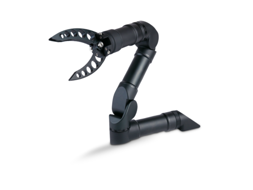
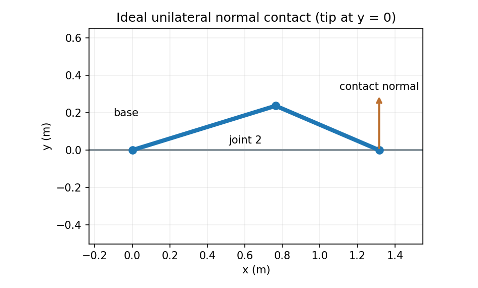

# 接触与约束动力学：机器人遇到环境以后

> **本章解决的问题：** 机械臂碰到桌面后，为什么自由运动方程不再足够？碰撞前后速度为何会突然改变？接触力、摩擦力及抓取力如何确定

**先修：** M03 速度雅可比、M05 静力学、M06 刚体动力学；**本章重点：** 刚性约束、单边接触与最小的冲量模型；软组织接触、有限元或复杂求解器属于进阶专题


## 1. 从空中运动到碰到桌子

没有接触时，电机力矩和重力决定关节加速度；碰到桌面后，桌面会产生反作用力，阻止末端穿透；接触过程至少涉及三种不同的量

- **间隙（gap）**：两个物体是否已经碰到，单位 m
- **接触力（force）**：持续接触时的约束反力，单位 N
- **碰撞冲量（impulse）**：极短时间内速度突变所对应的冲量，单位 N·s

将力、冲量和位置约束全部写成一种“接触力矩”会掩盖物理层级差异；下面先讨论约束已经成立且接触持续的情况，再讨论碰撞事件

<figure class="concept-diagram web-source-figure" data-asset="rov">
  
  <figcaption>夹爪接触物体后，允许的运动方向会受到接触面限制；照片只展示应用对象，法向、摩擦锥和约束雅可比仍需按实际接触几何建立 · 来源：<a href="https://commons.wikimedia.org/wiki/File:Robotic_ROV_Manipulator_Arm.png" target="_blank" rel="noopener noreferrer">BPLINFO</a> · <a href="https://creativecommons.org/licenses/by-sa/4.0" target="_blank" rel="noopener noreferrer">CC BY-SA 4.0</a></figcaption>
</figure>

## 2. 核心：双边约束的微分与动力学

对理想完整约束（holonomic constraint），设

$$
\boldsymbol\phi(\mathbf q)=\mathbf0,
\qquad \mathbf J_c(\mathbf q)=\frac{\partial\boldsymbol\phi}{\partial\mathbf q}
\in\mathbb R^{k\times n}
$$

沿运动轨迹求导

$$
\mathbf J_c\dot{\mathbf q}=\mathbf0,\qquad
\boxed{\mathbf J_c\ddot{\mathbf q}+\dot{\mathbf J}_c\dot{\mathbf q}=\mathbf0}
$$

若 $\boldsymbol\lambda\in\mathbb R^k$ 为按照约束梯度正方向定义的乘子，动态平衡为

$$
\mathbf M\ddot{\mathbf q}+\mathbf h(\mathbf q,\dot{\mathbf q})
=\boldsymbol\tau+\mathbf J_c^T\boldsymbol\lambda
$$

这里 $\mathbf h=\mathbf C\dot{\mathbf q}+\mathbf g+\boldsymbol\tau_f$；先暂时不另计其他外力；与约束加速度方程联立成鞍点系统

$$
\boxed{\begin{bmatrix}\mathbf M&-\mathbf J_c^T\\
\mathbf J_c&\mathbf0\end{bmatrix}
\begin{bmatrix}\ddot{\mathbf q}\\\boldsymbol\lambda\end{bmatrix}
=\begin{bmatrix}\boldsymbol\tau-\mathbf h\\
-\dot{\mathbf J}_c\dot{\mathbf q}\end{bmatrix}}
$$

这一线性系统的唯一性需要约束雅可比行满秩等条件；冗余约束或奇异构型可能导致乘子不唯一；实际求解器常用分解、冗余约束处理和正则化，不应盲目直接求逆

### 2.1 一个具体例子：二维末端位于水平桌面

M06 的二维 2R 末端位置为 $\mathbf p=[x,y]^T$；令桌面为 $y=0$，且假定末端在桌面上保持无穿透、不发生脱离，则

$$
\phi(\mathbf q)=y(\mathbf q),\qquad
\mathbf J_c=\frac{\partial y}{\partial\mathbf q}=\big[\mathbf J_p\big]_{y,:}
$$



保持接触时，$\mathbf J_c\dot{\mathbf q}=0$，并要求 $\mathbf J_c\ddot{\mathbf q}+\dot{\mathbf J}_c\dot{\mathbf q}=0$；桌面对末端施加的法向力 $\lambda$ 沿 $+y$，经雅可比转成 $\mathbf J_c^T\lambda$

注意上述方程以“持续接触”为前提，它可能在计算中给出 $\lambda<0$，这相当于桌面需要**拉住**机械臂；普通桌面做不到吸附，必须切换到脱离模式，不能仍把负值当成合法接触力

## 3. 核心：单边接触为什么要互补条件

对于只推不拉的刚性桌面，非穿透间隙 $\phi\ge0$、法向反力 $\lambda_n\ge0$，还需

$$
\boxed{\phi(\mathbf q)\ge0,\quad \lambda_n\ge0,\quad
\phi(\mathbf q)\lambda_n=0}
$$

解释为

- 尚未接触（$\phi>0$）时，桌面不能隔空施力，所以 $\lambda_n=0$
- 接触闭合（$\phi=0$）时，法向力可以非零，但不能为负

在接触边界上，还需要选择正确的速度/加速度层级约束，处理即将碰撞、持续接触和正在分离这三种不同模式；只写上面的间隙互补条件**并不足以唯一描述高速碰撞**

### 3.1 消元可以看出“等效法向惯量”

若忽略接触外的其他力，令 $\mathbf a_0=\mathbf M^{-1}(\boldsymbol\tau-\mathbf h)$ 为自由加速度，则

$$
\ddot{\mathbf q}=\mathbf a_0+\mathbf M^{-1}\mathbf J_c^T\lambda
$$

代入保持接触条件（单个法向约束）

$$
(\mathbf J_c\mathbf M^{-1}\mathbf J_c^T)\lambda
=-\mathbf J_c\mathbf a_0-\dot{\mathbf J}_c\dot{\mathbf q}
$$

若 $\mathbf J_c\neq0$、$\mathbf M\succ0$，系数为正；其倒数可以解释为沿法向的**接触等效惯量**；接触方向改变、机器人构型改变，接触力也可能显著变化

## 4. 摩擦：法向力并不是接触作用的全部

库仑摩擦的基本锥约束可写为

$$
\|\mathbf f_t\|_2\le\mu f_n,\qquad f_n\ge0
$$

其中 $\mathbf f_t$ 为切向力，$f_n$ 为法向力，$\mu$ 为无量纲静摩擦系数（实际静摩擦与动摩擦系数可以不同）

- **粘着（stick）**：接触点切向相对速度为零，切向力在摩擦锥内部调整
- **滑动（slip）**：通常采用沿相对切向速度反方向的摩擦模型；库仑摩擦在零速处是多值关系
- **滚动**：可能存在非完整约束与滚动阻力，不能简单等同于“没有摩擦”

摩擦系数不应被当作与速度、温度、表面状况无关的绝对常数；对真实末端夹爪，软接触、接触面积与粘附需要额外模型

## 5. 进阶：碰撞冲量与恢复系数

设碰撞前法向相对速度为 $v_n^-<0$，碰撞后为 $v_n^+$；刚性、单接触、法向无摩擦冲击的简化模型采用恢复系数 $e\in[0,1]$

$$
v_n^+=-e\,v_n^-
$$

冲量 $\Lambda\ge0$ 使广义速度发生跳变

$$
\dot{\mathbf q}^+=\dot{\mathbf q}^-
+\mathbf M^{-1}\mathbf J_n^T\Lambda
$$

当 $\mathbf J_n$ 是一行、有效法向质量有限并忽略接触点其他耦合、摩擦及外部冲量时，得到

$$
\boxed{\Lambda=-\frac{(1+e)v_n^-}{\mathbf J_n\mathbf M^{-1}\mathbf J_n^T}}
$$

这不是持续接触力：单位是 N·s，不应直接把它放进 $\mathbf M\ddot q$ 的力项；用测量的冲击峰值力乘一个随意的时间就得到“精确冲量”也不可靠，因为接触时间和采样带宽影响很大

实际多点冲击需要处理多个接触之间的耦合、先后顺序、摩擦和非光滑动力学，简单恢复系数模型不保证复杂系统的真实碰撞行为

## 6. 抓取静力：为什么“夹住”不等于“抓稳”

若有多个接触，设所有接触力组成 $\mathbf f_c$，抓取映射为 $\mathbf G$，它将所有接触力转换为物体受到的合 wrench

$$
\mathbf w_{\mathrm{obj}}=\mathbf G\mathbf f_c+\mathbf w_{\mathrm{gravity}}+\mathbf w_{\mathrm{other}}
$$

静止抓取要求 $\mathbf w_{\mathrm{obj}}=0$，且每个接触力满足相应的摩擦锥、法向非负和执行器能力约束；力闭合（force closure）的条件涉及允许的接触模型与能够抵抗的扰动 wrench 集合；不能只因为两个接触点的位置在物体两侧就宣称形成力闭合

同样一个物体外力平衡可能对应多种内部夹持力分配；超过静摩擦限时会滑落；完整抓取设计还需考虑抓取构型、接触位置误差、软指接触转矩和末端机构的顺应性

## 7. 进阶：数值求解中的三类陷阱

1. **只解加速度约束，却不校正位置漂移**：离散积分会逐渐让 $\phi(\mathbf q)$ 偏离零，需要投影、稳定化或一致积分等方法
2. **把互补条件当作光滑普通方程**：接触模式切换处是非光滑的，应使用适合该问题的求解策略
3. **把接触点 jacobian 当作固定不变**：接触位置和物体姿态变化使 $\mathbf J_c$、$\dot{\mathbf J}_c$ 变化，遗漏后者会造成约束加速度误差

## 8. 实践：最小的单法向接触与冲量实验

运行

```bash
python labs/python/dynamics/main.py --check
```

实验先选择一个末端**精确落在 $y=0$、且关节速度为零**的平面 2R 构型，计算无驱动情况下桌面的约束法向反力，检查

- 接触后法向加速度为零
- 动力学方程和计算得到的法向反力一致
- 法向反力非负（若为负，当前持续接触假设即不成立）
- 单次法向冲量使恢复系数关系成立

这一实验使用**无切向摩擦、理想刚体、单法向接触**假设；它不是通用摩擦锥求解器，也没有实现多点抓取、软体接触或真实碰撞验证

### 本章自测

1. 写出双边位置约束的速度、加速度条件，解释为什么 $\dot{\mathbf J}_c\dot{\mathbf q}$ 不能忽略
2. 如果计算出桌面对机械臂的法向反力为 $-3\ \mathrm N$，应如何理解并处理
3. 说明碰撞前后关节速度突变与持续作用的接触力有何区别

**参考：** Lynch & Park, *Modern Robotics*, Ch. 12；Stewart & Trinkle, *An Implicit Time-Stepping Scheme for Rigid Body Dynamics with Inelastic Collisions and Coulomb Friction*, 1996；Siciliano & Khatib (eds.), *Springer Handbook of Robotics*, 2nd ed.；Featherstone, *Rigid Body Dynamics Algorithms*, 2008