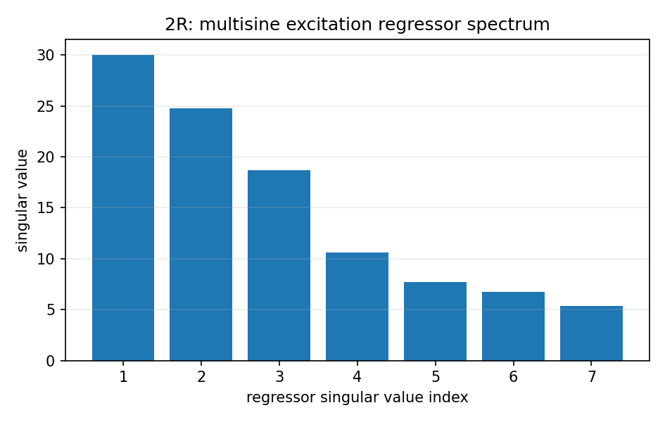

# 机器人标定与动力学参数辨识：什么能从数据中恢复

> **本章解决的问题：** 为什么知道一条机械臂的关节位置和电机力矩，仍然不一定能分别求出每个连杆的质量与质心？如何设计激励轨迹，识别真正影响控制的动力学参数

**先修：** F04 最小二乘、M02 正运动学、M06 刚体动力学；**本章核心是可辨识性**，而不是把某个最小二乘求解器包装成万能标定算法

## 1. 先区分三种标定问题

| 任务 | 测量/输入 | 期望输出 | 最大风险 |
|---|---|---|---|
| 几何标定 | 关节角与外部测量的位姿 | 零位、连杆几何、工具/基座变换 | 参数耦合、坐标基准不明确 |
| 动力学辨识 | $q,\dot q,\ddot q,\tau$ 及已知负载等 | 惯性和摩擦的**可辨识组合** | 激励不足、力矩与摩擦模型偏差 |
| 传感器标定 | 观测与参考量 | 内参、外参、时间偏差、偏置 | 时延与坐标系混淆 |

这三种问题可以联合估计，但**几何误差被动力学参数“吸收”**往往不是你想要的正确结果；即使终端误差变小，也不能证明估出的各个参数就是物理真值

## 2. 核心：几何参数标定是非线性最小二乘

机器人末端位姿由 $\mathbf T(\mathbf q;\boldsymbol\beta)$ 描述，其中 $\boldsymbol\beta$ 包括运动学几何参数、关节零位或工具坐标变换；给定外部测量 $\mathbf T_k^{\mathrm{meas}}$，可构造局部的李代数残差

$$
\mathbf r_k(\boldsymbol\beta)=\operatorname{Log}\!\left(\mathbf T(\mathbf q_k;\boldsymbol\beta)^{-1}\mathbf T_k^{\mathrm{meas}}\right)^{\vee}
$$

带权最小二乘可以写为

$$
\min_{\boldsymbol\beta}\sum_k\mathbf r_k^T\mathbf W_k\mathbf r_k
$$

如果把平移残差（米）与旋转残差（弧度）直接放在一个无权范数中，隐含了未说明的尺度选择；$\mathbf W_k$ 可以来自测量协方差或明确的设计权重，但不能随意称为“统计最优”

局部线性化得到 $\mathbf r(\boldsymbol\beta+\Delta\boldsymbol\beta)\approx\mathbf r+\mathbf H\Delta\boldsymbol\beta$；可通过奇异值、秩或 Fisher 信息检查局部辨识能力；若同时允许基座、工具及机械臂所有零位自由变化，可能存在无法由数据区分的坐标规范自由度（gauge freedom），需要固定参考定义

## 3. 动力学具有“对惯性参数线性”的重要性质

虽然动力学对 $\mathbf q,\dot{\mathbf q}$ 是非线性的，但给定运动量时，对适当排列的刚体惯性参数可写成线性回归

$$
\boxed{\boldsymbol\tau_k=\mathbf Y(\mathbf q_k,\dot{\mathbf q}_k,\ddot{\mathbf q}_k)\boldsymbol\pi+\boldsymbol\epsilon_k}
$$

其中 $\mathbf Y$ 是回归矩阵；$\boldsymbol\pi$ 是一个待估参数向量，常用**质量、第一质量矩与关于连杆坐标原点的惯性分量**，因为这些量便于线性化；$\boldsymbol\epsilon$ 表示噪声、摩擦模型误差和未建模项

并非所有 $\boldsymbol\pi$ 的分量都可以独立识别；取足够多样本堆叠

$$
\underbrace{\begin{bmatrix}\boldsymbol\tau_1\\\vdots\\\boldsymbol\tau_N\end{bmatrix}}_{\mathbf y}
=\underbrace{\begin{bmatrix}\mathbf Y_1\\\vdots\\\mathbf Y_N\end{bmatrix}}_{\mathbf W}\boldsymbol\pi+\boldsymbol\epsilon
$$

若 $\mathbf W$ 列不满秩，存在非零 $\mathbf z$ 使 $\mathbf W\mathbf z=0$，则 $\boldsymbol\pi$ 与 $\boldsymbol\pi+\mathbf z$ 生成相同预测力矩；**真实数据再精确也不能恢复原本就不可辨识的方向**

这里必须区分

- **结构不可辨识**：由机械臂构型和参数化决定，任何合格实验都难以分离某些参数
- **实验激励不足**：理论上有希望辨识，但当前轨迹让回归矩阵缺乏足够秩或条件数很差
- **实际数据噪声/模型偏差**：即便列满秩，估计仍可能不准确

## 4. 核心示例：2R 只能识别哪些复合参数

沿用 M06 的竖直平面 2R，已知几何长度 $L_1,L_2$，并采用每个关节一个粘性摩擦系数 $b_1,b_2$ 的简化模型

定义七个**复合参数**

$$
\boldsymbol\theta=[a,b,d,e,f,b_1,b_2]^T
$$

其中（$I_i$ 为质心面外惯量）

$$
\begin{aligned}
a&=I_1+I_2+m_1c_1^2+m_2(L_1^2+c_2^2),\\
b&=m_2L_1c_2,\\
d&=I_2+m_2c_2^2,\\
e&=(m_1c_1+m_2L_1)g,\\
f&=m_2c_2g
\end{aligned}
$$

令 $c=\cos q_2$、$s=\sin q_2$、$\dot q_i=v_i$、$\ddot q_i=\alpha_i$，无外部接触力时，逆动力学可写成

$$
\boldsymbol\tau=\underbrace{\begin{bmatrix}
\alpha_1&c(2\alpha_1+\alpha_2)-s(2v_1v_2+v_2^2)&\alpha_2&\cos q_1&\cos(q_1+q_2)&v_1&0\\
0&c\alpha_1+sv_1^2&\alpha_1+\alpha_2&0&\cos(q_1+q_2)&0&v_2
\end{bmatrix}}_{\mathbf Y(\mathbf q,\dot{\mathbf q},\ddot{\mathbf q})}\boldsymbol\theta
$$

你可以将它和 M06 的 $\mathbf M\ddot{\mathbf q}+\mathbf c+\mathbf g+\mathbf B\dot{\mathbf q}$ 逐项展开，验证完全一致

**重要：七个数并不等于七个可以直接称量出来的独立物理参数；** 本例中 $b=m_2L_1c_2$ 与 $f=m_2c_2g$ 甚至在已知 $L_1,g$ 时具有关系 $f=bg/L_1$；因此，对这个理想平面模型，$\mathbf Y$ 的第 2 列与第 5 列虽在某些轨迹上能给出不同的时间变化，**物理上允许的参数集合仍受到约束**；一个无约束的线性最小二乘可能返回不满足这种关系的复合参数

这就是“数值上的独立回归列”与“实际刚体参数物理可实现性”之间的区别

## 5. 如何设计激励轨迹

只有在不同关节位置、速度与加速度下充分运动，惯性项、速度项与重力项才可能表现出不同特征

1. 设计满足关节位置、速度、加速度、力矩、安全及碰撞约束的轨迹
2. 若采用力矩回归，必须明确驱动器给出的是**可靠的实际关节力矩**还是期望/电流换算值
3. 对数据记录统一时间轴，检查传感器与驱动延迟
4. 使用与同一轨迹一致的速度、加速度估计方法，避免噪声放大
5. 训练轨迹和**独立评估轨迹**分开，不仅报告训练残差

本项目的 `labs/python/dynamics/main.py` 用带解析导数的多正弦轨迹生成 $q,\dot q,\ddot q$，以明确可控的合成力矩噪声测试最小二乘；它对比了**多频激励**与**所有关节静止**时的回归矩阵秩，后者无法识别惯性和粘性摩擦项

## 6. 进阶：最小二乘、正则化和可信参数约束

若 $\mathbf W$ 满列秩，普通最小二乘解为

$$
\hat{\boldsymbol\theta}=\arg\min_{\boldsymbol\theta}\|\mathbf W\boldsymbol\theta-\mathbf y\|_2^2
$$

数值实现宜采用 QR 或 SVD，而不是显式求 $\mathbf W^T\mathbf W$ 的逆；若采用岭回归

$$
\min_{\boldsymbol\theta}\|\mathbf W\boldsymbol\theta-\mathbf y\|_2^2
+\lambda^2\|\mathbf L(\boldsymbol\theta-\boldsymbol\theta_0)\|_2^2
$$

其中 $\boldsymbol\theta_0$ 是先验参数，$\mathbf L$ 反映需要保护/约束的方向，必须说明各项尺度与 $\lambda$ 的选择；正则化可以减少方差，却不会凭空创造不存在的物理信息

### 6.1 保留已有可信参数，做局部辨识

将参数划分为固定可信部分 $\boldsymbol\theta_F$ 与待辨识部分 $\boldsymbol\theta_U$

$$
\mathbf y=\mathbf W_F\boldsymbol\theta_F+\mathbf W_U\boldsymbol\theta_U+\boldsymbol\epsilon
$$

于是

$$
\boxed{\hat{\boldsymbol\theta}_U=\arg\min_{\boldsymbol\theta_U}
\|\mathbf W_U\boldsymbol\theta_U-(\mathbf y-\mathbf W_F\boldsymbol\theta_F)\|_2^2}
$$

仅在 $\mathbf W_U$ 对**所选自由参数**有足够秩、固定参数正确且模型一致时，局部辨识才有可靠解释；如果某些待辨识组合与固定参数在动力学上耦合，机械地对 URDF 每个字段勾选“冻结/可估”并不一定符合实际可辨识空间

### 6.2 物理一致性不等于 $\mathbf M(q)$ 在几个采样点正定

单个刚体至少需 $m>0$；质心与惯性张量必须对应同一个物理刚体，质心惯性矩阵应满足适当的正定/半正定约束和主惯量三角不等式，并与参考点变换一致

- 某几组构型下 $\mathbf M(q)$ 正定，是系统层面的**必要数值合理性检查**之一
- 并不能据此证明每个连杆质量、质心与惯性张量物理真实
- 对完整三维惯性参数，需用与空间惯性一致的约束参数化/优化，参考经典惯性参数可行性研究

重力-only 的短时离线辨识通常更适合改进**重力预测模型的有效组合参数**，不能无条件把所有回归参数解释成每个连杆的真实质量与质心

## 7. 进阶：不拆机械臂快速校正重力模型的边界

将关节保持在一系列静止姿态，理想条件下 $\dot q=\ddot q=0$，动力学减少为

$$
\boldsymbol\tau_{\mathrm{hold}}\approx\mathbf g(\mathbf q)+\boldsymbol\tau_{\mathrm{static}\ friction}\ -\mathbf J^T\mathbf F_{\mathrm{ext}}
$$

若无接触、力矩读数可靠且静摩擦偏差能够界定，可以辨识对当前关节保持力矩有影响的重力组合参数；但实际伺服输出可能包含积分控制、齿槽效应、背隙与温度相关偏差，因此需要重复测量、方向对照与独立姿态验证

**不能从“重力补偿力矩预测更准”直接推出“每个连杆的质量与质心辨识更准”；** 如果没有外部称量或独立物理真值，论文或报告应将结论限制在重力项预测误差及工程控制表现

## 8. 实践：可复现的合成参数辨识实验

```bash
python labs/python/dynamics/main.py --check
```

实验固定随机种子与多正弦轨迹，按 M06 模型生成无接触力矩，向训练力矩加入已知标准差的高斯噪声；利用 `np.linalg.lstsq` 拟合七个复合参数，在**不同时间段**的测试轨迹上评估无噪声预测误差，同时报告 $\mathbf W$ 的秩与条件数



结果保存到 `labs/python/dynamics/results/metrics.json`，包括：真实参数、拟合参数、独立测试 RMSE、激励条件数，以及静止数据秩；**这是理想化合成实验**，不能据此评价真实机械臂的辨识精度；且测试虽按时间切分，仍使用同一多频轨迹分布，不等于跨任务泛化实验

### 本章自测

1. 为什么固定姿态零速实验通常无法辨识关节惯性矩阵
2. 若 $\mathbf W$ 列不满秩，为什么增加完全相同姿态的采样次数无法恢复缺失参数
3. 对“自动保护可信参数并局部辨识”，列出至少三个必须核查的技术条件
4. 举例说明“力矩预测误差下降”和“连杆真实质心更准确”并非同一结论

**参考：** Gautier, *Numerical Calculations of the Base Inertial Parameters of Robots*, J. Robotic Systems, 1991；Featherstone, *Rigid Body Dynamics Algorithms*, 2008；Traversaro et al., *Identification of Fully Physical Consistent Inertial Parameters using Optimization on Manifolds*, IROS 2016；Lynch & Park, *Modern Robotics*, Ch. 8
