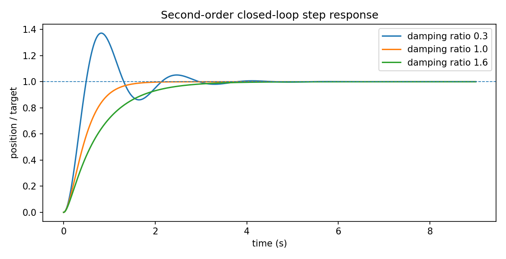

# 反馈控制与稳定性：误差为什么会消失

> **问题：** 指令为“到达 30°”时，为什么只发送一次电机命令不能保证关节到达？反馈能纠正误差，但为什么增大增益又可能振荡

**先修：** F02（矩阵/特征值）、F03（微分方程）；**学习层次：** 核心（闭环和误差动力学）→ 进阶（Lyapunov 与离散稳定）→ 实践（阶跃响应数值实验）

## 1. 先看物理闭环

设 $r(t)$ 为期望关节角，$y(t)$ 为实际关节角，测得 $y_m=y+n$；采用全书约定 $e=r-y_m$，控制器根据误差产生输入 $u$，执行器与机械系统把 $u$ 变成运动，传感器再将运动送回控制器

**开环**只按照预测施加输入，模型误差、负载变化和摩擦可能积累位置偏差；**闭环**用测量误差实时修正，但传感器噪声和延迟也会进入闭环；*反馈不是“永远更稳定”*，设计不当会使系统失稳

## 2. 核心：一阶与二阶误差动力学

最简单的一阶对象为 $\dot y=u$；采用比例反馈 $u=k_p(r-y)$，对常值目标 $r$ 得

$$
\dot e=-k_pe,\qquad e(t)=e(0)e^{-k_pt},\quad k_p>0
$$

这说明比例增益控制收敛时间尺度约为 $1/k_p$；只对**该理想积分对象**成立；加入输入饱和、延迟、外扰后不能直接套用

若对象为受力驱动的惯性系统 $m\ddot y+b\dot y=u$，采用 $u=k_p(r-y)-k_d\dot y$，对常值目标有

$$
m\ddot e+(b+k_d)\dot e+k_pe=0
$$

与标准二阶形式比较

$$
\omega_n=\sqrt{k_p/m},\qquad \zeta=\frac{b+k_d}{2\sqrt{mk_p}}
$$

$\omega_n$ 控制快慢尺度，$\zeta$ 影响超调与振荡；$\zeta<1$ 通常欠阻尼，$\zeta=1$ 临界阻尼，$\zeta>1$ 过阻尼；这并不意味着不同负载和采样条件下调同一个 $k_d$ 就会得到同样的响应

### 2.1 状态空间把多变量系统写清楚

线性时不变系统

$$
\dot{\mathbf x}=\mathbf A\mathbf x+\mathbf B\mathbf u,\qquad \mathbf y=\mathbf C\mathbf x+\mathbf D\mathbf u
$$

对状态反馈 $\mathbf u=-\mathbf K\mathbf x$，闭环为 $\dot{\mathbf x}=(\mathbf A-\mathbf B\mathbf K)\mathbf x$；连续时间局部指数稳定的线性判据是闭环矩阵所有特征值实部严格小于零；仅仅要求“输出曲线看着平滑”不是稳定性证明

## 3. 进阶：Lyapunov 不等于“写个正定二次型”

选取候选函数 $V(\mathbf x)$，若 $V(0)=0$ 且局部正定，$\dot V\le0$ 通常给出相应条件下的 Lyapunov 稳定结论；若要证明**渐近稳定**，还需要如 $\dot V<0$ 的严格负定条件，或结合 LaSalle 不变原理检查最大不变集；全局结论还要求适当的径向无界性等条件

对前述二阶误差，令 $m>0,k_p>0,b+k_d>0$，取

$$
V(e,\dot e)=\tfrac12k_pe^2+\tfrac12m\dot e^2,
\quad \dot V=-(b+k_d)\dot e^2\le0
$$

等号发生在 $\dot e=0$，此时若 $e\ne0$，根据动力学 $m\ddot e=-k_pe\ne0$，无法停留在该集合，因此无其他平衡不变集；可由 LaSalle 得到原点渐近稳定；*不能仅凭 $\dot V\le0$ 那一行就宣布渐近稳定*

### 3.1 离散时间没有“积分器无限快”的许可

对理想 $\dot y=k(r-y)$ 采用前向 Euler 更新

$$
e_{k+1}=(1-kT_s)e_k
$$

该离散实现渐近稳定要求 $|1-kT_s|<1$，即 $0<kT_s<2$；随着采样周期 $T_s$ 增大，原来在连续域稳定的反馈可以在离散实现中出现震荡甚至发散；真实数字控制还需处理量化、通信时延、零阶保持、计算时间与执行器动态

## 4. 直观反例：快不总比稳好

若 $k_p$ 很大而阻尼不足，系统会更快到达目标附近，也可能明显超调；若传感器噪声变大，增大微分增益还可能放大高频控制指令；位置限幅和力矩限幅必须单独处理，不是稳定性证明的自然结果

## 5. 实践：独立验证阶跃与离散极点

运行 `python labs/python/control/main.py --check`，检查理想二阶系统闭环稳定，并生成不同阻尼比的阶跃响应图；实验采用已知参数的数值模型，不代表真实电机闭环带宽

### 自测

1. 从 $m\ddot y+b\dot y=u$ 推导常值目标的 PD 误差方程，并计算 $\zeta$
2. 说明 $\dot V\le0$ 与渐近稳定之间还差什么论证
3. 为什么将 $T_s$ 从 $1$ ms 增大到 $100$ ms 不能忽略离散稳定性

**资料：** [Modern Robotics, Ch. 11](https://modernrobotics.northwestern.edu/nu-gm-book-resource/)；[MIT Underactuated Robotics, Lyapunov Analysis](https://underactuated.mit.edu/lyapunov.html)；Khalil, *Nonlinear Systems*, 3rd ed.，Ch. 4
