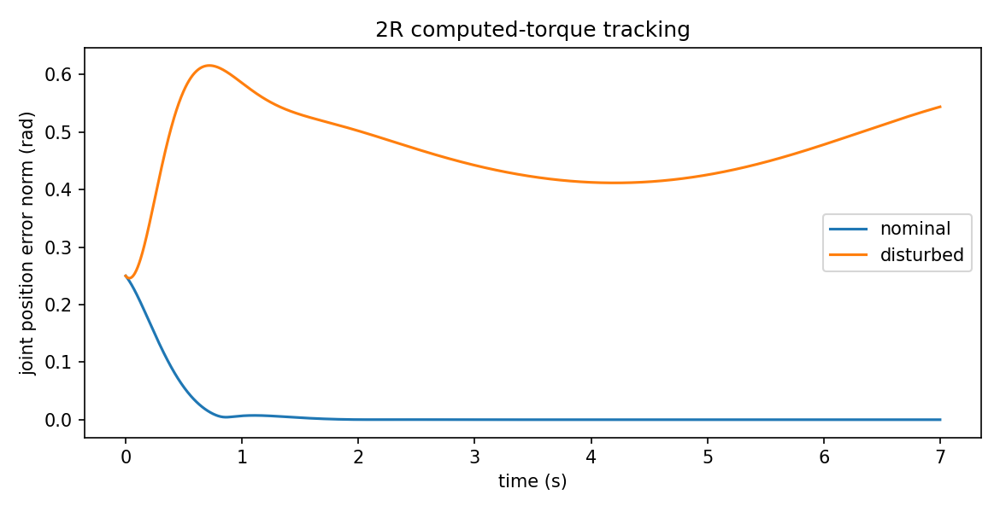

# 非线性动力学控制：怎样利用机器人的质量矩阵

> **问题：** 机械臂姿态改变后，仅用固定 PID 为什么有时跟踪变差？如果重力、惯性和速度耦合已知，能否在反馈之前主动补偿

**先修：** M06、C01；**路线：** 关节重力补偿 → 计算力矩 → 跟踪稳定性 → 模型失配和安全边界

## 1. 明确对象、模型及误差

在无外部接触的固定基刚体机械臂，先忽略或已显式补偿摩擦，考虑

$$
\mathbf M(\mathbf q)\ddot{\mathbf q}+\mathbf h(\mathbf q,\dot{\mathbf q})+\mathbf g(\mathbf q)=\boldsymbol\tau
$$

其中 $\mathbf h=\mathbf C\dot{\mathbf q}$，且 $\mathbf M$ 正定；希望跟踪二次可微的参考 $\mathbf q_d(t)$；统一误差 $\mathbf e=\mathbf q_d-\mathbf q$，$\dot{\mathbf e}=\dot{\mathbf q}_d-\dot{\mathbf q}$

## 2. 计算力矩控制为何能变成线性误差方程

在动力学模型**完全正确、力矩指令准确执行**时，构造

$$
\boldsymbol\tau=\mathbf M(\mathbf q)\left(\ddot{\mathbf q}_d+\mathbf K_d\dot{\mathbf e}+\mathbf K_p\mathbf e\right)+\mathbf h(\mathbf q,\dot{\mathbf q})+\mathbf g(\mathbf q)
$$

代入真实动力学，得

$$
\ddot{\mathbf e}+\mathbf K_d\dot{\mathbf e}+\mathbf K_p\mathbf e=\mathbf0
$$

若 $\mathbf K_p,\mathbf K_d$ 为正的对角增益，关节误差按独立二阶方程衰减；常用 $\mathbf K_p=\operatorname{diag}(\omega_{n,i}^2)$、$\mathbf K_d=\operatorname{diag}(2\zeta_i\omega_{n,i})$；这里增益在*计算加速度*的括号内部，量纲为 $\mathrm{s}^{-2}$、$\mathrm{s}^{-1}$，不要直接当作 N·m/rad 的扭矩刚度

**注意：** 此为逆动力学反馈线性化，并非说机械臂在现实中不再有模型误差、饱和或接触

## 3. 进阶：严格证明和它的边界

设 $\mathbf K_p,\mathbf K_d$ 对称正定且为对角常数（更一般情况需要额外条件），取

$$
V=\tfrac12\dot{\mathbf e}^T\dot{\mathbf e}+\tfrac12\mathbf e^T\mathbf K_p\mathbf e,
\qquad \dot V=-\dot{\mathbf e}^T\mathbf K_d\dot{\mathbf e}\le0
$$

可由闭环线性系统的 Hurwitz 性直接得到指数稳定；或进一步用 LaSalle 证明渐近稳定，不能只凭半负定一行推断；证明假设参考、模型、状态反馈足够光滑且控制未饱和

### 3.1 用估计模型时到底剩下什么

若控制中采用 $\hat{\mathbf M},\hat{\mathbf h},\hat{\mathbf g}$，则实际误差满足

$$
\ddot{\mathbf e}+\mathbf K_d\dot{\mathbf e}+\mathbf K_p\mathbf e=\mathbf M^{-1}\!\left[\left(\mathbf M-\hat{\mathbf M}\right)\mathbf a+\left(\mathbf h-\hat{\mathbf h}\right)+\left(\mathbf g-\hat{\mathbf g}\right)\right]
$$

其中 $\mathbf a=\ddot{\mathbf q}_d+\mathbf K_d\dot{\mathbf e}+\mathbf K_p\mathbf e$；右侧是模型误差引入的扰动（严格等号成立于上述同一动力学约定）；**更精确的质量与质心不一定意味着所有工况跟踪自动变好**，仍要看未建模摩擦、外力、驱动带宽和控制律敏感性

### 3.2 仅做重力补偿更适合什么

对低速度或静态保持，可用 $\boldsymbol\tau=\hat{\mathbf g}(\mathbf q)+\mathbf K_p\mathbf e+\mathbf K_d\dot{\mathbf e}$；这并不等价于完整计算力矩控制：它补偿估计重力，仍保留实际惯性和速度耦合；模型只需重力预测较准时，常比错误地叠加不可信惯性前馈更稳健

## 4. 反例：接触力和力矩接口不能忽略

若环境施加外力 $\mathbf F_{\mathrm{ext}}$，真实方程右侧还有 $\mathbf J^T\mathbf F_{\mathrm{ext}}$；高带宽位置跟踪可能通过大力矩对抗接触环境，从而使接触力上升；此时需要 C05 的力控、阻抗/导纳或明确的任务约束，而不应继续无限增大位置环增益

实际关节若只有位置指令接口，则没有直接实施理想逆动力学扭矩的能力；所谓“计算力矩控制”只能在**有足够透明且可靠的力矩执行层**时按原式解释

## 5. 实践：2R 跟踪可复现测试

`python labs/python/control/main.py --check` 对配套的 2R 动力学模型使用小步长积分，检查完全模型条件下跟踪误差下降、系统无外扰时静止保持重力项的正确抵消；再引入确定的力矩扰动，观察模型失配导致的残余跟踪误差；**这是模型验证，不是真机控制器验证**

### 自测

1. 控制律中为什么 $\ddot{\mathbf q}_d$ 不应省略
2. 解释 $\mathbf K_d$ 与物理关节粘性阻尼的量纲差异
3. 写出加入 $\mathbf J^T\mathbf F_{\mathrm{ext}}$ 后的误差动力学，并说明对接触力会发生什么

**资料：** [Modern Robotics Ch. 11](https://modernrobotics.northwestern.edu/nu-gm-book-resource/)；Spong et al., *Robot Modeling and Control*；Slotine & Li, *Applied Nonlinear Control*
