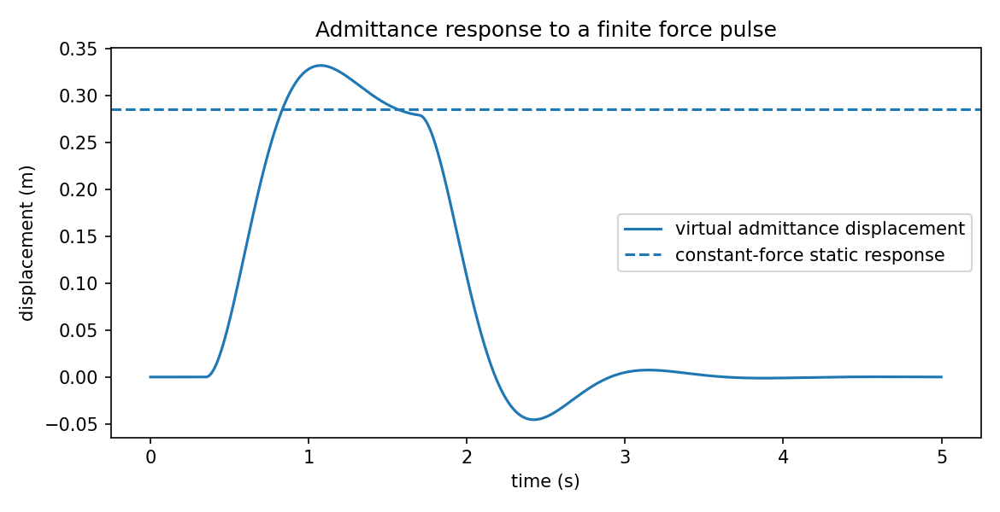

# 力控制与柔顺控制：让机器人既能运动，也能接触

> **问题：** 为什么同一条高精度位置轨迹，在空中运行很平稳，碰上树枝或硬桌面时却可能施加危险的接触力？如何定义“推一下会让步”的机器人行为

**先修：** M05、M06、M07、C04；**层次：** 物理阻抗直觉 → 混合力位与阻抗/导纳 → 被动性和工程实现

## 1. 三种目标不是同一回事

**位置控制**关注 $\mathbf x\to\mathbf x_d$；**力控制**关注接触方向的 $\mathbf f\to\mathbf f_d$；**阻抗控制**关注外力与运动偏差之间指定的*动态关系*；机器人被推动时是否移动，取决于所选控制对象、执行器及环境交互，而不是算法名字

设环境施加给机器人末端的外力为 $\mathbf f_{\mathrm{ext}}$（向右为正），期望位置固定 $\mathbf x_d$；定义偏差 $\boldsymbol\delta=\mathbf x-\mathbf x_d$，则典型期望阻抗关系

$$
\boxed{\mathbf M_{\mathrm{imp}}\ddot{\boldsymbol\delta}+\mathbf D_{\mathrm{imp}}\dot{\boldsymbol\delta}+\mathbf K_{\mathrm{imp}}\boldsymbol\delta=\mathbf f_{\mathrm{ext}}}
$$

$\mathbf M_{\mathrm{imp}},\mathbf D_{\mathrm{imp}},\mathbf K_{\mathrm{imp}}$ 分别是**期望任务空间**惯量、阻尼和刚度，不是机器人实际惯性矩阵 $\mathbf M(\mathbf q)$；单自由度单位分别为 kg、N·s/m、N/m；$\mathbf K_{\mathrm{imp}}$ 在这里表示期望刚度，**不同于 C03 中表示加速度反馈微分增益的 $\mathbf K_d$**；使用独立的阻抗增益记号是为了避免符号混乱

单轴恒力作用、无漂移且最后静止时 $\delta_{\mathrm{ss}}=f_{\mathrm{ext}}/k$：刚度越高，位移越小；自然频率 $\omega_n=\sqrt{k/m}$；阻尼比 $\zeta=d/(2\sqrt{mk})$；矩阵多自由度情况下不能逐元使用该标量结论，除非各轴解耦或已在模态坐标下处理

## 2. 进阶：阻抗和导纳在实现上的区别

**理想阻抗**从运动偏差形成需要施加的力/力矩，通常依赖足够透明的力矩接口或底层力矩闭环；**理想导纳**从测得的外力计算期望位置/速度，再发送给已有的高性能位置控制内环

导纳虚拟模型可写为

$$
\mathbf M_a\ddot{\mathbf z}+\mathbf D_a\dot{\mathbf z}+\mathbf K_a\mathbf z=\mathbf f_{\mathrm{ext}},
\quad \mathbf x_{\mathrm{cmd}}=\mathbf x_d+\mathbf z
$$

**导纳的方程像阻抗，不代表真实机器人已经严格实现该机械阻抗；** 如果下层位置环跟踪不准、延迟大、力传感器漂移、末端的真实柔性/背隙不可忽略，实际交互关系会偏离目标

### 2.1 位置—力混合控制

与刚性约束环境接触时，若已知局部独立的运动与力自由度，可在适合的任务坐标中用选择矩阵 $\mathbf S$ 分配控制通道

$$
\mathbf u=\mathbf S\mathbf u_{\mathrm{motion}}+(\mathbf I-\mathbf S)\mathbf u_{\mathrm{force}}
$$

这是说明思想的结构式，**不能无条件把位姿误差与力矩向量直接相加**；选择矩阵作用的变量必须在相容的单位、坐标及执行层中表达；只有约束方向独立、控制维数匹配时才有清晰解释；接触面法向估计偏差或面摩擦会造成位置与力分配失败

## 3. 接触稳定性与被动性

把期望单轴质量–阻尼–弹簧看作以 $f_{\mathrm{ext}}$ 为输入、$\dot\delta$ 为输出，取储能

$$
H=\tfrac12m\dot\delta^2+\tfrac12k\delta^2,
\qquad \dot H=f_{\mathrm{ext}}\dot\delta-d\dot\delta^2\le f_{\mathrm{ext}}\dot\delta
$$

当 $m>0,k\ge0,d\ge0$，此理想连续时间模型满足输入输出意义下的被动性不等式；真实数字控制中采样、内环滞后、滤波、外力估计和能量注入可能破坏被动性；**“把阻尼调到临界”也不能替代接触稳定性分析**

### 3.1 外力方向是最常见的实现错误

本教材始终把 $\mathbf f_{\mathrm{ext}}$ 定义为环境作用于机器人；若传感器报告的是机器人对环境的反作用力，或末端传感器坐标系方向相反，就必须先进行符号/坐标变换；不同 wrench 参考点的力矩分量还受到力臂影响（M05）

## 4. 现实设计：你真能控制什么

先确认驱动模式：电流/力矩、速度还是位置接口；再确认可测量的外力是否包括末端夹爪质量、重力、加速度伪力与传感器零漂；实时链路还需设置力限幅、速度限幅、位置/关节限位、失联保护，以及不可取消的独立安全停机路径

“关节阻抗 = 任务空间阻抗”一般不成立；关节刚度 $\mathbf K_q$ 对应任务空间局部刚度涉及雅可比、构型与负载等因素；奇异位形和柔性传动时尤需小心

## 5. 实践：推一下的响应

运行 `python labs/python/control/main.py --check`，验证单轴虚拟导纳 $m\ddot z+d\dot z+kz=f(t)$ 的静态位移、稳定性与不同比例阻尼响应

实验刻意只使用理想单轴模型：它不能证明某台机械臂在接触中安全，也不能推断真实三维多轴系统的被动性

### 自测

1. 同样 $k=200$ N/m，受到 $10$ N 恒力时理想稳态偏差是多少
2. 为什么不应该直接把外力测量值叠加到高增益位置指令里称为“力控制”
3. 如果外力来自驱动器残差估计，重力模型有偏差会如何影响拖拽手感

**资料：** Hogan, [*Impedance Control: An Approach to Manipulation, Part I*](https://doi.org/10.1115/1.3140702), 1985；[Modern Robotics Ch. 11](https://modernrobotics.northwestern.edu/nu-gm-book-resource/)（阻抗/导纳算法应同时查教材第 11.7 节，视频目录覆盖不完整）；Siciliano et al., *Robotics: Modelling, Planning and Control*
