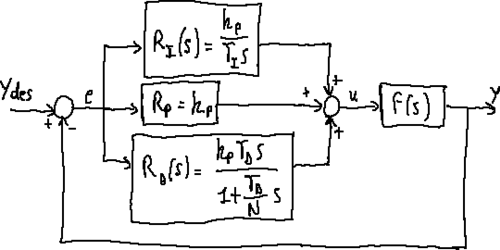

# 鲁棒与自适应控制：模型有误差，还能给出什么保证

> **问题：** 同一个动力学控制器换上重一点的末端夹爪就表现变差，鲁棒控制能否抵御误差？自适应控制能否“边运行边学质量”

**先修：** M06、M08、C01、C03；**学习结构：** 扰动边界 → 鲁棒反馈 → 参数自适应 → 保证条件与实验局限

## 1. 先把未知的量分类

假设真实机器人

$$
\mathbf M(\mathbf q)\ddot{\mathbf q}+\mathbf C(\mathbf q,\dot{\mathbf q})\dot{\mathbf q}+\mathbf g(\mathbf q)=\boldsymbol\tau+\mathbf d
$$

$\mathbf d$ 统称未建模外扰；可区分：有界但未知的力矩扰动、缓慢变化的惯性参数、时延/传感器噪声、不确定输入增益、未观测接触；**不同不确定性类型需要不同理论工具**，一个“鲁棒”标签不能自动涵盖全部

## 2. 经典鲁棒思想：把扰动限制在可接受的界内

对一阶误差 $\dot e=-ke+d$，若 $k>0$ 且 $|d(t)|\le\bar d$，比较原理给出

$$
|e(t)|\le |e(0)|e^{-kt}+\frac{\bar d}{k}(1-e^{-kt})
$$

因此只能保证稳态进入大小不超过 $\bar d/k$ 的界，而非所有外扰下精确零误差；把 $k$ 无限增大在实际驱动器中会受饱和、采样和噪声限制

### 2.1 滑模控制的到达条件

对可设计的标量滑模变量 $s$，若真实简化模型能写为 $\dot s=u+d$，且 $|d|\le\bar d$，选择

$$
u=-k\operatorname{sign}(s),\qquad k>\bar d
$$

在理想连续时间无延迟条件下 $\dot V=s\dot s\le-(k-\bar d)|s|$，其中 $V=\tfrac12s^2$，可证明有限时间到达 $s=0$；但不连续切换可能造成抖振，实际常使用边界层 $\operatorname{sat}(s/\phi)$，代价是严格精确到达结论改变；物理关节、采样周期及噪声都不能被省略

## 3. 自适应控制：在线调整的往往是动力学组合参数

机械臂动力学常能线性化为 $\mathbf Y(\mathbf q,\dot{\mathbf q},\mathbf v,\mathbf a)\boldsymbol\pi$，其中 $\boldsymbol\pi$ 为未知但可线性表示的惯性参数组合（参见 M08）；采用关节误差 $\mathbf e=\mathbf q_d-\mathbf q$，定义

$$
\dot{\mathbf q}_r=\dot{\mathbf q}_d+\boldsymbol\Lambda\mathbf e,
\qquad \mathbf s=\dot{\mathbf q}-\dot{\mathbf q}_r=-\dot{\mathbf e}-\boldsymbol\Lambda\mathbf e
$$

其中 $\boldsymbol\Lambda\succ0$；一种 Slotine–Li 风格的自适应控制结构为

$$
\boldsymbol\tau=\mathbf Y(\mathbf q,\dot{\mathbf q},\dot{\mathbf q}_r,\ddot{\mathbf q}_r)\hat{\boldsymbol\pi}-\mathbf K_s\mathbf s,
\quad \dot{\hat{\boldsymbol\pi}}=-\boldsymbol\Gamma\mathbf Y^T\mathbf s
$$

这里 $\mathbf K_s,\boldsymbol\Gamma$ 对称正定，$\mathbf Y$ 满足机器人线性参数化恒等式 $\mathbf M\ddot{\mathbf q}_r+\mathbf C\dot{\mathbf q}_r+\mathbf g=\mathbf Y\boldsymbol\pi$；**$\mathbf C$ 的选择须满足 Lyapunov 证明所需结构性质**

令 $\tilde{\boldsymbol\pi}=\hat{\boldsymbol\pi}-\boldsymbol\pi$，理想无外扰模型给出

$$
\mathbf M\dot{\mathbf s}+\mathbf C\mathbf s=\mathbf Y\tilde{\boldsymbol\pi}-\mathbf K_s\mathbf s
$$

选取 $V=\frac12\mathbf s^T\mathbf M\mathbf s+\frac12\tilde{\boldsymbol\pi}^T\boldsymbol\Gamma^{-1}\tilde{\boldsymbol\pi}$，利用 $\dot{\mathbf M}-2\mathbf C$ 斜对称，可得

$$
\dot V=-\mathbf s^T\mathbf K_s\mathbf s\le0
$$

在参考有界且满足必要正则性等条件下，可进一步证明跟踪相关收敛；**不应因此宣称所有参数估计自动收敛到物理真值**：缺少持续激励时，参数可能停在多个能实现同样动力学预测的估计点

## 4. 扰动观测器与 H∞：不能只讲名词

扰动观测器（DOB）通常结合名义模型、可测运动和滤波估计等效输入扰动，随后作补偿；性能依赖观测带宽、延迟、测量噪声、未建模共振和名义逆模型；“估计外力”不能自动等价于有力传感器提供的接触真值

$H_\infty$ 控制通过适当的广义对象、加权函数和稳定性条件，约束从外部扰动 $w$ 到性能输出 $z$ 的诱导增益，如 $\|T_{w\to z}\|_\infty<\gamma$；数值上求一个 $\gamma$ 并不表示所有非线性机器人行为都有相同增益界

<figure class="concept-diagram web-source-figure" data-asset="pidresp">
  
  <figcaption>这是带不同前馈和反馈通道的 PID 结构图，不是鲁棒性证明或误差响应曲线；可以借它定位模型补偿和误差反馈所在通道，再分析模型不确定性如何进入闭环 · 来源：<a href="https://commons.wikimedia.org/wiki/File:PID_regulator_for_non-step_inputs.png" target="_blank" rel="noopener noreferrer">Luca Ghio</a> · <a href="https://creativecommons.org/licenses/by-sa/3.0" target="_blank" rel="noopener noreferrer">CC BY-SA 3.0</a></figcaption>
</figure>

## 5. 实践：有界扰动下的误差下界

`labs/python/control/main.py --check` 验证标量扰动系统的理论误差界；它不是 Slotine–Li 真机算法的复现；复杂自适应律的理论可从 M08 回归矩阵、C03 理想控制与本章 Lyapunov 推导理解，正式工程实现需要额外验证执行器和动力学回归的时间同步

### 自测

1. 证明 $\dot e=-ke+d$ 在 $|d|\le\bar d$ 时的输入到状态误差上界
2. “跟踪误差趋于零”和“质量辨识准确”有什么逻辑区别
3. 哪种测量/时延因素会让高带宽 DOB 反而放大噪声

**资料：** Slotine & Li, [*On the Adaptive Control of Robot Manipulators*](https://doi.org/10.1177/027836498700600303), IJRR 1987；Khalil, *Nonlinear Systems*；Skogestad & Postlethwaite, *Multivariable Feedback Control*, 2nd ed