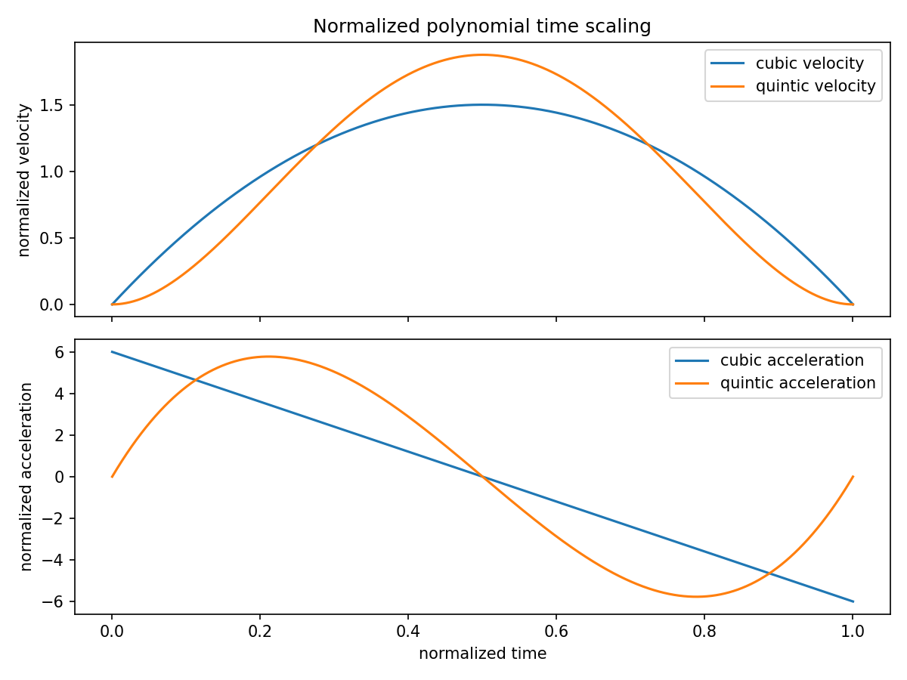

# 轨迹生成：路径相同，运动时间为什么不同

> **问题：** 两个机器人都沿直线从 A 移动到 B，为什么有的会在起点猛然抖动，有的运动平滑？“路径”与“轨迹”并不是同义词

**先修：** M02～M04、F03；**路线：** 几何路径 → 时间标定 → 速度、加速度、跃度约束

## 1. 区分路径、轨迹和时间参数

路径是几何曲线 $\mathbf q(s)$，$s\in[0,1]$；给定单调时间标定 $s(t)$，才得到随时间变化的轨迹 $\mathbf q(t)=\mathbf q(s(t))$；链式法则

$$
\dot{\mathbf q}=\frac{d\mathbf q}{ds}\dot s,\qquad
\ddot{\mathbf q}=\frac{d^2\mathbf q}{ds^2}\dot s^2+\frac{d\mathbf q}{ds}\ddot s
$$

所以同一路径经过不同 $s(t)$ 会有不同速度、加速度，进而产生不同扭矩；**路径无碰撞不代表任意时间标定都可执行**

## 2. 经典三次和五次多项式

从 $q_0$ 到 $q_1$，持续时间 $T>0$，设 $u=t/T\in[0,1]$，零端点速度的三次标定

$$
s_3(u)=3u^2-2u^3
$$

它满足 $s_3(0)=0,s_3(1)=1,s_3'(0)=s_3'(1)=0$，但一般**不满足端点加速度为零**；若还要两端加速度为零，五次标定

$$
s_5(u)=10u^3-15u^4+6u^5
$$

均具有 $q(t)=q_0+(q_1-q_0)s(t/T)$；速度和加速度分别引入 $1/T$、$1/T^2$：若时间缩短一半，轨迹加速度峰值将放大四倍

### 2.1 五次时间标定的峰值需要检查

对 $s_5$，$\dot s_{\max}=\frac{15}{8T}$；绝对加速度峰值可通过 $s_5''(u)$ 求极值为 $\frac{10\sqrt3}{3T^2}$（约 $5.7735/T^2$）；因此必须结合每个关节 $|\Delta q_i|$ 检查其速度和加速度限值，而不能因为端点导数为零就称轨迹“安全”

## 3. 梯形与 S 曲线速度规划

梯形速度轨迹由加速、匀速、减速段组成；若行程不足以达到设定最大速度，会退化为三角速度曲线；S 曲线规划进一步限制跃度 $j=\dddot q$，用于减少加速度突变，但受时间标定、路径曲率和驱动约束共同影响；*限制跃度不等于证明结构振动消失*；柔性模态仍需单独考虑

## 4. 多路点与高维位姿

多个关节点组成样条时，需要要求相应阶数的连续性；例如速度连续不足以保证加速度连续；对空间刚体位姿，应区分平移插值、旋转插值与 $SE(3)$ 上的螺旋插值；直接线性插值旋转矩阵的元素一般不再严格属于 $SO(3)$；四元数 Slerp 需考虑 $q$ 与 $-q$ 的双覆盖和最短角路径约定

### 4.1 动力学限制下的时间标定

将 $\dot{\mathbf q}$、$\ddot{\mathbf q}$ 的链式法则代入 M06 逆动力学，可把力矩约束变为对 $\dot s$、$\ddot s$ 随路径参数变化的限制；只按关节最大速度排序，并不足以确保力矩、接触力及热限制均满足

## 5. 实践：可计算的极值

`python labs/python/planning/main.py --check` 用解析导数验证三次、五次多项式端点条件与峰值，并输出不同时间标定下的 $q,\dot q,\ddot q$ 曲线

## 交互观察

拖动下方参数，比较模型输出与本章公式的联系，交互演示采用简化假设，不替代 Python 数值检查或真实机器人验证

<!-- INTERACTIVE:TRAJECTORY -->

### 自测

1. 推导 $\ddot{\mathbf q}$ 中的 $\dot s^2$ 项来自何处
2. 使用三次时间标定时，两个端点的加速度一定为零吗
3. 将运行时间 $T$ 减半时，五次标定的速度、加速度峰值如何变化

**资料：** [Modern Robotics Ch. 9](https://modernrobotics.northwestern.edu/chapters/chapter9/)；Siciliano et al., *Robotics: Modelling, Planning and Control*, trajectory planning chapters
