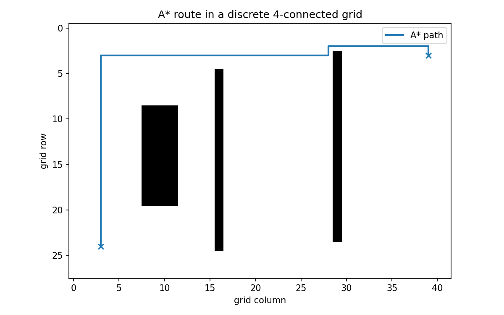

# 运动规划：找到一条无碰撞路径需要哪些条件

> **问题：** 机械臂的末端能绕过障碍物，是否说明所有连杆都没有碰撞？为什么 RRT 在狭窄通道里可能很慢

**先修：** M01～M04、C08；**结构：** 构型空间 → 碰撞 → 图搜索/采样规划 → 时间参数化与优化


## 1. 构型空间比末端的二维路线更重要

一台 $n$ 关节机器人配置为 $\mathbf q\in\mathcal C$；关节范围和闭链条件决定合法构型集合；定义障碍集合 $\mathcal C_{\mathrm{obs}}$，自由空间 $\mathcal C_{\mathrm{free}}=\mathcal C\setminus\mathcal C_{\mathrm{obs}}$；机械臂末端轨迹不与障碍物相交仍不能保证**中间连杆、线缆、工具和本体**不碰撞

规划通常寻找连续曲线 $\sigma:[0,1]\to\mathcal C_{\mathrm{free}}$，满足起点与目标约束；控制和运动学还需要检查可达性、关节限位和执行速度

<figure class="concept-diagram web-source-figure" data-asset="scheme">
  
  <figcaption>图中两根杆的关节角可以作为二维构型空间的坐标；改变任一关节会带动整段机构，障碍检查应覆盖全部连杆，不能仅检查末端位置 · 来源：<a href="https://commons.wikimedia.org/wiki/File:Robotic_Arm_schemat.png" target="_blank" rel="noopener noreferrer">Arczi325</a> · <a href="https://creativecommons.org/licenses/by-sa/4.0" target="_blank" rel="noopener noreferrer">CC BY-SA 4.0</a></figcaption>
</figure>

## 2. 核心：离散搜索和启发式

在网格或已知路网图 $G=(V,E)$ 中，非负边权可表示路径长度、风险或时间；Dijkstra 在所有非负边权下求最短路径；A* 的优先级 $f(n)=g(n)+h(n)$，当启发式 $h$ 可采纳且采用相应算法实现条件时可以保留最优性保证；**机器人配置空间的欧氏距离不自动等于含障碍的真实最短路径长度**

图搜索的保证取决于分辨率、图构造和碰撞离散化；网格路径没有穿过障碍物节点不代表相邻节点间的真实连续运动不碰撞

## 3. 概率路线图 PRM 与 RRT

PRM 随机采样有效构型并连接局部无碰撞边，适合复用地图进行多次查询；RRT 逐步朝随机目标扩展树，倾向探索尚未覆盖的空间；RRT* 在合适的采样、邻域选择与代价假设下具备**渐近最优性**，但不代表有限时间内一定得到全局最短路径

采样规划常见理论术语

- **概率完备**：存在可行路径并满足一定稳健/几何条件时，采样数趋于无穷找到解的概率趋于 1
- **渐近最优**：在相应条件下，当采样数趋于无穷，解的代价趋向全局最优代价
- **实时成功率**：有限计算预算内求出可执行路径的概率，需要靠实验测量，不能由上述极限性质直接代替

### 3.1 RRT 的最小算法

```text
T = {start}
repeat:
    q_rand = sample(configuration_space)
    q_near = nearest(T, q_rand)
    q_new = steer(q_near, q_rand, max_step)
    if valid_config(q_new) and valid_continuous_edge(q_near, q_new):
        add_vertex_and_edge(T, q_new, q_near)
        if reachable_goal(q_new): return path(T)
return TIMEOUT
```

关键不是“随机”，而是**连续边碰撞检查**；仅检查顶点会允许边穿过障碍物，形成看似成功却不可执行的伪路径；对带微分约束的汽车底盘，还要检查运动学可行的转向与曲率，不能在 $x,y$ 空间随意连直线

## 4. 轨迹优化是另一条互补路线

把节点或时间离散的轨迹记为 $\mathbf q_{0:N}$，定义代价

$$
J=\sum_k \underbrace{\|\mathbf q_{k+1}-\mathbf q_k\|_{\mathbf W}^2}_{\text{平滑/长度代理项}}+\lambda\,\phi_{\mathrm{collision}}(\mathbf q_k)
$$

这只是示例，具体的碰撞势、连续碰撞条件、动力学/端点约束需要明确定义；局部轨迹优化可利用一条采样规划生成的可行路径作为初始化；在非凸障碍物条件下，局部极小值不能宣称全局最优

## 5. 规划成功后还有什么问题

路径生成后，需要用 C08 时间标定并检查 $\dot{\mathbf q},\ddot{\mathbf q},\boldsymbol\tau$；进入真实系统前还要加自碰撞与工具几何、感知不确定度、环境动态更新及故障停机策略；抓取规划和移动操作的高层协调属于 C10

## 6. 实践：二维配置空间 A* 对照

`python labs/python/planning/main.py --check` 在固定种子的栅格地图上运行 A*，逐段验证返回路径没有占据障碍格，并与 Dijkstra 最短路径代价比较；只保证**该栅格模型中的点机器人路径**；不能将此验证冒充机械臂连杆的连续空间碰撞安全



### 自测

1. “末端位置无碰撞”和“机器人全身无碰撞”有什么区别
2. 为什么 RRT 的概率完备不能保证 100 ms 内找到解
3. 什么条件下 A* 的启发式能保持最优性

**资料：** [Modern Robotics Ch. 10](https://modernrobotics.northwestern.edu/chapters/chapter10/)；LaValle, [*Planning Algorithms*](https://lavalle.pl/planning/)；Karaman & Frazzoli, *Sampling-based Algorithms for Optimal Motion Planning*, IJRR 2011