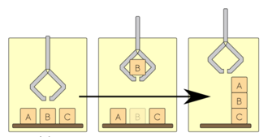

# 高层任务与协同规划：从“到目标点”到“完成工作”

> **问题：** 识别到番茄以后，机器人不仅要移动机械臂，还要选择目标、调整观察位姿、避开枝叶、抓取并确认成功；谁来决定这些动作的先后和失败回退

**先修：** C09、M07、C05；**学习路径：** 任务动作 → 操作规划 → 移动操作/多机器人协调 → 可执行性与失败恢复

## 1. 三种“规划”不要混在一起

- **运动规划**：给已指定的起点、终点与几何约束寻找无碰撞路径（C09）
- **抓取/操作规划**：选择接触位形、夹持姿态、接近路线、力和环境约束
- **任务规划**：决定先观察哪一个目标、什么时候移动底盘、何时切换末端执行器，以及失败以后采取什么动作

例如“采摘一颗果实”不是某条 $\mathbf q(t)$ 曲线；它可能包括感知更新、抓取可达性检查、移动底盘与机械臂时序协调、接触确认和安全退回

## 2. STRIPS 风格的前置与效果

一个离散动作可表示 $a=(\mathrm{Pre}(a),\mathrm{Add}(a),\mathrm{Del}(a))$，其中 $\mathrm{Pre}$ 是前置条件，$\mathrm{Add},\mathrm{Del}$ 分别是执行成功后状态命题集合的增加与删除

例如 `Pick(target)` 的前置条件可能包含 `seen(target)`、`grasp_feasible(target)`、`arm_ready`；成功效果包含 `holding(target)`；但这只是**符号层的抽象**：前置条件被符号模型判真并不能代替碰撞检查、力限幅或执行时实际传感器确认

## 3. 任务与运动联合规划 TAMP

如果先决定一系列任务，再调用运动规划器，可能发现每一步都可达却整条任务不可行；例如先移动果篮会封闭机械臂通道，或抓取后新负载导致路径不再满足扭矩约束

任务与运动联合规划（Task and Motion Planning, TAMP）通过离散动作候选与连续参数（抓取位姿、基座位姿、路径）之间的往返检查来解决该问题，计算成本高且通常没有“所有任务都能实时求最优解”的保证

<figure class="concept-diagram web-source-figure" data-asset="plancrop">
  
  <figcaption>左侧是抓取积木的中间状态，右侧是堆叠目标；任务规划决定抓取与放置的顺序，运动规划还需验证每一步的可达性、碰撞与抓持条件，箭头本身不是连续可执行轨迹 · 来源：<a href="https://commons.wikimedia.org/wiki/File:Planning-robot_(cropped).png" target="_blank" rel="noopener noreferrer">Guicho w</a> · <a href="https://creativecommons.org/licenses/by-sa/3.0" target="_blank" rel="noopener noreferrer">CC BY-SA 3.0</a></figcaption>
</figure>

## 4. 协同：机器人间耦合约束是什么

多机器人系统可能共享空间、时隙、通信带宽和操作物体；若两个机械臂共同搬运刚体，同一物体位姿的约束会耦合两个机器人末端运动；若仅是两辆运输车调度，主要约束可能在冲突路径与任务分配层；不要把“同时运行两台机器”直接称为协同控制

从图调度的角度，任务 $i$ 分配给机器人 $r$ 可引入二元变量 $z_{ir}\in\{0,1\}$，要求 $\sum_r z_{ir}=1$；还必须附加机器人能力、容量、时间、可达性和冲突约束，否则只是空的分配公式

## 5. 执行层：有限状态机还是行为树

状态机适合明确阶段和安全状态，行为树适合组织可重试、回退和条件检查的任务节点；它们不是运动规划器本身，也不应把“成功”归因于一个按钮或硬编码延时

推荐将每个动作节点设计为**命令—反馈—结果**接口：启动动作、读取执行状态、判断超时/取消、回传成功或失败，并且失败时进入有明确物理后果的安全回退；视觉识别后仍要在动作前重新检查位姿新鲜度和碰撞环境变化

## 6. 实践：一个可手算的采摘任务图

考虑 `Observe → Approach → Grasp → Retract → Place`，指定前置条件和失败回退，手工列出目标丢失、抓取失败、障碍变化三种情况的执行路径；这是**任务级逻辑实验**，没有把文本流程图称为真实机器人系统的安全验证

### 自测

1. 为什么移动规划成功不等于抓取计划可执行
2. 行为树中的 `SUCCESS` 是否代表物理夹爪已经抓牢物体？需要哪些额外反馈
3. 举例区分任务规划、抓取姿态规划、关节轨迹规划三层结果

**资料：** [MIT Robotic Manipulation](https://manipulation.mit.edu/)；Garrett et al., *Integrated Task and Motion Planning*, Annual Review of Control, Robotics, and Autonomous Systems, 2021；[Modern Robotics Ch. 12](https://modernrobotics.northwestern.edu/nu-gm-book-resource/)