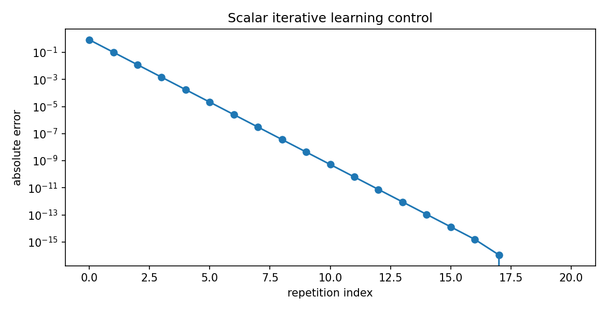

# 迭代学习与复合控制：如何利用上一次实验改进下一次

> **问题：** 同一条采摘轨迹每天重复执行，能否利用昨天的跟踪误差提前补偿？迭代学习与实时自适应有什么区别

**先修：** C02、C03、C06、C08；**层次：** 重复任务误差 → ILC 更新 → 复合架构 → 收敛条件与部署边界

## 1. 两类学习发生在不同时间轴

实时自适应控制根据当前时刻测量更新内部参数；迭代学习控制（ILC）根据第 $j$ 次运行的整段误差 $e_j(t)$ 改进第 $j+1$ 次同任务的前馈指令；在 ILC 中必须明确：每次运行是否共享初始条件、轨迹时长和任务环境，误差是否按同一时间轴对齐

线性离散提升形式（lifted system）可写成

$$
\mathbf y_j=\mathbf P\mathbf u_j+\mathbf d_j,\quad
\mathbf e_j=\mathbf r-\mathbf y_j
$$

这里粗体可表示整个运行周期的堆叠时间序列；$\mathbf P$ 表示从前馈序列到输出序列的线性映射（包含因果动态）；若扰动每次相同 $\mathbf d_j=\mathbf d$，更新

$$
\mathbf u_{j+1}=\mathbf u_j+\mathbf L\mathbf e_j
$$

则误差满足

$$
\mathbf e_{j+1}=(\mathbf I-\mathbf P\mathbf L)\mathbf e_j
$$

若 $\rho(\mathbf I-\mathbf P\mathbf L)<1$，在有限维理想重复系统可获得迭代收敛；要保证给定范数下**逐次单调**减小，通常还需要更强的范数条件，如 $\|\mathbf I-\mathbf P\mathbf L\|<1$；随机变化的扰动、初始条件偏差和执行器饱和会增加残差或破坏推导

## 2. 不要混淆三种数据驱动方法

| 方法 | 更新频率 | 主要用途 | 常见限制 |
|---|---|---|---|
| ILC | 每次重复任务后 | 重复轨迹的前馈补偿 | 任务需高度可重复 |
| 自适应控制 | 一次任务执行中 | 在线跟踪/参数调整 | 稳定性与激励条件 |
| 强化/模仿学习 | 训练阶段或持续数据收集 | 学习策略或行为映射 | 数据覆盖和安全泛化 |

本篇讨论控制器设计机制；监督学习、模仿学习与 RL 的完整算法属于第五篇

## 3. 复合控制必须尊重作用层级

典型机器人控制链：轨迹规划提供参考 $\mathbf q_d$，模型前馈给出重力/惯性项，反馈控制修正误差；接触时按状态切换或融合柔顺控制，ILC 在重复任务之间校正前馈，安全模块对最终指令执行约束与急停；**不是把五个控制器的力矩直接相加就叫多算法融合**

特别注意两种常见冲突

- 同一自由度同时由刚性位置伺服和导纳位置目标独立积分，可能形成冲突反馈或重复积分
- 扰动观测器估计到的“外力”同时被阻抗控制和模型补偿处理，可能错误抵消真正应当感知的接触力

实现前必须对每个控制层标注它接收什么、输出什么、何时生效、能够直接驱动哪一级接口，以及超时/不一致时的安全状态

## 4. 进阶：标量 ILC 的最小证明

若每次输出 $y_j=p u_j+d$，$p>0$ 为固定标量增益，$d$ 为重复扰动；令 $u_{j+1}=u_j+\ell(r-y_j)$，则

$$
e_{j+1}=(1-p\ell)e_j
$$

收敛当且仅当 $|1-p\ell|<1$，即 $0<p\ell<2$；当 $p$ 估计符号错了，盲目用正学习率可能导致误差越学越大；对于多自由度非线性系统需回到线性化/提升域与稳定条件，不能照搬一个标量区间

## 5. 实践：20 次相同任务重复

`python labs/python/control/main.py --check` 使用标量可重复模型验证 ILC 的几何收敛率，与理论 $|1-p\ell|$ 比较；结果明确是**重复线性标量算例**，不代表机器人仿真和真实操控学习性能

### 自测

1. 在 $p=0.8,\ell=1.2$ 下预测 $20$ 次 ILC 的误差倍率
2. 哪些扰动不重复会导致 ILC 的“误差逐次下降”结论失效
3. 设计一个有重力模型补偿、阻抗跟踪和安全限幅的控制链，指出每层接口

**资料：** Arimoto et al., *Bettering Operation of Robots by Learning*, Journal of Robotic Systems, 1984；Bristow, Tharayil & Alleyne, *A Survey of Iterative Learning Control*, IEEE Control Systems, 2006；[MIT Underactuated Robotics](https://underactuated.mit.edu/)
