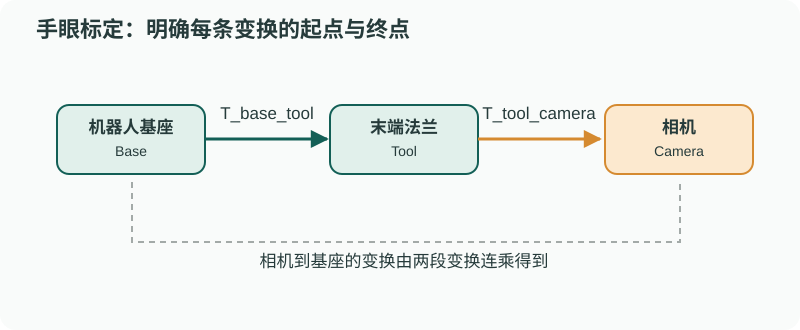
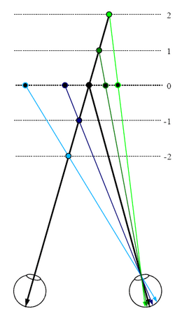

# 传感器模型与标定：先对齐时间和坐标，再融合信息

> **问题：** 相机已经识别到物体三维位置，为什么机械臂仍然抓偏？可能是相机内参、深度误差、手眼外参、TCP 偏置、时间延迟或机器人本身的运动学模型，不能全怪检测算法

**先修：** P01、F05、M02、M08；**目标：**能从坐标链写出标定方程，知道哪些参数能辨识以及怎样验证，而不是只看拟合残差

## 1. 针孔相机、畸变与深度

相机系点 $\mathbf p_c=[X,Y,Z]^T$ 在 $Z>0$ 时，理想针孔模型为

$$
\begin{bmatrix}u\\v\\1\end{bmatrix}\sim \mathbf K\begin{bmatrix}X/Z\\Y/Z\\1\end{bmatrix},\quad
\mathbf K=\begin{bmatrix}f_x&s&c_x\\0&f_y&c_y\\0&0&1\end{bmatrix}
$$

仅在 $s=0$ 且已消除镜头畸变时，反投影才可用 $X=(u-c_x)Z/f_x$、$Y=(v-c_y)Z/f_y$；真实镜头常用径向/切向畸变参数，深度图和彩色图还可能来自不同光心，必须进行外参对齐和适当重采样

标定并不等于“得到一组看着合理的参数”：应该使用未参与优化的不同姿态/距离图像检查**重投影残差**和空间覆盖；仅看训练集 RMS 容易掩盖畸变模型失配

<figure class="concept-diagram web-source-figure" data-asset="calib">
  
  <figcaption>对比同一物体在两视图中的横向位置差；校正双目模型中视差越小，深度越大，同样的视差噪声会在远处造成更大的深度误差 · 来源：<a href="https://commons.wikimedia.org/wiki/File:Visual_disparity_-_depth_from_2D.png" target="_blank" rel="noopener noreferrer">Sbitzer at English Wikipedia</a> · <a href="http://creativecommons.org/licenses/by-sa/3.0/" target="_blank" rel="noopener noreferrer">CC BY-SA 3.0</a></figcaption>
</figure>

## 2. 坐标系约定：把每一次变换写完整

沿用 F05 的约定：$\mathbf T_{ab}$ 将 **b 坐标系中表示的点**变到 a 坐标系；若相机固定在机器人末端（eye-in-hand），则

$$
\boxed{\mathbf T_{bt}=\mathbf T_{be}\mathbf T_{ec}\mathbf T_{ct}}
$$

其中 b=基座、e=末端法兰、c=相机、t=目标；若相机固定在外部（eye-to-hand），变为 $\mathbf T_{bt}=\mathbf T_{bc}\mathbf T_{ct}$，不能照搬上一种连乘顺序；工具 TCP 与法兰间变换也应单列，不要把 TCP 平移混入相机外参

## 3. 手眼标定：$AX=XB$ 的前提

固定目标与刚性安装的相机/末端产生两次姿态间的相对运动，经过统一方向定义，可写为

$$
\boxed{\mathbf A_i\mathbf X=\mathbf X\mathbf B_i},\qquad \mathbf A_i,\mathbf B_i,\mathbf X\in SE(3)
$$

$\mathbf X$ 是待求手眼变换，$\mathbf A_i,\mathbf B_i$ 的顺序和左右方向**必须在实际数据里推导**，不能仅靠变量名；仅做绕同一轴的旋转、缺乏平移或运动激励时可能退化；多方向旋转、分布良好的视角通常更有帮助，但需要检查机械臂限位和标定板可见性

进阶残差可以定义在李代数中

$$
\mathbf r_i=\operatorname{Log}\!\left((\mathbf A_i\mathbf X)^{-1}(\mathbf X\mathbf B_i)\right)^{\vee}
$$

平移和旋转分量的单位不同，不能直接将六维残差未经权重处理就宣称“最优”

## 4. 时间偏差：运动时小误差变大问题

假设相机观测发生于 $t_c$，机械臂姿态误用了 $t_c+\Delta t$，一阶下目标位置误差约满足

$$
\|\Delta\mathbf p\|\lesssim \|\mathbf v\|\,|\Delta t|
$$

（忽略转动引起的额外杠杆项）；在末端快速运动时，几毫米级误差可能仅来自时差；时间外参应当与空间外参分开验证：静止准确并不代表运动准确

## 5. 误差预算与可复核验收

1. 原始观测、内参、外参、深度对齐和时间基准独立保存，且记录参数变更标识
2. 用标定数据估计参数，用**新姿态与新位置**验证目标坐标误差
3. 比较目标在不同距离、视角、机器人构型下的残差，不只报告平均误差
4. 检查受约束参数的可辨识性；没有真值时报告一致性/重投影误差，**不称为绝对精度**
5. 若要执行机械臂校验，必须先满足碰撞/速度/关节限位和急停要求

### 实践

`labs/python/perception/main.py --check` 在已知 $K$、无畸变与准确深度的**理想模型**中验证投影/反投影闭环；它不能代替真实相机内参标定或手眼外参评估

### 自测

1. 从 $\mathbf T_{be}$、$\mathbf T_{ec}$、$\mathbf T_{ct}$ 写出目标在基座下的表示
2. 如果相机固定在机械臂外部，哪一段坐标链必须改变
3. 为什么静态精度好不能证明动态抓取精度好

**参考：** [Szeliski, *Computer Vision: Algorithms and Applications*, 2nd ed.](https://szeliski.org/Book/)；[Barfoot, *State Estimation for Robotics*](https://doi.org/10.1017/9781009299909)；M08 的几何标定和参数可辨识性