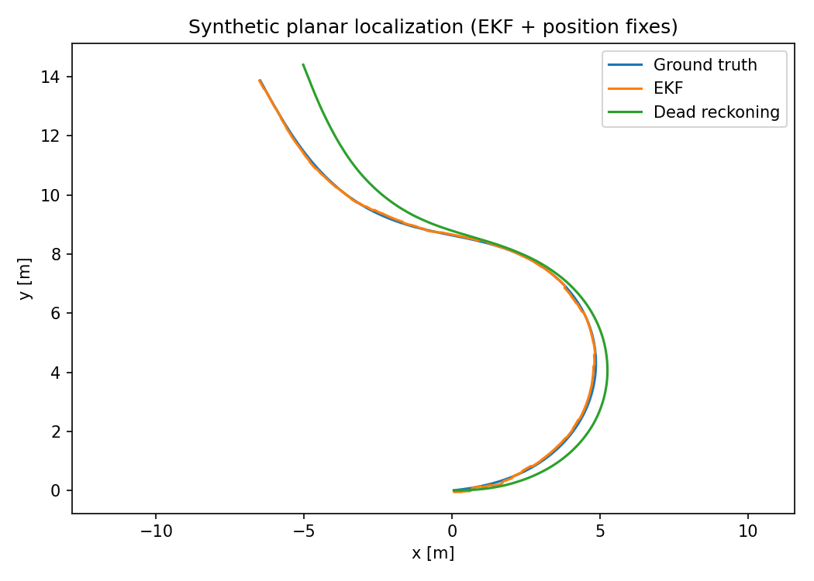

# 状态估计：从不确定的测量恢复可信的机器人状态

> **问题：** 轮编码器能够在两次定位之间预测运动，但误差会积累；定位观测可能低频而且有噪声；能否在每次测量后获得更好的位姿估计，同时保留“我有多不确定”的信息

**先修：** F02～F04、P01；**目标：**掌握贝叶斯预测—校正、KF/EKF/UKF/粒子滤波、因子图的数学关系和适用边界

## 1. 贝叶斯滤波：同一问题的统一递推

令状态为 $\mathbf x_k$、控制/运动输入为 $\mathbf u_k$、观测为 $\mathbf z_k$，全部过去观测记为 $\mathbf z_{1:k}$；在适当一阶马尔可夫和条件独立假设下，预测及校正为

$$
\begin{aligned}
p(\mathbf x_k\mid\mathbf z_{1:k-1})&=\int p(\mathbf x_k\mid\mathbf x_{k-1},\mathbf u_k)\,p(\mathbf x_{k-1}\mid\mathbf z_{1:k-1})\,d\mathbf x_{k-1},\\
p(\mathbf x_k\mid\mathbf z_{1:k})&\propto p(\mathbf z_k\mid\mathbf x_k)\,p(\mathbf x_k\mid\mathbf z_{1:k-1})
\end{aligned}
$$

预测传播运动不确定性，校正把观测中的新信息纳入信念分布；滤波并非强制让估计靠近最新测量；当传感器噪声大时，更新应较弱

## 2. 线性卡尔曼滤波：明确条件的最优递推

考虑 $\mathbf x_k=\mathbf F_k\mathbf x_{k-1}+\mathbf B_k\mathbf u_k+\mathbf w_k$，$\mathbf z_k=\mathbf H_k\mathbf x_k+\mathbf v_k$；过程噪声和测量噪声为**相互独立、零均值高斯**，协方差分别为 $\mathbf Q_k,\mathbf R_k$；在初始分布也高斯且模型已知时，线性 KF 的后验均值/协方差是精确贝叶斯解

$$
\begin{aligned}
\hat{\mathbf x}_k^-&=\mathbf F_k\hat{\mathbf x}_{k-1}^++\mathbf B_k\mathbf u_k,\\
\mathbf P_k^-&=\mathbf F_k\mathbf P_{k-1}^+\mathbf F_k^T+\mathbf Q_k,\\
\mathbf y_k&=\mathbf z_k-\mathbf H_k\hat{\mathbf x}_k^-,\quad
\mathbf S_k=\mathbf H_k\mathbf P_k^-\mathbf H_k^T+\mathbf R_k,\\
\mathbf K_k&=\mathbf P_k^-\mathbf H_k^T\mathbf S_k^{-1},\quad
\hat{\mathbf x}_k^+=\hat{\mathbf x}_k^-+\mathbf K_k\mathbf y_k
\end{aligned}
$$

实践中不必显式求 $\mathbf S_k^{-1}$，用线性系统求解；更稳健的 Joseph 形式为

$$
\boxed{\mathbf P_k^+=(\mathbf I-\mathbf K_k\mathbf H_k)\mathbf P_k^-(\mathbf I-\mathbf K_k\mathbf H_k)^T+\mathbf K_k\mathbf R_k\mathbf K_k^T}
$$

它可减轻浮点误差造成的非对称/非正定，但**不能修复错误的噪声模型**

## 3. EKF、UKF 与粒子滤波有什么区别

非线性系统 $\mathbf x_k=f(\mathbf x_{k-1},\mathbf u_k,\mathbf w_k)$，$\mathbf z_k=h(\mathbf x_k,\mathbf v_k)$ 中

| 方法 | 如何近似 | 典型限制 |
|---|---|---|
| EKF | 对动力学/观测在当前估计处一阶线性化 | 线性化点偏差和强非线性导致不一致 |
| UKF | 通过 sigma 点传播均值和协方差 | 不是任意分布的精确解，参数与流形处理需小心 |
| 粒子滤波 | 用带权粒子近似概率分布 | 高维退化、重采样粒子贫化、计算负担 |
| 因子图平滑 | 联合估计时间窗/全轨迹的未知状态 | 数据关联和优化初始化不正确时可能失败 |

以平面 $(x,y,\theta)$ 状态为例，$\theta$ 是圆周变量：创新角度残差应使用合适的角度包裹或流形运算；直接把 $179^\circ$ 与 $-179^\circ$ 做普通减法将得到错误的大误差

## 4. EKF 的局部线性化

设已将噪声离散化为加性形式 $\mathbf x_k=f(\mathbf x_{k-1},\mathbf u_k)+\mathbf w_k$，预测 Jacobian $\mathbf F_k=\partial f/\partial\mathbf x$，则 $\mathbf P_k^-=\mathbf F_k\mathbf P_{k-1}^+\mathbf F_k^T+\mathbf Q_k$；观测 Jacobian $\mathbf H_k=\partial h/\partial\mathbf x$ 用于线性化校正

如果误差源是速度输入噪声 $\mathbf n_u$ 而非直接状态加性噪声，过程噪声应传播成 $\mathbf L_k\mathbf Q_u\mathbf L_k^T$，$\mathbf L_k=\partial f/\partial\mathbf u$；任意设一个常数 $\mathbf Q$ 并称“反映了轮速噪声”在数学上不充分

**一致性检查**可看创新 $\mathbf y_k$ 及标准化创新平方 $\mathrm{NIS}=\mathbf y_k^T\mathbf S_k^{-1}\mathbf y_k$；仅有一次 NIS 接近观测维数不能证明滤波器校准正确；应该在模型假设、统计样本与独立验证下解释

## 5. 因子图与递推滤波的联系

在独立噪声和给定数据关联下，全轨迹 MAP 常写为

$$
\arg\min_{\mathbf x_{0:K}}\|\mathbf r_0\|_{\mathbf\Sigma_0^{-1}}^2+\sum_k\|\mathbf r_k^{\mathrm{motion}}\|_{\mathbf Q_k^{-1}}^2+\sum_j\|\mathbf r_j^{\mathrm{obs}}\|_{\mathbf R_j^{-1}}^2
$$

它和滤波都是概率状态估计，只是选择不同的变量窗口与数值求解方法；因子图通常将不同来源的信息表达为因子，但**不代表所有优化都会收敛到正确关联的全局最优**；还需固定规范自由度，例如给一个位姿设置先验

## 6. 实践：平面机器人 EKF 与真实误差边界

执行 `python labs/python/perception/main.py --check`；实验用合成转弯运动、带噪声的车速角速输入与定期到来的二维位置观测，检查 Joseph 协方差更新及 EKF 相对纯积分的位置误差

该图只说明在**本实验的独立噪声、理想定位观测和已知控制模型**下，融合能够减少漂移，不是 GNSS/SLAM 真机定位精度证明

### 自测

1. 为什么过程噪声可能需要通过 $\mathbf L\mathbf Q_u\mathbf L^T$ 传播
2. EKF 什么时候会对自身的不确定度过度自信
3. 为什么因子图优化 SLAM 必须考虑规范自由度和数据关联

**参考：** [Barfoot, *State Estimation for Robotics*, 2nd ed.](https://doi.org/10.1017/9781009299909)；[Thrun 等, *Probabilistic Robotics*](https://mitpress.mit.edu/9780262201629/probabilistic-robotics/)；[GTSAM 因子图教程](https://gtsam.org/tutorials/intro.html)
