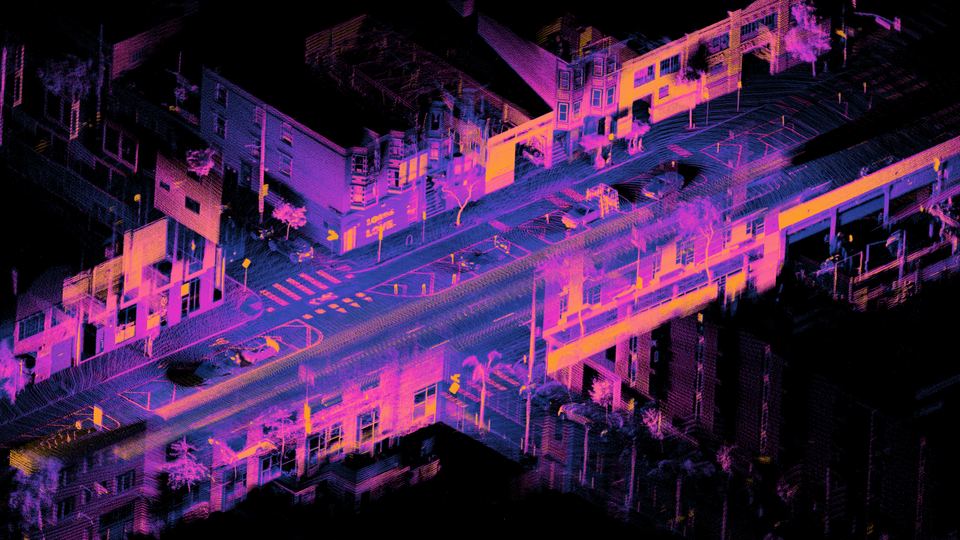

# 机器人视觉与三维感知：从像素到具有尺度的空间信息

> **问题：** 视觉模型画出一个完美的番茄检测框，机器人为什么仍不能直接抓取？因为二维检测、深度、相机位姿、物体姿态和可抓取性是不同的量，需要逐级定义和验证

**先修：** P01、P02、F05；**目标：**理解投影几何、深度、特征、三维点云与刚体配准，能够区分感知输出的**位置**、**姿态**和**语义**

## 1. 图像形成与尺度歧义

对于无畸变的针孔相机，$\mathbf p_c=(X,Y,Z)^T$ 且 $Z>0$，若 $s=0$，则

$$
u=f_x\frac{X}{Z}+c_x,\qquad v=f_y\frac{Y}{Z}+c_y
$$

单个像素提供一条射线，而非确定的三维位置；已知沿光轴深度 $Z$ 时，才能得到

$$\boxed{X=(u-c_x)Z/f_x,\qquad Y=(v-c_y)Z/f_y}$$

**单目尺度歧义：** 把目标与相机平移同时按同一比例缩放，投影可保持不变，因此没有额外尺度线索时，纯单目两视图几何不能恢复真实米制尺度

双目整列后，在理想平行光轴、无畸变情况下，有 $Z=fB/d$，$B$ 是基线，$d$ 是像素视差；视差趋近零时深度不稳定；大基线虽能增强深度精度，也可能增大遮挡与匹配难度

<figure class="concept-diagram web-source-figure" data-asset="calib">
  
  <figcaption>同一物体在左右视图中的位置差提供深度线索；对于校正双目，深度与视差成反比，因此远距离的小视差对像素误差更敏感 · 来源：<a href="https://commons.wikimedia.org/wiki/File:Visual_disparity_-_depth_from_2D.png" target="_blank" rel="noopener noreferrer">Sbitzer at English Wikipedia</a> · <a href="http://creativecommons.org/licenses/by-sa/3.0/" target="_blank" rel="noopener noreferrer">CC BY-SA 3.0</a></figcaption>
</figure>

## 2. 图像几何、位姿估计与重投影残差

已知三维地图点 $\mathbf P_i^w$ 及相机内参 $\mathbf K$，待估相机世界位姿，通常通过最小化重投影残差求解

$$
\min_{\mathbf T_{cw}\in SE(3)}\sum_i\rho\left(\left\|\mathbf z_i-\pi\!\left(\mathbf K(\mathbf R_{cw}\mathbf P_i^w+\mathbf t_{cw})\right)\right\|_{\mathbf\Sigma_i^{-1}}^2\right)
$$

这里 $\pi$ 是透视投影，$\rho$ 可用于鲁棒处理异常对应点；**模型检测框中心不是天然的三维刚体坐标原点；** 要获得六维目标姿态，需要几何模型、足够的非退化特征/点、PnP、点云配准或其他明确的信息来源

若物体近球形、无辨识纹理，绕某轴的姿态可能天然不唯一；应将这种对称性表达在输出的姿态或可抓取约束中，而不是虚构唯一的真值姿态

## 3. 特征法、直接法与匹配关系

| 方法 | 主要约束 | 易失败情形 |
|---|---|---|
| 特征匹配 | 对应关键点的描述子与几何一致性 | 重复纹理、低纹理、快速模糊 |
| 直接视觉 | 对应图像区域的光度/颜色一致性 | 曝光变化、遮挡、非朗伯表面 |
| 学习检测分割 | 物体类别、掩码、关键点或概率分布 | 数据分布偏移、遮挡与开放类别误识别 |

RANSAC 的意义在于从大量候选对应中寻找几何上一致的内点集，但阈值、退化情况和异常值比例都会影响结果；它不能保证选出的内点真实对应同一静态物体

## 4. 点云配准：已知对应时的刚体 SVD

给定已知匹配的源点 $\mathbf p_i$、目标点 $\mathbf q_i$，最小化

$$
\min_{\mathbf R\in SO(3),\,\mathbf t}\sum_i\|\mathbf R\mathbf p_i+\mathbf t-\mathbf q_i\|_2^2
$$

先去中心化，定义 $\mathbf H=\sum_i(\mathbf p_i-\bar{\mathbf p})(\mathbf q_i-\bar{\mathbf q})^T$；对 $\mathbf H=\mathbf U\mathbf\Sigma\mathbf V^T$，求

$$
\mathbf R=\mathbf V\operatorname{diag}(1,1,\det(\mathbf V\mathbf U^T))\mathbf U^T,\qquad
\mathbf t=\bar{\mathbf q}-\mathbf R\bar{\mathbf p}
$$

行列式修正确保 $\mathbf R\in SO(3)$ 而非镜面反射；**这里假设对应已经正确**；ICP 将对应搜索与位姿优化交替进行，易受初值、局部极小值及退化场景影响

<figure class="concept-diagram web-source-figure" data-asset="lidarcloud">
  
  <figcaption>这是车载 Ouster 激光雷达采集后配准到共同坐标系的街道点云；单帧原始点位于传感器坐标系，拼接前需估计运动，图中颜色编码回波强度与距离的组合，不代表语义类别 · 来源：<a href="https://commons.wikimedia.org/wiki/File%3AOuster_OS1-64_lidar_point_cloud_of_intersection_of_Folsom_and_Dore_St%2C_San_Francisco.png" target="_blank" rel="noopener noreferrer">Daniel L. Lu</a> · <a href="https://creativecommons.org/licenses/by/4.0" target="_blank" rel="noopener noreferrer">CC BY 4.0</a></figcaption>
</figure>

## 5. 三维感知不能仅看检测准确率

视觉任务的评价量应与机器人需求匹配：二维检测看召回率和误检率；深度估计看距离分层误差和无效像素比例；姿态估计看旋转平移误差与对称性处理；点云配准还需考虑重叠率和环境几何退化；任务安全还需要估计延迟、置信度与不可见区域

**实践：** `python labs/python/perception/main.py --check` 在无畸变的合成点云上验证投影—反投影及已知对应点的 SVD 配准，其机器精度级别残差来自**人为无噪声数据**，绝不能当成相机标定或真机配准精度

## 交互观察

拖动下方参数，比较模型输出与本章公式的联系，交互演示采用简化假设，不替代 Python 数值检查或真实机器人验证

<!-- INTERACTIVE:CAMERA -->

### 自测

1. 为什么仅靠单张单目图无法直接确定目标的米制距离
2. 三维点云 ICP 和已知对应点 SVD 解的假设差在哪里
3. 对无特征的圆形水果，物体的哪些旋转可能不重要或不可辨识

**参考：** [Szeliski, *Computer Vision: Algorithms and Applications*, 2nd ed.](https://szeliski.org/Book/)；[Barfoot, *State Estimation for Robotics*](https://doi.org/10.1017/9781009299909)