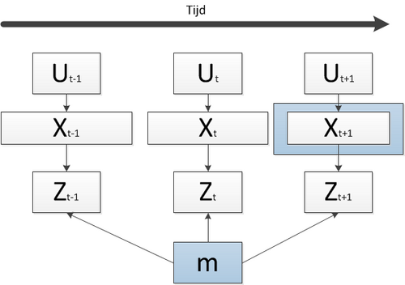
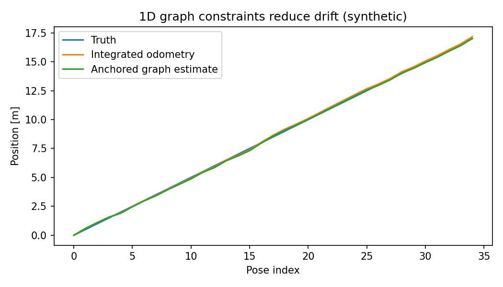

# 定位与 SLAM：局部运动估计为何会漂移

> **问题：** 里程计在短时间内可能连续且平滑，但长时间仍会漂移；回环与重定位为什么有时能修正地图，又为什么可能因为一次错误匹配毁掉整张地图

**先修：** P03、P04、F06；**目标：**区分 VO/VIO/LIO、建图、闭环、重定位和全局地图锚定；理解因子图残差及可观测性

## 1. 五种常被混用的任务

| 任务 | 主要输出 | 不能直接承诺 |
|---|---|---|
| 视觉里程计 VO | 由图像约束得到相对轨迹 | 不一定有全局闭环或绝对尺度 |
| 视觉惯性里程计 VIO | 相机与 IMU 融合的连续运动估计 | 无外部参考时位置/yaw 仍可能漂移 |
| 激光惯性里程计 LIO | 点云运动约束与 IMU 融合轨迹 | 长期全局一致性不等于自动保证 |
| SLAM | 同时估计轨迹与地图，常含重访约束 | 错误闭环/动态环境下可严重失真 |
| 重定位 | 在已有地图中重新估计当前位置/姿态 | 能成功依赖地图、几何与匹配质量 |

**局部低漂移不等于全局无漂移；“有地图”不代表必然具有高质量回环优化；** FAST-LIO2 强项是快速紧耦合 LiDAR–IMU 里程计及增量地图维护，不应仅因名字包含 mapping 就把它等同于全局闭环 SLAM

<figure class="concept-diagram web-source-figure" data-asset="slam">
  
  <figcaption>图中状态、控制、观测和地图通过概率依赖关系相连；SLAM 同时估计轨迹和地图，不能把这张依赖图误读为已经求出的真实地图 · 来源：<a href="https://commons.wikimedia.org/wiki/File:OnlineSLAM.png" target="_blank" rel="noopener noreferrer">Krzysztof.zielinski</a> · <a href="https://creativecommons.org/licenses/by-sa/3.0" target="_blank" rel="noopener noreferrer">CC BY-SA 3.0</a></figcaption>
</figure>

## 2. 为什么相对运动误差会积累

设连续位姿 $\mathbf T_{k,k+1}$ 都带有噪声，累积世界位姿为 $\mathbf T_{0,k}=\mathbf T_{0,1}\cdots\mathbf T_{k-1,k}$；哪怕相对位姿每段误差很小，也会因为连续复合而积累，特别是方向误差投影到后续大位移产生的位置漂移

仅将相邻里程计约束放入图优化，不会凭空消除这个问题；需要真正提供额外信息的回环、外部定位或多次独立观察

## 3. 位姿图优化与因子图

令 $\mathbf T_i\in SE(3)$ 为节点位姿，$\mathbf Z_{ij}$ 为从节点 i 到 j 的相对测量（固定全文约定），可采用右扰动形式下的残差

$$
\mathbf r_{ij}=\operatorname{Log}\left(\mathbf Z_{ij}^{-1}(\mathbf T_i^{-1}\mathbf T_j)\right)^{\vee}
$$

在测量误差小、残差坐标定义与噪声协方差一致时，MAP 目标形式为

$$
\arg\min_{\{\mathbf T_i\}}\sum_{(i,j)\in\mathcal E}\rho\left(\mathbf r_{ij}^T\mathbf\Omega_{ij}\mathbf r_{ij}\right),\qquad \mathbf\Omega_{ij}=\mathbf\Sigma_{ij}^{-1}
$$

**没有固定参考位姿时，全图存在整体刚体变换的 gauge freedom**，优化 Hessian 可能奇异；回环边应先通过几何一致性及异常值检验；鲁棒核只能降低个别大残差的影响，不能替代正确的数据关联

## 4. 退化与可观测性

- LiDAR 在长直走廊中容易缺少某些平移/旋转方向的约束，点到面残差可能退化
- 单目 VO 的绝对尺度在缺少其他信息时不可观测
- IMU 可以约束高频运动，但偏置、重力方向与时间同步误差会污染轨迹
- GNSS RTK 或已知地图可提供全局锚点，但也可能遭遇遮挡、多路径和异常跳变

因此算法评估不能只看最后一帧偏差；常见指标包括对齐约定下的 APE、RPE、闭环前后轨迹一致性、轨迹失效率、耗时、资源占用及地图质量；**对齐所消除的自由度（SE(3)/Sim(3)）必须报告**，否则看起来很小的 APE 可能掩盖尺度误差

## 5. 示例系统的正确定位

**ORB-SLAM3** 是视觉/视觉惯性/多地图 SLAM 的代表系统，论文强调使用多时段共视信息和地图重访约束；**FAST-LIO2** 是高效的直接点云到地图配准与 LiDAR–IMU 迭代滤波框架；两者只是不同设计路线的代表，不能仅凭论文标题判定“哪个绝对更好”；具体场景仍需考虑硬件配置、同步、光照、几何结构与动态障碍

## 6. 实践：一维图约束演示

`python labs/python/perception/main.py --check` 中使用**一维锚定位置图**：先累积有偏里程，再增加一个带已知观测方差的末端绝对位置约束，解加权最小二乘

这是“额外独立约束可限制漂移”的最小例子，**既不是二维回环，也不是完整 SLAM 系统**，没有模拟数据关联、IMU 预积分或 LiDAR 点云匹配

### 自测

1. 为什么点云帧间匹配稳定，不等于全局地图无漂移
2. 为什么不固定第一个位姿的图优化可能不可解
3. 评价单目 SLAM 时，为什么有时采用 Sim(3) 对齐而非 SE(3)

**参考：** [Dellaert & Kaess, *Factor Graphs for Robot Perception*](https://doi.org/10.1561/2300000043)；[ORB-SLAM3, IEEE T-RO](https://doi.org/10.1109/TRO.2021.3075644)；[FAST-LIO2, IEEE T-RO](https://doi.org/10.1109/TRO.2022.3141876)；[GTSAM 官方教程](https://gtsam.org/tutorials/intro.html)
