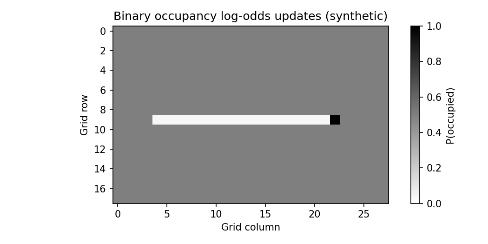
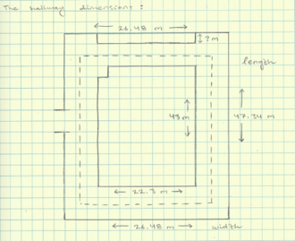

# 地图与自主导航：地图不是路线，定位不是规划

> **问题：** 机器人已经拥有稳定 SLAM 轨迹，为什么仍然可能撞上障碍或者一直绕不过窄通道？因为建图、定位、碰撞模型、全局规划和局部控制是不同的模块

**先修：** P03、P05、C09、F07；**目标：**区分多类地图，理解占据概率更新、膨胀和规划闭环，不把二维网格导航结论推广到所有机器人

## 1. 地图表达因任务而异

| 地图 | 通常保存的内容 | 适用场景与代价 |
|---|---|---|
| 占据栅格 | 体素/网格中“被占用”的概率 | 可直接碰撞查询；离散化和未知区策略显著影响导航 |
| 点云 / surfel 地图 | 三维表面几何 | 建图与配准；导航前通常需推断可通行空间 |
| TSDF / ESDF | 截断有符号距离/欧氏距离 | 表面重建、轨迹优化；依赖地图精度与更新维护 |
| 语义地图 | 类别、实例与可通行性属性 | 高层任务；语义错误可能影响安全 |
| 拓扑图 | 位置节点及连通关系 | 大尺度路径规划；细节避障仍需几何模块 |

**SLAM 输出的稠密点云不等同于二维可通行代价地图；** 还需考虑机体足迹、地面/台阶、可通行坡度、障碍物高度与动态障碍

## 2. 占据栅格与 log-odds 更新

令 $m_i\in\{0,1\}$ 为第 i 个栅格是否被占用，概率 $p_i=P(m_i=1\mid z_{1:t})$，log-odds $\ell_i=\log\frac{p_i}{1-p_i}$；在**单元独立的简化反向传感器模型**下，有

$$
\boxed{\ell_{i,t}=\ell_{i,t-1}+\log\frac{p(m_i=1\mid z_t)}{1-p(m_i=1\mid z_t)}-\ell_{i,0}}
$$

此式依赖给定姿态和观测的模型假设；多个相邻栅格真实状态并非独立，同一观测反复计入也可能造成过度自信；未知栅格的 $p=0.5$ **不是自由空间**

实践中对被射线穿过的格子增加“空闲证据”，在检测到障碍的末端格子增加“占用证据”，再把 log-odds 转回概率；实际需要考虑激光最大量程、误检、动态障碍与传感器坐标

## 3. 代价地图和机器人足迹

全局规划前，将障碍物按机器人足迹/安全余量膨胀是常见方法；对圆形足迹近似，障碍集合 $\mathcal O$ 与半径 $r$ 的圆盘 $\mathcal B_r$ 的 Minkowski 和 $\mathcal O\oplus\mathcal B_r$ 构成禁止参考点进入的区域；非圆足迹可按姿态使用更准确的碰撞模型

膨胀并不是地图真值的一部分，而是**针对特定机器人几何及风险要求的规划约束**；膨胀距离过大可堵死通道，过小则可能碰撞

## 4. 导航闭环中各层职责

一条典型移动机器人任务链可以描述为

**状态估计 → 地图更新/选择 → 全局路径 → 局部避障与轨迹/速度控制 → 执行器 → 传感器反馈**

- 全局路径规划（如 A*）在离散地图上找路径，不自动保证连续轨迹满足 Ackermann 最小转弯半径、速度与加速度约束
- 局部控制器会追踪路径、考虑动态障碍，但并不意味着能解决所有非凸动态避障问题
- 任务/行为树负责恢复、重规划、目标切换，但不能弥补定位失效或错误的碰撞足迹

在 ROS2 Nav2 中，代价地图层、Planner、Controller 和行为树等以插件方式组合；**这是系统架构参考，不是必须使用某一种插件才能称为自主导航**

<figure class="concept-diagram web-source-figure" data-asset="robotpath">
  
  <figcaption>将路径叠在环境里只是导航的一层输出；完整闭环还需要定位、地图更新和局部避障，障碍或定位变化后原路径可能需要重新规划 · 来源：<a href="https://commons.wikimedia.org/wiki/File:Robot_Path.PNG" target="_blank" rel="noopener noreferrer">Hmaarya</a> · <a href="https://creativecommons.org/licenses/by-sa/3.0" target="_blank" rel="noopener noreferrer">CC BY-SA 3.0</a></figcaption>
</figure>

## 5. 评价导航效果

建议分开报告：定位质量（APE/RPE 与失效），规划质量（路径长度、规划时延、碰撞余量），执行质量（任务成功率、轨迹跟踪、重规划次数），系统质量（CPU、延迟、恢复行为）；所有指标要注明地图配置、规划参数、机器人外形与测试环境

**实践：** `labs/python/perception/main.py --check` 验证 log-odds 更新及未观测区保持未知；`labs/python/planning/main.py --check` 验证二维静态栅格 A* 路径；二者都不是对 Nav2 整机导航的功能验证

## 交互观察

拖动下方参数，比较模型输出与本章公式的联系，交互演示采用简化假设，不替代 Python 数值检查或真实机器人验证

<!-- INTERACTIVE:OCCUPANCY -->

### 自测

1. 为什么点云障碍可以“存在”，但机器人仍没有安全可通行区
2. 未观测栅格 $p=0.5$ 能否直接当作空闲区域
3. A* 输出离散最短路径，为何不能直接给 Ackermann 底盘执行

**参考：** [*Probabilistic Robotics*：占据建图与导航](https://mitpress.mit.edu/9780262201629/probabilistic-robotics/)；[Nav2 Navigation Plugins 官方说明](https://docs.nav2.org/rolling/configuration_and_development/navigation_plugins/)；C09 运动规划