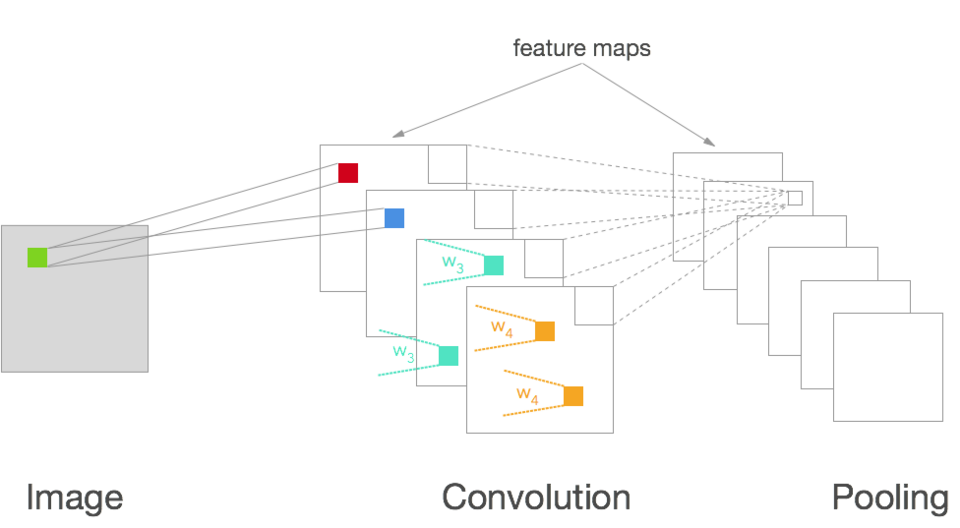

# 机器人机器学习基础：数据怎样变成可执行的动作

> **问题：** 同样一组相机图像与关节数据，为什么训练损失很低的策略仍可能在新环境中失败

**先修：** F02–F04、P01；**学习目标：**区分监督、自监督与策略学习；看懂数据、目标函数、泛化指标及部署分布之间的关系

## 核心｜1. 先定义任务，再选择网络

机器人学习不是“给图片接一个神经网络”；一个标准样本至少须定义观测 $o_t$（例如图像与关节状态）、期望动作 $a_t$（关节目标/速度/力矩，含单位、坐标系与采样周期）和任务条件 $g$；学习策略可写为

$$
\pi_\theta(a_t\mid o_{0:t},g)
$$

它**不一定**能看到完整物理状态 $s_t$；相机遮挡、标定误差和历史信息不足会造成部分可观测性；若动作实际是一段时域序列，则需明确其长度、控制频率和执行方式

学习前必须分别回答：标签从哪来、模型预测什么、部署时由谁闭环执行，以及失败时如何停止；分类器、动力学模型和闭环控制策略不能因都使用神经网络而等同

## 核心｜2. 监督学习与经验风险

已知样本 $D=\{(x_i,y_i)\}_{i=1}^N$，监督学习通过

$$
\hat\theta=\arg\min_\theta\frac1N\sum_{i=1}^N\ell(f_\theta(x_i),y_i)+\lambda\Omega(\theta)
$$

拟合预测函数；回归常用平方误差，分类常用交叉熵；不同损失表达**不同概率假设和评价目标**；例如平方误差的最优单点预测是条件均值，若真实动作具有多个互斥可行解，均值可能不是任何一个可行动作

机器人数据通常是沿同一轨迹连续采样，邻近帧高度相关；随机逐帧划分训练/测试可能让同一场景几乎重复出现在两侧；可靠评估应优先按**轨迹、物体、场景、机器人或采集时段**分组切分，并报告切分规则、种子、失败例与置信区间

## 核心｜3. 自监督、表征学习与动力学学习

- **自监督**从数据构造学习目标，例如未来观测预测、遮挡重建、对比学习；不等于“完全不需要监督信号”
- **表征学习**构造特征 $z=f_\theta(o)$，希望保留任务相关信息并降低噪声、背景或视角干扰
- **动力学学习**拟合 $\hat s_{t+1}=f_\theta(s_t,a_t)$ 或概率转移，不等于已经学会最优控制策略

对比学习常见形式（一个正样本 $z^+$ 与多个候选 $z_j$）

$$
\ell_{\mathrm{NCE}}=-\log\frac{\exp(\operatorname{sim}(z,z^+)/\tau)}{\sum_j\exp(\operatorname{sim}(z,z_j)/\tau)}
$$

这里的正负样本构造决定了模型学会何种不变性；若把可影响抓取姿态的物体方向当作应忽略的变化，好的对比损失也可能损害控制

<figure class="concept-diagram web-source-figure" data-asset="cnn">
  
  <figcaption>从图像到特征图的卷积与池化逐步改变空间分辨率和表征；这些特征仍需接到明确的预测或控制任务，网络结构本身不保证机器人泛化 · 来源：<a href="https://commons.wikimedia.org/wiki/File:Convolutional_Network.png" target="_blank" rel="noopener noreferrer">Will Whitney</a> · <a href="https://creativecommons.org/licenses/by-sa/4.0" target="_blank" rel="noopener noreferrer">CC BY-SA 4.0</a></figcaption>
</figure>

## 进阶｜4. 泛化与分布偏移不是同一件事

独立同分布测试只估计与训练样本近似同分布的风险；机器人部署会遭遇物体、背景、光照、动力学参数、执行时序变化；而闭环策略还会改变自己接下来看到的状态分布

$$
 d_{\pi_\theta}(s)\neq d_{\pi_E}(s)
$$

因此，在专家轨迹上的离线动作误差小，并不保证在学习者自行滚动执行时成功率高；评价应至少区分：单步预测误差、闭环任务成功率、异常恢复率和安全约束违反率

**数据泄漏**不仅出现在训练集和测试集共享图像，也出现在归一化统计量在全数据上拟合、同一动作序列拆分到两边，以及用测试成功率反复选超参数等过程

## 进阶｜5. 不确定度与安全边界

模型不确定性可源于观测噪声、环境随机性和样本覆盖不足；网络输出的置信分数不是自动校准的概率；应单独校验概率校准、分布外情形和时间相关误差；策略置信度高也不能替代关节限位、碰撞约束和急停等硬件层保护

## 实践｜6. 本章可以检查什么

`labs/python/robot_learning/main.py --check` 用线性特征去拟合非线性专家策略，对比仅使用窄状态分布的行为克隆与收集学习者访问状态后再询问专家的差异；它不是深度学习性能基准，而是演示为什么部署分布和训练分布的覆盖程度重要

### 自测

1. 为什么机械臂任务的图像帧不应默认随机独立划分训练集与测试集
2. 什么情况下平方误差学到的条件均值可能是“坏动作”
3. 状态预测模型、策略网络和目标检测模型的输出单位及验证方式有何不同

**参考：** [ETH Robot Learning 2026 官方课程](https://cvg.ethz.ch/lectures/Robot-Learning/)；[Sutton & Barto, *Reinforcement Learning: An Introduction*](http://incompleteideas.net/book/the-book-2nd.html)