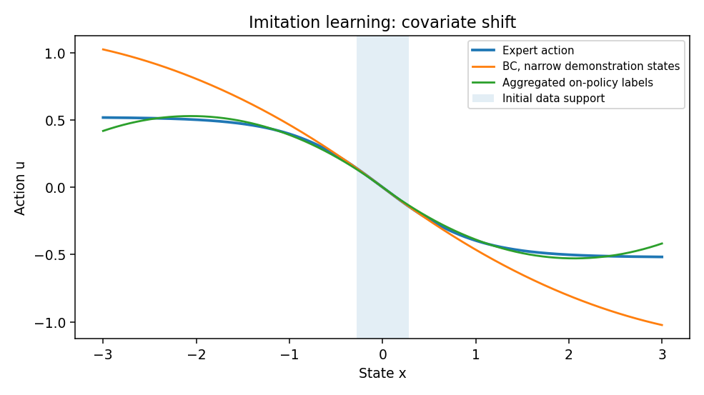

# 模仿学习：从示范轨迹到闭环策略

> **问题：** 学生在老师演示的视频里每一步都能模仿，为什么自己操作几个回合就偏离轨迹

**先修：** L01、C01；**学习目标：**能够写出 BC 与 DAgger 的目标，解释闭环分布偏移，并设计示范数据采集与验证方案

## 核心｜1. 示范是什么

一条示范轨迹为 $\tau=(o_0,a_0,o_1,a_1,\ldots)$；通常还需记录时间戳、动作约定、相机标定、末端坐标系、任务指令、完成/失败标签；观察到的动作可能是专家的**控制指令**而非传感器测出的实际位移，两者不可混作标签

模仿学习希望从专家 $\pi_E$ 学到 $\pi_\theta$；其特点是利用示范信息，而不必对每次真实机器人尝试都定义可计算奖励；但这并不意味着不需要部署安全与闭环评估

## 核心｜2. 行为克隆（BC）

给定专家分布下的数据，确定性策略可用

$$
\min_\theta \mathbb E_{(o,a)\sim D_E}\big[\|\pi_\theta(o)-a\|^2\big]
$$

训练；概率策略常用最大似然 $-\mathbb E[\log\pi_\theta(a\mid o)]$；如果示范存在多种合理路线，单点均值可能落在两个路线之间的障碍物上；应考虑条件多峰动作模型、规划约束或重新定义动作表示

### 为什么误差会累积

BC 学到的是专家访问状态分布 $d_{\pi_E}$ 下的近似动作，而真正部署后的输入来自 $d_{\pi_\theta}$；小偏差可能把系统送入训练集中没有的状态，进而触发更大偏差；常见理论示例中，若每步在专家分布上有至多 $\epsilon$ 级错误，在特定有界成本假设下，轨迹总成本差可能出现 $O(T^2\epsilon)$ 级累积；**这不是每个闭环系统都必然按平方失稳**

## 核心｜3. DAgger：纠正访问状态覆盖问题

DAgger（Dataset Aggregation）迭代地收集学习者执行时访问的状态，并为这些状态请求专家动作标签，再汇总训练

$$
D_{k+1}=D_k\cup\{(o_t,\pi_E(o_t)):o_t\sim d_{\pi_k}\}
$$

其在线学习式性能保证依赖策略混合、专家查询、损失假设和相应在线学习后悔界，**不能泛化成“只要聚合数据就一定收敛到最佳策略”**

在真实机器人上直接执行未成熟策略会带来碰撞风险，必须有安全边界、专家接管或安全仿真；离线已有示范而不能向专家查询时，就不能把简单重采样写成标准 DAgger

## 进阶｜4. 复杂示范与策略形式

- **离线 BC**：训练成本低，受示范覆盖与质量限制
- **交互式数据聚合**：补充学习者访问状态，依赖专家查询与安全执行
- **逆强化学习**：从行为推断潜在奖励，通常存在奖励等价性/不可辨识问题
- **离线强化学习**：在既有数据上优化回报，和纯模仿并不相同，受超出数据支持的动作估值误差影响
- **序列动作策略**：一次预测多个动作，减少逐步推理开销，但必须处理观测延迟与执行中重规划

## 实践｜5. 数据聚合的最小示意

执行 `python labs/python/robot_learning/main.py --check`；初始状态示范只覆盖 $[-0.28,0.28]$，拟合可外推但不精确的非线性专家；随后从更广的初始分布访问状态、查询同一专家函数并重新拟合；实验报告“测试状态范围内的动作预测误差”，**不是成功率、不是完整 DAgger，也不是机器人真机结果**

## 交互观察

拖动下方参数，比较模型输出与本章公式的联系，交互演示采用简化假设，不替代 Python 数值检查或真实机器人验证

<!-- INTERACTIVE:IMITATION -->

### 自测

1. 为什么轨迹级闭环指标可能与单帧 BC 误差排序相反
2. DAgger 和在原示范数据上反复训练有何根本区别
3. 在不能让未成熟策略直接控制机械臂时，可以如何安全获取纠偏标签

**参考：** [Ross, Gordon & Bagnell, AISTATS 2011：DAgger](https://proceedings.mlr.press/v15/ross11a.html)；[ETH Robot Learning 2026](https://cvg.ethz.ch/lectures/Robot-Learning/)
