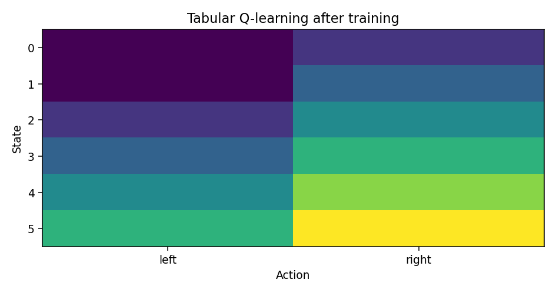

# 强化学习：让机器人从交互后果中改进策略

> **问题：** 在没有人逐帧给出正确动作的情况下，怎样用“是否到达目标、是否碰撞、能耗高低”等反馈学习决策

**先修：** F04、C01、L01；**学习目标：**解释 MDP、Bellman 方程、Q-learning 与策略梯度，区分在线 RL、离线 RL 和模型式 RL 的适用边界

## 核心｜1. 马尔可夫决策过程（MDP）

MDP 通常记为 $(\mathcal S,\mathcal A,P,r,\gamma)$；$P(s'\mid s,a)$ 描述转移，$r(s,a,s')$ 为一步奖励，$\gamma\in[0,1)$ 为折扣因子；给定策略 $\pi$，回报为

$$
G_t=\sum_{k=0}^{\infty}\gamma^k r_{t+k},\qquad V^\pi(s)=\mathbb E_\pi[G_t\mid s_t=s]
$$

这里假设无限期回报有界或期望存在；机器人相机观测 $o_t$ 未必满足马尔可夫性质，需要增加历史状态、状态估计或使用 POMDP 表述；奖励的数值也不等同于安全规则

## 核心｜2. Bellman 方程和动作价值

$$
Q^\pi(s,a)=\mathbb E\big[r_t+\gamma V^\pi(s_{t+1})\mid s_t=s,a_t=a\big]
$$

$$
Q^*(s,a)=\mathbb E\big[r_t+\gamma\max_{a'}Q^*(s_{t+1},a')\mid s,a\big]
$$

Bellman 最优性是在给定 MDP、动作集合与奖励条件下的性质，不代表一个近似神经网络必然找到全局最优；对**有限状态、有限动作、表格 Q-learning**，更新式为

$$
Q(s,a)\leftarrow Q(s,a)+\alpha\Big[r+\gamma\max_{a'}Q(s',a')-Q(s,a)\Big]
$$

终止状态的后续价值按零处理；收敛理论需要充分访问状态动作、适当的衰减学习率等条件；固定学习率的有限次迭代只能展示经验结果

## 核心｜3. 策略优化与 Actor–Critic

参数化策略目标为 $J(\theta)=\mathbb E_{\tau\sim\pi_\theta}[\sum_t\gamma^t r_t]$；在通常的可微性与概率密度条件下，策略梯度可表达为与

$$
\mathbb E\left[\sum_t\nabla_\theta\log\pi_\theta(a_t\mid s_t)\,\hat A_t\right]
$$

成正比的形式，具体折扣和采样分布需要按目标定义处理；$\hat A_t$ 是优势函数估计，减小方差但不自动消除由错误价值函数造成的偏差

Actor 负责动作分布，Critic 估计价值；PPO、SAC 等是具体算法族，其更新目标、离策略修正、熵项与稳定性条件彼此不同，不能用一行通式代替完整实现

## 进阶｜4. 模型式、离线与安全强化学习

- **模型式 RL**学习或使用预测转移，再规划或想象未来；模型误差会随时间滚动累积
- **离线 RL**仅从固定数据集训练，可能因为评价了未见过的动作而高估价值
- **安全约束**可描述为约束 MDP，但惩罚系数不是严格安全保证；硬件限位、控制屏障与监控层仍不可省略
- **Sim-to-Real**受接触摩擦、延迟、驱动饱和、传感器标定与仿真器偏差影响

## 实践｜5. 七状态一维导航

配套学习实验提供 7 个格点、左右两个动作的确定性小环境；终点为状态 6，普通步奖励为 $-1$，到达奖励为 $+10$；使用探索式表格 Q-learning 训练后，在固定环境上检查从各非终止状态按贪心策略到达终点的步数

本实验不包含碰撞、连续动作、策略网络、视觉输入或真实机器人；它只能说明 Bellman 更新与数据驱动行为改进的最小机制

## 交互观察

拖动下方参数，比较模型输出与本章公式的联系，交互演示采用简化假设，不替代 Python 数值检查或真实机器人验证

<!-- INTERACTIVE:BELLMAN -->

### 自测

1. 为什么奖励惩罚与真实安全约束不是一回事
2. 表格 Q-learning 的收敛结论为什么不能直接用于神经网络 Q-learning
3. 在线 RL、离线 RL、模型式 RL 的数据来源有何差异

**参考：** [Sutton & Barto, *Reinforcement Learning: An Introduction*](http://incompleteideas.net/book/the-book-2nd.html)；[ETH Robot Learning 2026](https://cvg.ethz.ch/lectures/Robot-Learning/)
