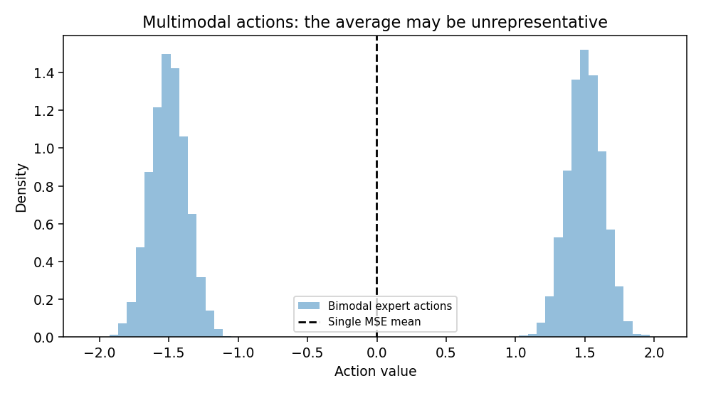
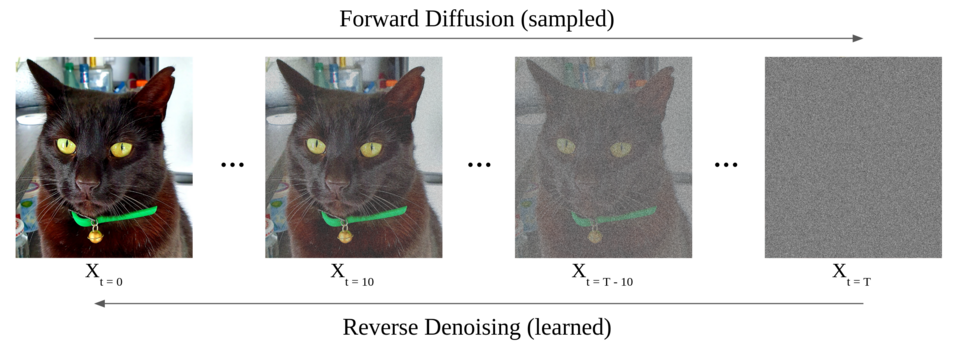

# 生成式机器人策略：为什么动作不能总用一个均值表示

> **问题：** 绕过障碍物可以向左也可以向右；若模型把两条成功路径平均，会不会反而撞上障碍物

**先修：** L01、L02、F04；**学习目标：**理解动作多峰分布、序列动作、扩散策略与条件生成，明确“数学去噪示例”和真实视觉生成式机器人策略的差别

## 核心｜1. 均方误差为什么可能产生无效动作

设给定相同观测 $o$，专家一半选择 $a=-1.5$，另一半选择 $a=+1.5$；仅用平方损失训练确定性输出 $f(o)$，其最优值为

$$
 f^*(o)=\mathbb E[a\mid o]\approx0
$$

而 $a=0$ 可能正好撞上障碍；这不是神经网络“不够强”，而是**单点条件均值的统计定义**与多模态任务需求不匹配；可采用显式概率密度、多模态策略、隐变量模型或条件生成模型，在候选动作中选择一个满足约束的方案

## 核心｜2. 动作分块（Action Chunking）

传统单步策略预测 $a_t=\pi(o_t)$；动作分块改为输出未来 $H$ 步的候选序列

$$
\mathbf a_{t:t+H-1}=\pi_\theta(o_{\le t},g)
$$

推理后可只执行前 $h\le H$ 步再重规划，既减少策略推理频率，也可维持闭环反馈；代价是动作分块期间的环境变化、执行延迟和不同块之间的衔接问题必须处理；ACT（Action Chunking with Transformers）使用条件生成结构学习动作分块；**ACT 不等于 Diffusion Policy**，二者的生成机制与训练目标不同

## 核心｜3. 条件扩散策略的基本思想

扩散模型从干净动作序列 $x_0$ 出发构造加噪过程；DDPM 形式中

$$
 q(x_k\mid x_{k-1})=\mathcal N(\sqrt{1-\beta_k}\,x_{k-1},\beta_k I)
$$

定义 $\alpha_k=1-\beta_k$ 与 $\bar\alpha_k=\prod_{j=1}^k\alpha_j$，可直接采样

$$
 x_k=\sqrt{\bar\alpha_k}\,x_0+\sqrt{1-\bar\alpha_k}\,\epsilon,\qquad\epsilon\sim\mathcal N(0,I)
$$

条件去噪网络 $\epsilon_\theta(x_k,k,o,g)$ 的常见训练目标是

$$
\mathcal L=\mathbb E_{x_0,k,\epsilon,o,g}\left[\|\epsilon-\epsilon_\theta(x_k,k,o,g)\|_2^2\right]
$$

推理从噪声出发多步生成候选动作，配合真实机器人观测执行滚动规划；训练损失低不保证所有生成动作遵守机器人动力学、碰撞边界或关节限制；这些仍需独立约束和验证

<figure class="concept-diagram web-source-figure" data-asset="diffuse">
  
  <figcaption>正向过程逐步加噪，反向过程逐步去噪；图中对象是图像，本章动作扩散使用动作序列作为变量，必须额外给出观测条件与动作约束 · 来源：<a href="https://commons.wikimedia.org/wiki/File:Image_diffusion_process.png" target="_blank" rel="noopener noreferrer">Dragweb</a> · <a href="https://creativecommons.org/licenses/by-sa/4.0" target="_blank" rel="noopener noreferrer">CC BY-SA 4.0</a></figcaption>
</figure>

## 进阶｜4. Diffusion Policy、ACT 与 Flow Matching

| 方法 | 主要思路 | 常见取舍 |
|---|---|---|
| ACT | Transformer + 条件潜变量生成动作块 | 高效序列预测，仍依赖示范覆盖与时序设计 |
| Diffusion Policy | 条件扩散去噪生成一段动作 | 适合多峰连续动作，但采样迭代可能较耗时 |
| Flow Matching 策略 | 学习将噪声映射为动作分布的连续向量场 | 训练与采样形式不同于 DDPM，需要数值积分/离散求解 |
| 自回归动作 token | 逐 token 预测离散或离散化动作 | 接口清晰，但量化误差和顺序延迟不可忽略 |

上述方法不具有不依赖数据、任务及计算预算的绝对优劣；动作是笛卡尔位姿、关节角、关节增量还是力矩，对模型学习和部署验证都会产生根本影响

## 实践｜5. 最小双峰去噪实验

配套学习实验生成均值为 $\pm1.5$ 的双高斯专家动作，向其加已知高斯噪声，并根据**已知混合先验**直接计算 $\mathbb E[x_0\mid x_k]$ 的 Bayes 后验均值；核对它的均方误差低于原始带噪观测

这是解析的**单步混合高斯去噪**，没有训练去噪神经网络、没有反向扩散采样链、没有视觉条件或机器人实机执行；不能把该实验称为“复现 Diffusion Policy”

### 自测

1. 为什么 MSE 单点估计在多峰分布下可能违背任务约束
2. 动作块长度 $H$ 与实际执行长度 $h$ 分别会影响什么
3. 扩散模型的训练噪声步数是否等于机器人动作执行时间步数

**参考：** [Chi 等, *Diffusion Policy*](https://arxiv.org/abs/2303.04137)；[Zhao 等, *Learning Fine-Grained Bimanual Manipulation*（ACT/ALOHA）](https://arxiv.org/abs/2304.13705)
