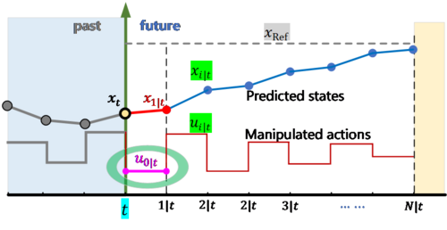
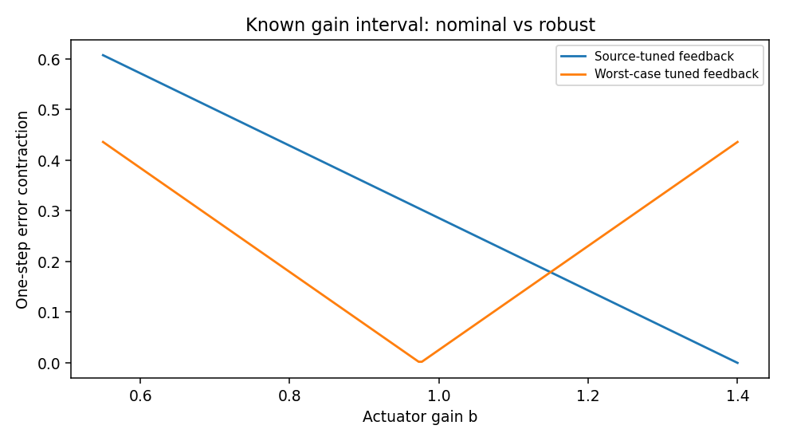

# 世界模型、Sim-to-Real 与学习型机器人系统

> **问题：** 如果机器人已经学会预测自己下一步会发生什么，为什么仍可能在真实环境中撞上看不见的障碍物

**先修：** L03、P03、M06、C07；**学习目标：**理解世界模型预测、规划时的模型偏差、域随机化的真实作用以及从模拟到硬件部署的必要安全分层

## 核心｜1. 世界模型预测什么

一种常见潜变量结构从历史观测和动作得到潜在状态 $z_t$，学习

$$
 p_\theta(z_{t+1}\mid z_t,a_t),\qquad
 p_\theta(o_t\mid z_t),\qquad
 r_\theta(z_t,a_t)
$$

这种模型可以预测未来状态、视觉观测或奖励，并供在线规划或想象轨迹优化使用；模型可以是确定性或概率的；**不是所有世界模型都同时有图像解码器和奖励网络**

在基于模型的 RL 中，策略可通过模型模拟的轨迹学习；但是模型误差会沿规划时域被放大：若模型单步误差不为零，多步误差通常还受到转移动力学的放大程度、状态分布偏移与策略反馈作用影响，不能简单假定与步数成线性关系

## 核心｜2. Dreamer 路线与模型预测控制

Dreamer 类方法使用学习到的潜在动态在模型中“想象”未来轨迹，并更新价值函数和策略；其具体训练包含序列表示、模型学习和策略/价值学习等模块；MPC 可以每一步根据最新观测重规划，二者可互补但不是同一种算法

即便模型能生成逼真视频，也不代表可精确预测摩擦力、碰撞冲量或机器人机体所承受的接触力；视频观感和可用于安全控制的动力学可信度属于不同验证维度

<figure class="concept-diagram web-source-figure" data-asset="mpc">
  
  <figcaption>预测模型把候选输入展开成未来状态，再比较目标函数；学习得到的世界模型也可用于这种规划，但滚动预测的形式本身并不说明模型来自训练还是解析方程 · 来源：<a href="https://commons.wikimedia.org/wiki/File:Model_predictive_control.png" target="_blank" rel="noopener noreferrer">Tsesea</a> · <a href="https://creativecommons.org/licenses/by-sa/4.0" target="_blank" rel="noopener noreferrer">CC BY-SA 4.0</a></figcaption>
</figure>

## 核心｜3. Sim-to-Real 与域随机化

仿真机器人动力学可写为 $s_{t+1}=f(s_t,a_t;\phi)$，其中 $\phi$ 包括质量、摩擦、控制增益、时延等物理参数；源域只用 $\phi_0$ 训练，很可能在真实 $\phi_*$ 上出现偏差；域随机化训练的目标通常是

$$
 \min_\theta\mathbb E_{\phi\sim p(\phi)}\big[\mathcal L(\pi_\theta;\phi)\big]
$$

但这是对某个选定分布上的平均风险优化，**并非对分布外的每一种真实参数都有鲁棒保证**；若希望保证最坏情况，需要明确参数集合并考虑 $\min_\theta\max_{\phi\in\Phi}\mathcal L(\pi_\theta;\phi)$ 等不同目标及其实现条件

## 进阶｜4. 一个可精确核对的鲁棒反馈反例

取教学用标量系统

$$
 x_{t+1}=x_t+b u_t,\quad u_t=-k x_t,\quad b\in[b_{\min},b_{\max}]
$$

误差每步放大/收缩因子为 $|1-bk|$；若只对源域增益 $b_{\max}$ 调参，$k_{\mathrm{src}}=1/b_{\max}$；若 $b_{\min}>0$ 且增益区间确定，最小化端点中的最大绝对因子可得

$$
 k_{\mathrm{rob}}=\frac{2}{b_{\min}+b_{\max}},\qquad
 \max_b|1-bk_{\mathrm{rob}}|=\frac{b_{\max}-b_{\min}}{b_{\max}+b_{\min}}
$$

这里可解析证明的只是**给定增益区间的标量线性系统**，不是端到端学习策略或接触机器人动力学的稳定性保证

## 进阶｜5. 从训练到部署的系统闭环

1. 数据：明确本体/传感器时间同步、关节动作定义、示范失败及质量审核
2. 模型：训练集、场景分组测试、分布外和延迟扰动测试，模型配置保持一致
3. 仿真：增加接触、摩擦、执行饱和、观测丢失和随机参数
4. 安全：动作裁剪、运动学/动力学约束、碰撞监控、人工接管及硬件急停
5. 硬件：台架、子系统再到整机逐级放行；日志记录目标、感知、策略输出、实际控制命令和故障原因

学习策略只是系统的一部分；与 E01～E07 工程篇的关键接口不同的是，学习算法中的训练成功并不会自动满足实时系统最坏时延与机器人安全要求

## 实践｜6. 理想线性模型失配实验

配套学习实验先在 $b=1.4$ 的确定性系统中拟合已知结构的增益，再用 $b=0.55$ 的目标域检验单步预测误差，并在 $b\in[0.55,1.4]$ 内比较名义反馈和 minimax 线性反馈的收缩因子

实验**没有**实现 Dreamer、端到端 Sim-to-Real、非线性系统辨识或真实域随机化训练；是一个足以检查模型失配和最坏情况反馈思想的最小反例

### 自测

1. 预测 RGB 帧逼真和控制用转移模型可信有何不同
2. 对随机参数分布的平均表现较好，为什么不等于最坏工况安全
3. 为什么机器人低层安全监控不能直接由学习策略自身取代

**参考：** [Hafner 等, *Mastering Diverse Control Tasks Through World Models*, Nature 2025](https://doi.org/10.1038/s41586-025-08744-2)；[MIT Underactuated Robotics](https://underactuated.mit.edu/)；[ETH Robot Learning 2026](https://cvg.ethz.ch/lectures/Robot-Learning/)