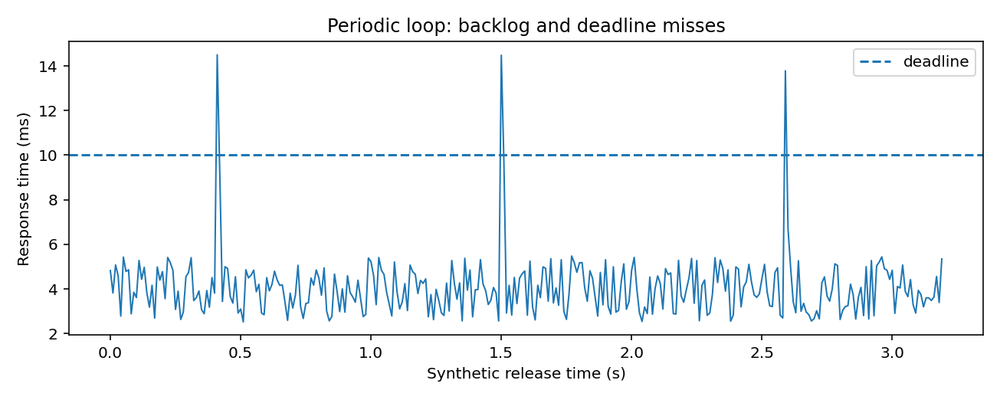
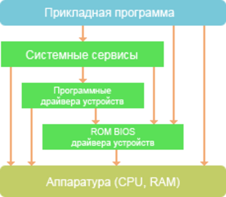
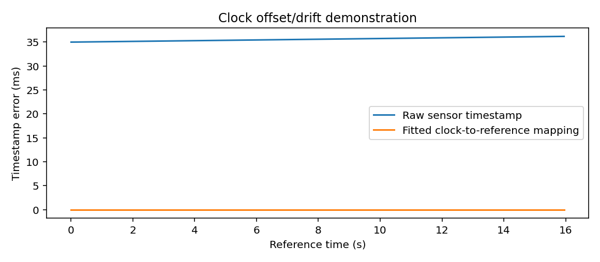

# 嵌入式系统与机器人实时控制

> **问题：** 控制器平均只用 3 ms 就完成计算，为什么以 100 Hz 驱动的机械臂仍可能偶尔抖动甚至触发保护

**先修：** F08、C01、C02；**学习目标：**区分控制周期、响应时间与抖动，理解 MCU—驱动器—工控机的分工，并能用可测量的时间指标描述闭环执行条件


## 核心｜1. 先区分“算得快”和“按时完成”

设控制周期为 $T_s=10\,\mathrm{ms}$，每次在释放时刻 $r_k=kT_s$ 允许执行，在截止时刻 $d_k=r_k+T_s$ 前完成；一次任务的响应时间定义为

$$
R_k=f_k-r_k
$$

其中 $f_k$ 是计算完成时间；**平均响应时间小于周期不保证没有超时**；最大响应时间、规定测量区间的分位数、超时计数与输入数据的新鲜度都应单独记录

可用下列指标描述实际控制循环

| 指标 | 含义 | 典型风险 |
|---|---|---|
| 周期 $T_s$ | 期望相邻更新间隔 | 模型离散假设与实际频率不符 |
| 响应时间 $R_k$ | 释放到完成 | $R_k>T_s$ 导致本周期超时 |
| 释放抖动 | 真实启动相对计划启动的偏差 | 控制输入不等间隔 |
| 输入数据年龄 | 消费时间减观测时间戳 | 使用过期状态进行控制 |
| 最坏情况执行时间 WCET | 特定平台与假设下的执行时间上界 | 仅靠统计均值不能推导 WCET |

工程中的“实时”强调能在明确的时间条件下完成任务，不等于 CPU 算力强，更不等于 Linux 用户态程序天然具有硬实时保证



## 核心｜2. 分层闭环：谁应负责什么

常见的执行链为 **高层任务 → 路径/轨迹 → 关节控制器 → 电机驱动器 → 电机与传感器**；MCU/驱动器通常承担电流环、编码器采样、局部保护；上位控制器计算关节或任务空间指令；任务软件处理低频决策

这些分工由硬件能力和接口协议决定，不能默认所有驱动器都暴露力矩指令；*位置模式下的驱动器* 与 *具备可验证力矩接口的驱动器* 对阻抗、动力学补偿的实现能力不同，详见 C05

数字控制还涉及保持器和延迟：若离散控制输出 $u_k$ 在一整个周期内保持，典型零阶保持模型为 $u(t)=u_k$（$kT_s\le t<(k+1)T_s$）；总执行延迟与通信延迟会改变控制回路相位裕度，不能只靠提高名义增益补偿

<figure class="concept-diagram web-source-figure" data-asset="rtos">
  
  <figcaption>按层区分应用任务、内核与硬件服务；控制周期是否按时完成取决于调度、阻塞和通信等整条执行链，不能仅凭架构分层推断最坏延迟 · 来源：<a href="https://commons.wikimedia.org/wiki/File:RTOS_Architecture_2.png" target="_blank" rel="noopener noreferrer">JohnnyBox</a> · <a href="https://commons.wikimedia.org/wiki/File:RTOS_Architecture_2.png" target="_blank" rel="noopener noreferrer">Public domain</a></figcaption>
</figure>

## 核心｜3. CAN、EtherCAT、串口与网络通信

- **CAN**：多节点总线仲裁与报文标识符决定竞争行为，较高优先级报文并非在任意负载下都具有零延迟；经典 CAN、CAN FD、上层协议需区分
- **EtherCAT**：工业以太网现场总线，支持分布式时钟和周期过程数据；精确同步仍需正确配置、测量和链路容量分析
- **RS485**：电气物理层，不规定唯一的上层帧格式、超时或可靠性机制
- **TCP/UDP**：提供不同传输语义，但本身不保证闭环控制的确定性时限

设计通信时应给出具体的帧长度、周期、负载率、错误恢复、超时和时间戳归属，而不是只填写波特率或带宽

## 进阶｜4. 时间预算与时钟同步

一个简化的端到端执行时间预算为

$$
T_{\mathrm{chain}}=T_{\mathrm{sense}}+T_{\mathrm{transport}}+T_{\mathrm{estimate}}+T_{\mathrm{plan}}+T_{\mathrm{control}}+T_{\mathrm{act}}
$$

此式是阶段耗时的*示意分解*，异步流水线存在重叠与等待，不能直接把平均时间之和作为最坏情况界；每个阶段必须明确时间戳来自传感器硬件时钟、主机接收时钟还是系统参考时钟



当原始传感器时钟满足 $t_s=(1+\epsilon)t+\delta$，已知同步点可拟合时间映射；但在真实系统中同步观测本身有噪声和延迟不对称，不能把合成数据的零残差解释为真实时钟同步精度

## 进阶｜5. 调度、锁与故障处理

优先级反转、动态内存分配、阻塞锁、非实时日志、页面错误和网络重试都可能使执行尾延迟变大；实时控制线程应尽量减少阻塞操作，利用线程优先级、内存策略、预分配及受控的进程间交换方式降低风险

区分 **运行时超时检测** 和 **独立保护链**：控制线程自己检测超时并不意味着控制线程失去调度时保护仍然有效；真正的安全停机不能只依赖可能已经失效的软件线程，见 E05

## 实践｜6. 运行合成周期任务检查

```bash
python labs/python/systems/main.py --check
```

该程序模拟一个非抢占式单线程周期任务，指定 $T_s=10\,\mathrm{ms}$，包含少量异常执行时长；结果显示 1200 个周期中有 11 次超时，最大响应时间约 14.83 ms，而大部分周期低于 10 ms

实验**并未运行真实周期调度线程**，不用于评估 CPU、Linux PREEMPT_RT 或 EtherCAT 的真实最坏情况性能


## 交互观察

拖动下方参数，比较模型输出与本章公式的联系，交互演示采用简化假设，不替代 Python 数值检查或真实机器人验证

<!-- INTERACTIVE:DEADLINE -->

### 自测

1. 平均执行时间为 3 ms 是否足以证明 100 Hz 控制环实时可用？缺少哪些证据
2. 如果总线帧准时送达、传感器时间戳却旧了 80 ms，机器人状态是否仍能用于控制
3. 位置接口与力矩接口如何改变控制器的实际可实现范围

**参考：** [ROS 2 官方支持信息](https://docs.ros.org/en/rolling/Releases.html)；[ros2_control 文档](https://control.ros.org/)；[Linux kernel real-time documentation](https://docs.kernel.org/core-api/real-time/index.html)