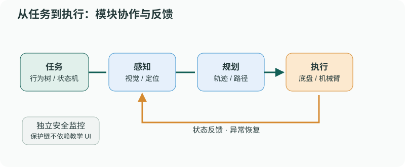
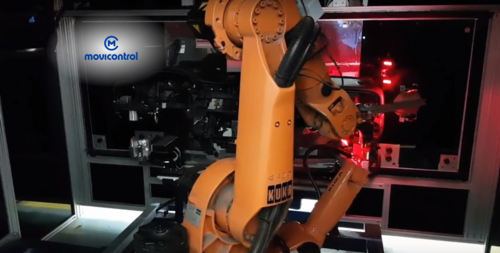
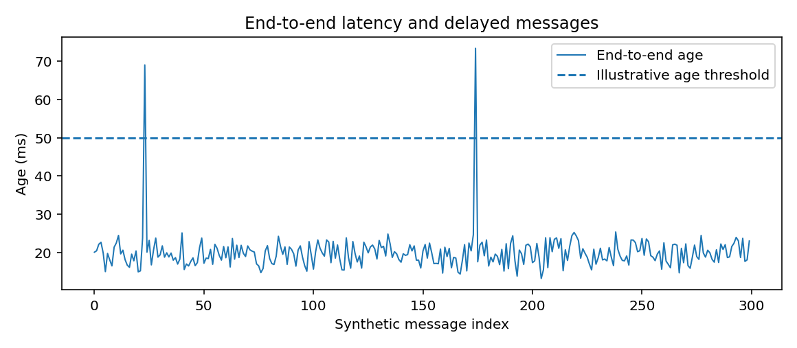

# 机器人系统集成：跨模块正确性比单模块成功更难

> **问题：** 同一个目标在视觉结果中很稳定，MoveIt2 也能规划到达，可真实机械臂为什么仍频繁抓空

**先修：** E02、E03、E05、P02、C04；**学习目标：**建立跨模块坐标/时间/单位契约，理解命令执行闭环、容错及系统级成功指标

## 核心｜1. 系统集成的最小必要信息

机器人动作通常经过“观测 → 状态估计 → 决策 → 规划 → 执行 → 结果确认”，任何一处假设不一致都可能导致整体失败

对一条目标位姿数据，至少注明：源坐标系、目标坐标系、观测时间、测量单位、不确定度、有效期、唯一目标标识、模型与标定标识

常见错误包括毫米与米混用、相机光学系与机械臂基座混用、使用过期 TF 进行转换、对不同时间的机器人运动状态和视觉观测做配对，以及把算法规划成功误认为物理任务完成

## 核心｜2. 四类跨模块契约

| 契约 | 必须明确 | 验收条件示例 |
|---|---|---|
| 数据契约 | 类型、单位、坐标系、时间戳、精度 | 坐标方向与真值/已知标定算例一致 |
| 时序契约 | 更新率、超时、最大数据年龄 | 过期目标必须拒绝进入执行 |
| 控制契约 | 接口模式、限位、反馈/取消语义 | 发送命令后的到位条件独立校验 |
| 故障契约 | 错误码、锁存、恢复与责任模块 | 上层取消不能绕开硬件级安全状态 |

建议给每项自动化任务设置唯一关联 ID，贯穿感知、规划和执行日志，用于追溯单次任务跨节点的状态，见 E07

<figure class="concept-diagram web-source-figure" data-asset="kuka">
  
  <figcaption>机械臂、视觉与工作站连接后，要检查位姿单位、时间基准和执行反馈；系统能通信并不意味着目标坐标、命令时刻与实际动作已经一致 · 来源：<a href="https://commons.wikimedia.org/wiki/File:Robot_industrial_Kuka_Movicontrol.png" target="_blank" rel="noopener noreferrer">Movicontrol</a> · <a href="https://creativecommons.org/licenses/by-sa/4.0" target="_blank" rel="noopener noreferrer">CC BY-SA 4.0</a></figcaption>
</figure>

## 核心｜3. 数据新鲜度比处理速度更重要

从观测发生到使用该数据发出控制命令之间的真实时间差称数据年龄；若各个处理阶段总和为

$$
 T_{\mathrm{age}}=T_{\mathrm{transport}}+T_{\mathrm{estimate}}+T_{\mathrm{decision}}+T_{\mathrm{execute\_queue}}
$$

这只是在相同参考时间下的近似分解，异步队列和时钟偏差需要额外考虑；系统应以源时间戳计算数据年龄，设置与任务运动速度、估计误差和安全约束一致的有效期，而不是只用“最近收到了消息”判断是否新鲜

## 进阶｜4. 任务与执行的双重验证

一种可审核的采摘任务定义为

1. **视觉有效**：置信度、时间戳、坐标变换有效
2. **规划有效**：规划时刻的环境和机器人状态合理、约束满足
3. **执行许可**：目标未过期、底盘停稳、执行器处于允许状态
4. **执行完成**：关节位置/速度或末端状态达到给定误差范围
5. **任务成功**：独立观测证明目标物品已抓取、切断或转移

这里第 4 项和第 5 项不同；没有感知或其他结果反馈时，“执行完成”不能自动推出“采摘成功”

## 进阶｜5. 可诊断的系统状态

系统可划分 `IDLE`、`READY`、`EXECUTING`、`RECOVERY`、`FAULT` 等**业务模式**；其中 `FAULT` 需要明确究竟是算法失败、传感器断线、运动约束失败，还是已经触发独立的硬件安全回路

不要设计一个包罗所有状态的中央大节点，把视觉、导航和机械臂算法重新耦合；各模块只暴露经验证的能力接口，任务层负责组织执行，安全监控独立承担保护职责

## 实践｜6. 最小跨模块延迟实验

配套合成流水线分别模拟感知、规划、通信和控制耗时，再比较端到端消息年龄与 **50 ms 的教学阈值**；结果中绝大部分消息低于阈值，但存在 8 条过期消息，说明较低平均延迟不能替代每条命令有效期检查

此处的 50 ms 只是方便观察的合成设置，不是机器人控制通用安全标准，更没有覆盖实际相机、网络和执行器；读者应结合速度、环境和风险分析确定自己的系统限制

### 自测

1. 机械臂关节角准确达到规划结果，采摘目标是否一定完成
2. 单节点运行成功但系统全流程失败，如何通过任务 ID 和时间戳定位责任
3. 什么时候应该重新感知目标而不是继续执行旧轨迹

**参考：** [ROS2 官方通信概念](https://docs.ros.org/en/rolling/Concepts/)；[MoveIt2 Planning Scene](https://moveit.picknik.ai/main/doc/examples/planning_scene/planning_scene_tutorial.html)；[Nav2 BT Navigator](https://docs.nav2.org/rolling/configuration_and_development/configuration_guide/core_servers/configuring_bt_navigator/)