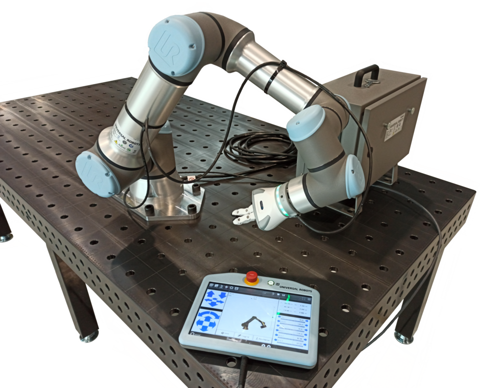
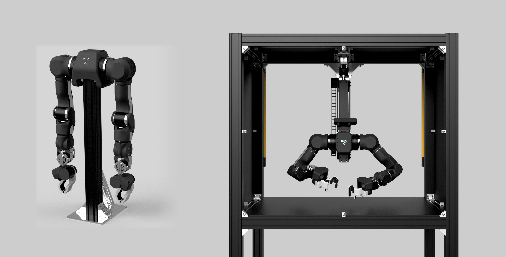

# F02-核心2.秩、零空间与几何约束-详细讲解

> **先记住一句话：** 秩说明输入能独立推动多少个输出方向，零空间说明输入还能怎样变化却不改变输出

为什么六轴机械臂有时会突然进入奇异位形，而七轴机械臂通常可以在末端保持不动时调整手肘？这两个现象背后，其实是同一个线性代数定理

<figure class="concept-diagram web-source-figure" data-asset="6dof">
  
  <figcaption>公开授权的六自由度机械臂结构示意图，注意六个关节的转轴与末端六维运动不是同一概念 · 来源：<a href="https://commons.wikimedia.org/wiki/File:6_Degree-of-Freedom_Robot_Diagram.png" target="_blank" rel="noopener noreferrer">Israel adilman</a> · <a href="https://creativecommons.org/licenses/by/4.0" target="_blank" rel="noopener noreferrer">CC BY 4.0</a></figcaption>
</figure>

## 1. 从两个电机开始：动了却等于没动

想象一个只有前后运动能力的小车，左右两个电机都能向同一方向提供速度贡献，先把它简化成

$$
v=v_1+v_2
$$

电机 1 输出 $+2$、电机 2 输出 $-2$，那么小车速度就是 $0$，不是电机都停了，而是**两个输入的作用刚好抵消**

这里的加法只是一种教学用线性模型，不是在模拟真实差速驱动小车的完整运动学

<!-- INTERACTIVE:RANK_MOTORS -->

用矩阵表示刚才的例子

$$
\underbrace{\begin{bmatrix}1&1\end{bmatrix}}_{\mathbf A}
\underbrace{\begin{bmatrix}1\\-1\end{bmatrix}}_{\mathbf x}
=\underbrace{0}_{\mathbf A\mathbf x}
$$

这里 $\mathbf x\ne\mathbf0$，但 $\mathbf A\mathbf x=\mathbf0$，因此 $\mathbf x$ 落在矩阵 $\mathbf A$ 的**零空间**里

严格来说，零空间是所有满足 $\mathbf A\mathbf x=\mathbf0$ 的输入组成的集合，包括零向量本身；我们特别关注非零向量，是为了找到可以相互抵消的输入方向

## 2. 秩到底在数什么

上面的矩阵 $\mathbf A=[1\quad1]$ 有两列，对应两个输入；但是两列都指向同一个一维输出方向，因此只有 **1 个独立输出方向**

$$
\operatorname{rank}(\mathbf A)=1
$$

输入有两维 $v_1,v_2$，但能够独立影响输出的只有一维，其余一维可以用于抵消

$$
\underbrace{\operatorname{rank}(\mathbf A)}_{\text{独立输出方向数}}
+\underbrace{\dim\ker(\mathbf A)}_{\text{可抵消输入方向数}}
=\underbrace{n}_{\text{输入维数}}
$$

对于这个例子，就是 $1+1=2$，这正是**秩–零度定理**

可以把它理解为对输入自由度的一次分账：一部分用来真正改变输出，剩余部分形成零空间，但这不是在说所有输入方向只能做一种用途，任意输入都可以分解为这两类方向的分量

## 3. 机械臂雅可比：把输入换成关节速度

机械臂控制中的局部线性映射是

$$
\underbrace{\mathbf V}_{\text{末端瞬时速度}}
=\underbrace{\mathbf J(\mathbf q)}_{\text{雅可比}}
\underbrace{\dot{\mathbf q}}_{\text{关节速度}}
$$

若任务是完整的空间末端位姿，$\mathbf V$ 有六个分量，即三个线速度和三个角速度，六轴机械臂的 $\mathbf J$ 为 $6\times6$，七轴机械臂的 $\mathbf J$ 为 $6\times7$

<figure class="concept-diagram web-source-figure" data-asset="ur16">
  
  <figcaption>六轴实例：真实 UR16e 协作机械臂 · 来源：<a href="https://commons.wikimedia.org/wiki/File:UR16e_robot_arm.png" target="_blank" rel="noopener noreferrer">Auledas</a> · <a href="https://creativecommons.org/licenses/by-sa/4.0" target="_blank" rel="noopener noreferrer">CC BY-SA 4.0</a></figcaption>
</figure>

  
<i class="rank-key-task"></i>影响末端输出的独立方向<i class="rank-key-null"></i>零空间方向

  
<strong>六轴 · 正常</strong>
6
<small>6 = 6 + 0</small>

  
<strong>六轴 · 奇异</strong>
51
<small>6 = 5 + 1</small>

  
<strong>七轴 · 满行秩</strong>
61
<small>7 = 6 + 1</small>

| 情况 | 雅可比尺寸 | 秩 | 零空间维数 | 直观理解 |
|:--|:--:|:--:|:--:|:--|
| 六轴正常 | $6\times6$ | $6$ | $0$ | 六维任务刚好够用 |
| 六轴奇异，例如秩降至 5 | $6\times6$ | $5$ | $1$ | 末端丢失一个独立的瞬时速度方向 |
| 七轴满行秩 | $6\times7$ | $6$ | $1$ | 末端六维速度可独立控制，仍有内部调整方向 |
| 七轴奇异，例如秩降至 5 | $6\times7$ | $5$ | $2$ | 零空间变大，却丢失一个末端速度方向 |

**尤其容易误会的一点：** 六轴奇异时的零空间维度虽然从 0 变成 1，但这不等于它更灵活，而是两个关节速度方向的效果发生重叠，以至于某个末端速度方向无法独立产生

## 4. 动手看一次奇异：二连杆伸直

想象一只只能在桌面上运动的二关节机械臂，末端任务只有平面 $x,y$ 两维，它的雅可比是 $2\times2$

$$
\mathbf J=\begin{bmatrix}
-l_1\sin q_1-l_2\sin(q_1+q_2)&-l_2\sin(q_1+q_2)\\
l_1\cos q_1+l_2\cos(q_1+q_2)&l_2\cos(q_1+q_2)
\end{bmatrix}
$$

行列式恰好是 $\det\mathbf J=l_1l_2\sin q_2$，当 $q_2=0$、两段手臂完全伸直时，行列式为零，秩从 2 降为 1

<figure class="concept-diagram web-source-figure" data-asset="kin">
  
  <figcaption>正运动学与逆运动学的输入输出关系，后面通过奇异实验观察雅可比局部映射退化 · 来源：<a href="https://commons.wikimedia.org/wiki/File:FWDvsINV_Kinematics_HighResTransp.png" target="_blank" rel="noopener noreferrer">Haendy-freak</a> · <a href="https://creativecommons.org/licenses/by-sa/4.0" target="_blank" rel="noopener noreferrer">CC BY-SA 4.0</a></figcaption>
</figure>

<!-- INTERACTIVE:RANK_SINGULARITY -->

观察两个关节分别能给末端贡献的瞬时速度箭头，在伸直时它们指向同一条直线，所以无法独立合成两个平面速度方向

这只是六轴腕部轴线重合等奇异现象的**二维类比**，并非所有六轴奇异都表现为整条手臂伸直

## 5. 七轴为什么能调整手肘：先看三关节类比

考虑一个平面三关节机械臂，只让它完成**末端 $x,y$ 位置任务**，它有三个关节输入、两个任务输出

一般的非奇异姿态下 $\operatorname{rank}(\mathbf J)=2$，所以 $\dim\ker(\mathbf J)=3-2=1$

这个多出的一维意味着我们可以沿着某个关节运动方向调整手臂形状，同时让末端位置的瞬时变化为零

<!-- INTERACTIVE:RANK_REDUNDANCY -->

这里为了便于观察，演示使用逆运动学直接求出多种**末端位置精确相同**的平面三连杆构型，注意这些构型的**末端朝向可以不同**，因为本例只约束二维位置

七轴机械臂的对应情况更严格：它的任务通常是六维末端速度；当 $6\times7$ 雅可比满行秩时，存在一维非零的关节速度零空间，**瞬时末端六维任务速度不变**

要让真实机械臂在有限时间内始终保持完整末端位姿，还需要连续求解运动轨迹，并遵守关节、碰撞与动力学约束，不能简单地把一次求出的零空间速度一直执行下去

<figure class="concept-diagram web-source-figure" data-asset="openarm">
  
  <figcaption>七轴实例：OpenArm 官方手臂与操作单元展示图，每条手臂有七个关节自由度；此图用于辨认平台外观，零空间运动仍需结合具体任务雅可比判断 · 来源：<a href="https://github.com/enactic/openarm/blob/main/website/static/img/hardware/openarm_and_cell.png" target="_blank" rel="noopener noreferrer">Enactic / OpenArm</a> · <a href="https://github.com/enactic/openarm/blob/main/LICENSE" target="_blank" rel="noopener noreferrer">Apache-2.0</a></figcaption>

图片许可全文 · Apache-2.0
<pre>
                                 Apache License
                           Version 2.0, January 2004
                        http://www.apache.org/licenses/

   TERMS AND CONDITIONS FOR USE, REPRODUCTION, AND DISTRIBUTION

   1. Definitions.

      &quot;License&quot; shall mean the terms and conditions for use, reproduction,
      and distribution as defined by Sections 1 through 9 of this document.

      &quot;Licensor&quot; shall mean the copyright owner or entity authorized by
      the copyright owner that is granting the License.

      &quot;Legal Entity&quot; shall mean the union of the acting entity and all
      other entities that control, are controlled by, or are under common
      control with that entity. For the purposes of this definition,
      &quot;control&quot; means (i) the power, direct or indirect, to cause the
      direction or management of such entity, whether by contract or
      otherwise, or (ii) ownership of fifty percent (50%) or more of the
      outstanding shares, or (iii) beneficial ownership of such entity.

      &quot;You&quot; (or &quot;Your&quot;) shall mean an individual or Legal Entity
      exercising permissions granted by this License.

      &quot;Source&quot; form shall mean the preferred form for making modifications,
      including but not limited to software source code, documentation
      source, and configuration files.

      &quot;Object&quot; form shall mean any form resulting from mechanical
      transformation or translation of a Source form, including but
      not limited to compiled object code, generated documentation,
      and conversions to other media types.

      &quot;Work&quot; shall mean the work of authorship, whether in Source or
      Object form, made available under the License, as indicated by a
      copyright notice that is included in or attached to the work
      (an example is provided in the Appendix below).

      &quot;Derivative Works&quot; shall mean any work, whether in Source or Object
      form, that is based on (or derived from) the Work and for which the
      editorial revisions, annotations, elaborations, or other modifications
      represent, as a whole, an original work of authorship. For the purposes
      of this License, Derivative Works shall not include works that remain
      separable from, or merely link (or bind by name) to the interfaces of,
      the Work and Derivative Works thereof.

      &quot;Contribution&quot; shall mean any work of authorship, including
      the original version of the Work and any modifications or additions
      to that Work or Derivative Works thereof, that is intentionally
      submitted to Licensor for inclusion in the Work by the copyright owner
      or by an individual or Legal Entity authorized to submit on behalf of
      the copyright owner. For the purposes of this definition, &quot;submitted&quot;
      means any form of electronic, verbal, or written communication sent
      to the Licensor or its representatives, including but not limited to
      communication on electronic mailing lists, source code control systems,
      and issue tracking systems that are managed by, or on behalf of, the
      Licensor for the purpose of discussing and improving the Work, but
      excluding communication that is conspicuously marked or otherwise
      designated in writing by the copyright owner as &quot;Not a Contribution.&quot;

      &quot;Contributor&quot; shall mean Licensor and any individual or Legal Entity
      on behalf of whom a Contribution has been received by Licensor and
      subsequently incorporated within the Work.

   2. Grant of Copyright License. Subject to the terms and conditions of
      this License, each Contributor hereby grants to You a perpetual,
      worldwide, non-exclusive, no-charge, royalty-free, irrevocable
      copyright license to reproduce, prepare Derivative Works of,
      publicly display, publicly perform, sublicense, and distribute the
      Work and such Derivative Works in Source or Object form.

   3. Grant of Patent License. Subject to the terms and conditions of
      this License, each Contributor hereby grants to You a perpetual,
      worldwide, non-exclusive, no-charge, royalty-free, irrevocable
      (except as stated in this section) patent license to make, have made,
      use, offer to sell, sell, import, and otherwise transfer the Work,
      where such license applies only to those patent claims licensable
      by such Contributor that are necessarily infringed by their
      Contribution(s) alone or by combination of their Contribution(s)
      with the Work to which such Contribution(s) was submitted. If You
      institute patent litigation against any entity (including a
      cross-claim or counterclaim in a lawsuit) alleging that the Work
      or a Contribution incorporated within the Work constitutes direct
      or contributory patent infringement, then any patent licenses
      granted to You under this License for that Work shall terminate
      as of the date such litigation is filed.

   4. Redistribution. You may reproduce and distribute copies of the
      Work or Derivative Works thereof in any medium, with or without
      modifications, and in Source or Object form, provided that You
      meet the following conditions:

      (a) You must give any other recipients of the Work or
          Derivative Works a copy of this License; and

      (b) You must cause any modified files to carry prominent notices
          stating that You changed the files; and

      (c) You must retain, in the Source form of any Derivative Works
          that You distribute, all copyright, patent, trademark, and
          attribution notices from the Source form of the Work,
          excluding those notices that do not pertain to any part of
          the Derivative Works; and

      (d) If the Work includes a &quot;NOTICE&quot; text file as part of its
          distribution, then any Derivative Works that You distribute must
          include a readable copy of the attribution notices contained
          within such NOTICE file, excluding those notices that do not
          pertain to any part of the Derivative Works, in at least one
          of the following places: within a NOTICE text file distributed
          as part of the Derivative Works; within the Source form or
          documentation, if provided along with the Derivative Works; or,
          within a display generated by the Derivative Works, if and
          wherever such third-party notices normally appear. The contents
          of the NOTICE file are for informational purposes only and
          do not modify the License. You may add Your own attribution
          notices within Derivative Works that You distribute, alongside
          or as an addendum to the NOTICE text from the Work, provided
          that such additional attribution notices cannot be construed
          as modifying the License.

      You may add Your own copyright statement to Your modifications and
      may provide additional or different license terms and conditions
      for use, reproduction, or distribution of Your modifications, or
      for any such Derivative Works as a whole, provided Your use,
      reproduction, and distribution of the Work otherwise complies with
      the conditions stated in this License.

   5. Submission of Contributions. Unless You explicitly state otherwise,
      any Contribution intentionally submitted for inclusion in the Work
      by You to the Licensor shall be under the terms and conditions of
      this License, without any additional terms or conditions.
      Notwithstanding the above, nothing herein shall supersede or modify
      the terms of any separate license agreement you may have executed
      with Licensor regarding such Contributions.

   6. Trademarks. This License does not grant permission to use the trade
      names, trademarks, service marks, or product names of the Licensor,
      except as required for reasonable and customary use in describing the
      origin of the Work and reproducing the content of the NOTICE file.

   7. Disclaimer of Warranty. Unless required by applicable law or
      agreed to in writing, Licensor provides the Work (and each
      Contributor provides its Contributions) on an &quot;AS IS&quot; BASIS,
      WITHOUT WARRANTIES OR CONDITIONS OF ANY KIND, either express or
      implied, including, without limitation, any warranties or conditions
      of TITLE, NON-INFRINGEMENT, MERCHANTABILITY, or FITNESS FOR A
      PARTICULAR PURPOSE. You are solely responsible for determining the
      appropriateness of using or redistributing the Work and assume any
      risks associated with Your exercise of permissions under this License.

   8. Limitation of Liability. In no event and under no legal theory,
      whether in tort (including negligence), contract, or otherwise,
      unless required by applicable law (such as deliberate and grossly
      negligent acts) or agreed to in writing, shall any Contributor be
      liable to You for damages, including any direct, indirect, special,
      incidental, or consequential damages of any character arising as a
      result of this License or out of the use or inability to use the
      Work (including but not limited to damages for loss of goodwill,
      work stoppage, computer failure or malfunction, or any and all
      other commercial damages or losses), even if such Contributor
      has been advised of the possibility of such damages.

   9. Accepting Warranty or Additional Liability. While redistributing
      the Work or Derivative Works thereof, You may choose to offer,
      and charge a fee for, acceptance of support, warranty, indemnity,
      or other liability obligations and/or rights consistent with this
      License. However, in accepting such obligations, You may act only
      on Your own behalf and on Your sole responsibility, not on behalf
      of any other Contributor, and only if You agree to indemnify,
      defend, and hold each Contributor harmless for any liability
      incurred by, or claims asserted against, such Contributor by reason
      of your accepting any such warranty or additional liability.

   END OF TERMS AND CONDITIONS

   APPENDIX: How to apply the Apache License to your work.

      To apply the Apache License to your work, attach the following
      boilerplate notice, with the fields enclosed by brackets &quot;[]&quot;
      replaced with your own identifying information. (Don&#x27;t include
      the brackets!)  The text should be enclosed in the appropriate
      comment syntax for the file format. We also recommend that a
      file or class name and description of purpose be included on the
      same &quot;printed page&quot; as the copyright notice for easier
      identification within third-party archives.

   Copyright [yyyy] [name of copyright owner]

   Licensed under the Apache License, Version 2.0 (the &quot;License&quot;);
   you may not use this file except in compliance with the License.
   You may obtain a copy of the License at

       http://www.apache.org/licenses/LICENSE-2.0

   Unless required by applicable law or agreed to in writing, software
   distributed under the License is distributed on an &quot;AS IS&quot; BASIS,
   WITHOUT WARRANTIES OR CONDITIONS OF ANY KIND, either express or implied.
   See the License for the specific language governing permissions and
   limitations under the License.
</pre>

</figure>

## 6. 最后要分清的三个层次

- **秩：** 映射能够独立生成多少个输出方向
- **零空间：** 哪些非零输入组合可以在映射中相互抵消
- **冗余：** 满足整个任务时，还能利用零空间调整内部构型的能力

**不要把数学可行误认为工程安全：** 雅可比满行秩，不代表关节不触及限位、运动不会碰撞，也不保证给定速度在电机约束内可以执行；雅可比描述的是局部瞬时映射，不直接保证有限距离的连续运动可行

### 试着回答

1. 两个电机模型中，$v_1=3,v_2=-3$ 时，小车为什么不动
2. 二连杆伸直时，零空间变大，为什么反而称为奇异
3. 三连杆实验里末端 $x,y$ 不动，是否意味着末端朝向也保持不变
4. 七轴机械臂的 $6\times7$ 雅可比从秩 6 降到秩 5 时，末端能力和零空间维数各发生什么变化

展开查看答案提示

1. 两个非零输入刚好相互抵消，合成速度为 0
2. 奇异时雅可比只剩一个独立输出方向，虽然出现非零零空间向量，但末端不能再独立产生整个平面的速度
3. 不一定，本例只保持末端二维位置，末端朝向可以改变
4. 秩由 6 降到 5，丢失一个独立末端速度方向；零空间维数从 1 变成 2

读完这里，再回到 [F02 原章节的核心 3：正交投影](#/F02/核心-3.-内积范数与正交投影)，后面就能进一步理解雅可比伪逆与零空间投影
